# omnigent-ae

<!-- showcase:start -->

<p align="center">
  <picture>
    <source media="(prefers-color-scheme: dark)" srcset="docs/media/banner-dark.png">
    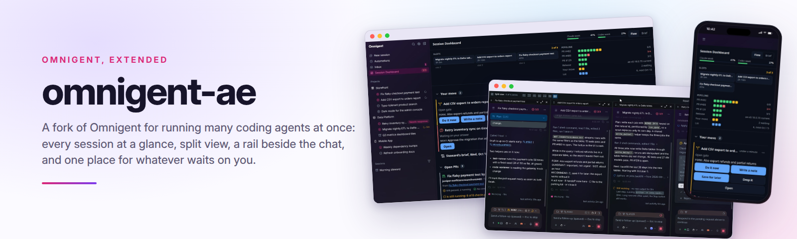
  </picture>
</p>

<p align="center">
  <a href="https://scorecard.dev/viewer/?uri=github.com/analyticendeavors/omnigent-ae-public"></a>
  <a href="LICENSE"></a>
  <a href="https://github.com/omnigent-ai/omnigent"></a>
</p>

<p align="center"><b>Omnigent, extended for running many coding agents at once.</b></p>

omnigent-ae is Analytic Endeavors' build of [Omnigent](https://github.com/omnigent-ai/omnigent) (Databricks, Apache-2.0), the open-source meta-harness that runs Claude Code, Codex and other coding agents behind one server, browser and phone UI. It adds a way of working for people who keep several agent sessions going at once: a few sessions at a time, everything that waits on you in one place, and the rest parked with a note. Every screen on this page is the real fork, running on made-up data.

<p align="center">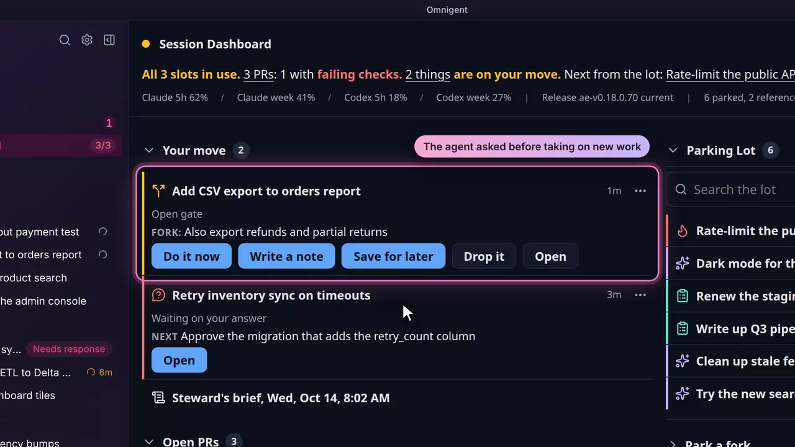</p>

<p align="center"><sub>From the narrated tour of the fork, on a made-up outdoor-gear retailer.</sub></p>

## What it adds

Grouped the way you meet them in a working day. Each picture opens a page with every feature in that area, how to reach it, and the core patch or package behind it.

<table>
<tr>
<td width="50%" valign="top"><a href="docs/features/session-dashboard.md">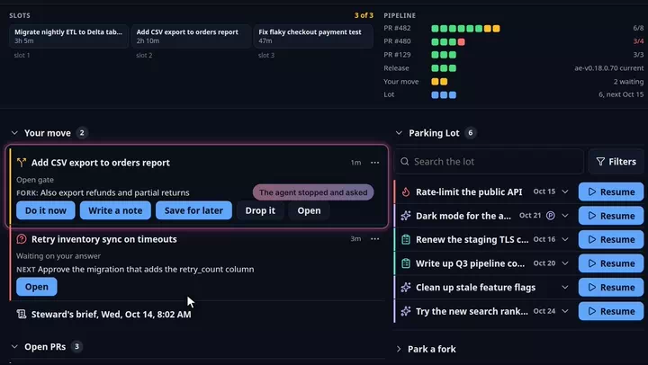</a><br><sub>MANY SESSIONS</sub><br><b><a href="docs/features/session-dashboard.md">Session Dashboard</a></b><br>One page for the day: the working slots, the decisions waiting on you, open pull requests and why they wait, and the parking lot.</td>
<td width="50%" valign="top"><a href="docs/features/sidebar.md">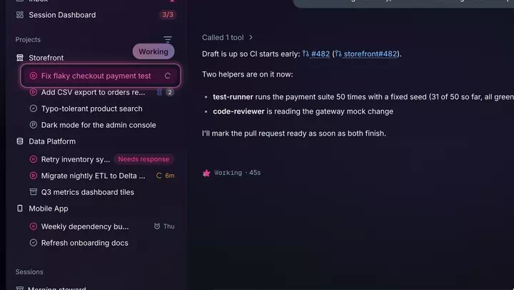</a><br><sub>MANY SESSIONS</sub><br><b><a href="docs/features/sidebar.md">Sidebar</a></b><br>Every row says whether its session is working, quiet, or waiting on you or its agents, and sessions group and sort by status.</td>
</tr>
<tr>
<td width="50%" valign="top"><a href="docs/features/split-view.md">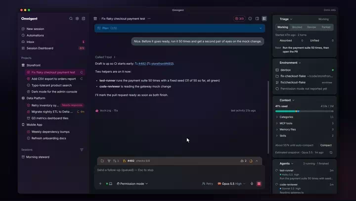</a><br><sub>MANY SESSIONS</sub><br><b><a href="docs/features/split-view.md">Split view</a></b><br>Up to four live sessions side by side, with layout presets and dividers you can drag.</td>
<td width="50%" valign="top"><a href="docs/features/session-rail.md">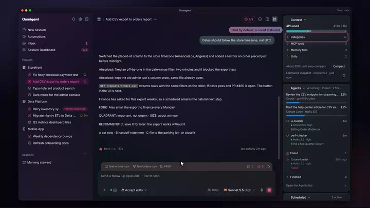</a><br><sub>INSIDE A SESSION</sub><br><b><a href="docs/features/session-rail.md">Session rail</a></b><br>One column beside the chat for triage notes, context, connectors, agents and plan limits.</td>
</tr>
<tr>
<td width="50%" valign="top"><a href="docs/features/composer.md">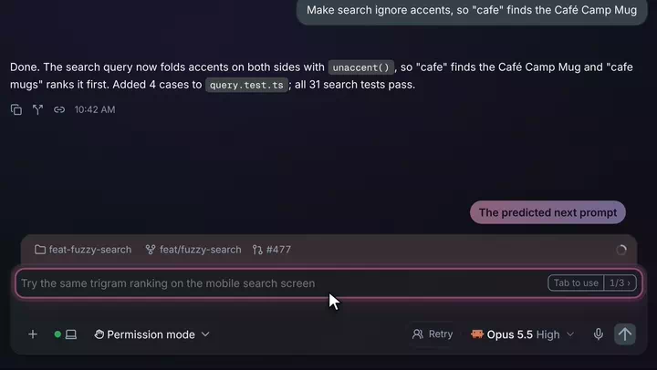</a><br><sub>INSIDE A SESSION</sub><br><b><a href="docs/features/composer.md">Composer</a></b><br>Ghost-text prompt suggestions with ranked alternatives, model versions with their effort, and a token defrag while a chat compacts.</td>
<td width="50%" valign="top"><a href="docs/features/action-dock.md">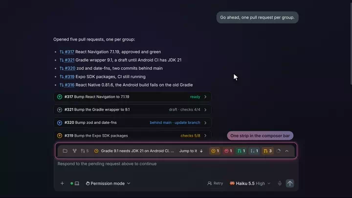</a><br><sub>INSIDE A SESSION</sub><br><b><a href="docs/features/action-dock.md">Action dock</a></b><br>One strip in the composer for questions, open pull requests and their state, drafts to mark ready, merges and deploys.</td>
</tr>
<tr>
<td width="50%" valign="top"><a href="docs/features/background-agents.md">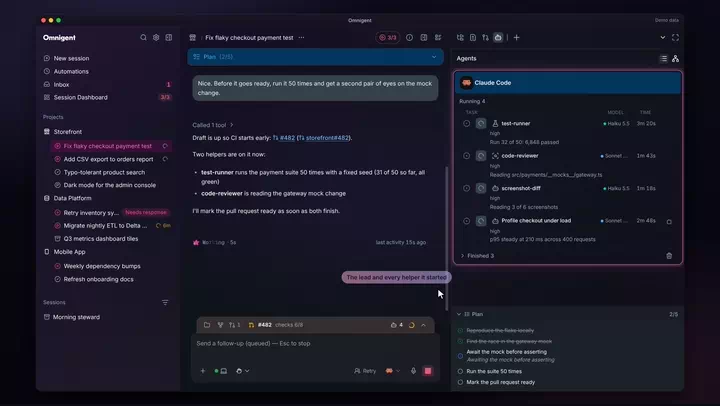</a><br><sub>AGENTS AND PULL REQUESTS</sub><br><b><a href="docs/features/background-agents.md">Background agents</a></b><br>Subagents laid out like Claude Desktop's background tasks: running, finished and failed, with the model each one ran on.</td>
<td width="50%" valign="top"><a href="docs/features/pull-requests.md">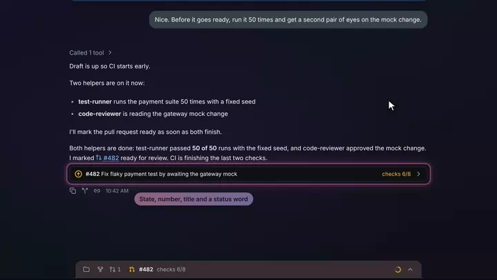</a><br><sub>AGENTS AND PULL REQUESTS</sub><br><b><a href="docs/features/pull-requests.md">Pull requests</a></b><br>A one-line receipt under the message that names a pull request, a preview on hover, and merged ones folded away.</td>
</tr>
<tr>
<td width="50%" valign="top"><a href="docs/features/usage-and-accounts.md">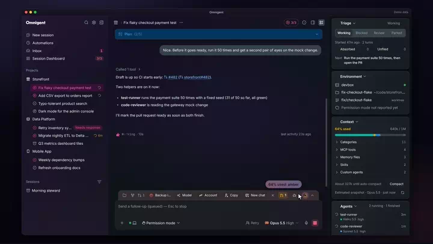</a><br><sub>ACCOUNTS AND ADMIN</sub><br><b><a href="docs/features/usage-and-accounts.md">Usage and accounts</a></b><br>Plan limits per account, backup and shared Claude accounts, and a context ring that warns before the window fills.</td>
<td width="50%" valign="top"><a href="docs/features/admin-center.md">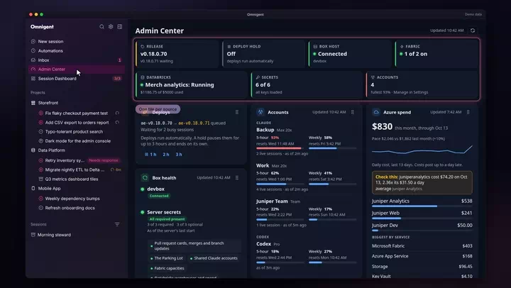</a><br><sub>ACCOUNTS AND ADMIN</sub><br><b><a href="docs/features/admin-center.md">Admin Center</a></b><br>A board of cards for whoever runs the server: deploy hold, host, accounts, limits and spend, plus editable global policies.</td>
</tr>
<tr>
<td width="50%" valign="top"><a href="docs/features/phone.md">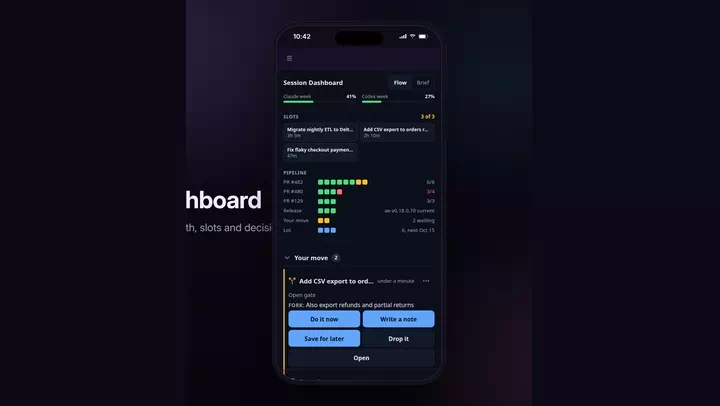</a><br><sub>ON THE PHONE</sub><br><b><a href="docs/features/phone.md">Phone</a></b><br>The Dashboard, Run with a safety sheet, terminal Paste, the action dock and menus sized for a thumb.</td>
<td width="50%" valign="top"><a href="docs/features/triage-and-policies.md">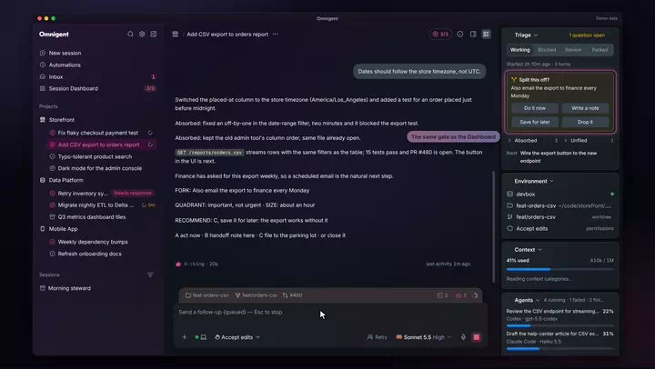</a><br><sub>TRIAGE AND POLICIES</sub><br><b><a href="docs/features/triage-and-policies.md">Triage and policies</a></b><br>The slot cap, the fork gate and its four answers, saved notes, the rabbit-hole check and the scheduled agents, all as Omnigent policies.</td>
</tr>
</table>

All of it sits on Omnigent's own seams: a series of small core patches that CI re-applies on every run ([patches/README.md](patches/README.md)), a policy package, an extension, and a few out-of-tree routes. The [feature gallery](docs/features/README.md) has everything on one page.

## Documentation

- [Feature gallery](docs/features/README.md): every feature on one page, with where to find it and what builds it
- [Deploy guide](deploy/README.md): run it as a service: compose, TLS, sign-in, a host for the agents, automatic updates and rollback
- [Core patches](patches/README.md): every change to Omnigent's own code, one patch each, and why
- [Upstream sync](docs/UPSTREAM-SYNC.md): how the pin moves to a new Omnigent release
- [Session labels](docs/LABELS.md): the ae.* labels the policies read and write
- [Plan limits](docs/PLAN-LIMITS.md): where the Claude Code and Codex plan limits come from
- [Changelog](docs/CHANGELOG.md): the dated build diary

<!-- showcase:end -->

## Quick start

This runs the published image on one Linux machine with username and password sign-in, then connects that machine as the host your agents run on. It takes about ten minutes. You need Linux on x86_64 (the image is `linux/amd64` only), Docker with Compose 2.24 or newer, `git`, [`uv`](https://docs.astral.sh/uv/), and the Claude Code CLI with a Claude subscription. The full service setup (TLS, Microsoft sign-in, systemd, automatic updates) is the [deploy guide](deploy/README.md).

```bash
git clone --recurse-submodules https://github.com/analyticendeavors/omnigent-ae-public.git
cd omnigent-ae-public
cp config/server.env.example config/server.env
# The release this checkout is on, and a data directory (an absolute path):
sed -i "s/^OMNIGENT_IMAGE_TAG=.*/OMNIGENT_IMAGE_TAG=$(git describe --tags --abbrev=0 --match 'ae-v*')/" config/server.env
echo "AE_DATA_DIR=$HOME/omnigent-ae-data" >> config/server.env
# The one secret a try-out needs:
(umask 077; printf 'POSTGRES_PASSWORD=%s\n' "$(openssl rand -hex 16)" > config/secrets.env)
deploy/compose.sh up -d
```

Open http://127.0.0.1:8010 and create the admin account; the first visit asks for it. Then make this machine a host, signing in with that account when asked:

```bash
deploy/install-host.sh
~/.omnigent-host/venv/bin/omnigent login http://127.0.0.1:8010
~/.omnigent-host/venv/bin/omnigent host --no-open http://127.0.0.1:8010
```

`install-host.sh` builds the host's Python environment in `~/.omnigent-host/venv` and also registers this fork's `ae` MCP server in your Claude Code and Codex settings. The host runs Claude Code as you, so it uses your existing `claude` login; on a machine where `claude` is not signed in, set `CLAUDE_CODE_OAUTH_TOKEN` (from `claude setup-token`) in the host's environment, or every turn ends with "Not logged in". With the host connected, type a task on the start page and press Start session.

On a machine that already runs omnigent-ae, `compose.sh` refuses to start a second copy under the same name. Prefix every `compose.sh` command with `COMPOSE_PROJECT_NAME=omnigent-try`, and set another `OMNIGENT_PORT` along with the two URLs beside it in `config/server.env`.

To stop, press Ctrl-C on the host and run `deploy/compose.sh down`. The database and files stay in `AE_DATA_DIR` for the next `up`. Docker creates them as root and as Postgres's user, so deleting them needs `sudo`. `config/server.env` lists every optional setting below its REQUIRED block. The Parking Lot, the Admin Center's cloud cards and the PR cards stay off until you add their settings (Configure, below).

## How the fork stays thin

Upstream is pinned as a submodule at a release tag, the AE layer sits out of tree on
Omnigent's own plugin seams (policies, extensions, out-of-tree routers), and the few
unavoidable core changes are a small patch series that CI re-applies on every run. See
`docs/UPSTREAM-SYNC.md` for how the pin moves.

## Status

The dated build diary (Phase 0 to Phase 7, then entry by entry) is
[docs/CHANGELOG.md](docs/CHANGELOG.md). The current pin is `upstream.lock`.

## Requirements

`git`, [`uv`](https://docs.astral.sh/uv/) 0.11.8 or newer, node 22 (22.13 or newer
for pnpm 11.15.1, upstream's `setup.py` floor) and `pnpm` 11.15 (upstream's
`packageManager` pin; `corepack enable` or `npm i -g pnpm@11.15.1`) for `web-check`,
the web UI build and the image, [`just`](https://github.com/casey/just), and Docker
for the image recipes.

## Install

```
git clone --recurse-submodules https://github.com/analyticendeavors/omnigent-ae-public.git
cd omnigent-ae-public
just setup
```

`just setup` checks out the `upstream/` submodule at the pinned commit, installs
upstream's locked test and lint environment into `upstream/.venv` with
`OMNIGENT_SKIP_WEB_UI=true` (so upstream's web UI is not built), then installs both
AE packages into that venv, editable. `uv sync` prunes anything outside upstream's
lock, so re-run `just setup` after a sync. From there `just lock-check`, `just lint`,
`just test`, `just upstream-smoke`, `just web-check` and `just ext-build` all run
(Daily commands, below). Two tests in `tests/deploy/test_deploy.py` run
`deploy/pull-secrets.sh` under `sudo` and fail without passwordless sudo; they skip
only when `sudo` is absent.

## Run

`just dev` runs `omnigent server --config ../config/server.yaml` from `upstream/`,
on loopback at port 6767 (upstream's default). A bare loopback `omnigent server`
sets `OMNIGENT_LOCAL_SINGLE_USER=1` (upstream `omnigent/cli.py`), so there is no
login: `GET http://127.0.0.1:6767/v1/ae/health` answers as the local user, the
`/v1/ae` routes are up, and the Parking Lot page's bundle is read from the package on disk.

What `just dev` does not serve is upstream's web UI. `just setup` skips the SPA
build and nothing in this repository builds it, so a browser on the dev server gets
upstream's API-only landing page (`omnigent/server/static/api_only_landing.html`),
not the app. The build upstream's `setup.py` runs when `OMNIGENT_SKIP_WEB_UI` is
unset is `pnpm install` followed by `pnpm --filter web run build`, both from
`upstream/`, writing `upstream/omnigent/server/static/web-ui/`; after it, `just dev`
serves the UI from that directory. Not yet documented: that local path has not been
walked end to end from a fresh clone, so the supported way to run the fork with its
UI is the published image (Quick start, above). To build your own, `just image` builds it (upstream's server image from the patched
tree, then the AE layer), `just image-smoke` proves it, and `deploy/README.md` is
how to run it with compose.

## Configure

Two files, both without secrets:

- `config/server.yaml` loads the AE layer (`policy_modules`, `debug_router_modules`),
  seeds the Global Policies page on a brand-new server (`ae_seed_policies`), ships
  the optional `llm:` block commented out, and documents the agents' environment.
  Its `admins:` line names the login identity promoted to admin; it ships a
  placeholder (`you@example.com`). Name the real admin in the roster file
  `/data/admins` inside the data volume (one login per line; `OMNIGENT_ADMIN_LIST_PATH`
  moves it), or in `admins:` in your fork's copy; `deploy/README.md`, step 7.
- `config/server.env.example` and `config/host.env.example` list every variable the
  server and a box host read, with the why per line. Copy them to `config/server.env`
  and `config/host.env` (gitignored). Secrets go in a separate env file the compose
  wrapper loads after them (`deploy/compose.sh`); Analytic Endeavors fills that file
  from Azure Key Vault with `deploy/pull-secrets.sh`, and the server itself never
  reads Key Vault, only its environment, so any other way of setting the same
  variables works.

The server reads the AE layer's environment at request time: `AE_TASK_STORE_URL`,
`AE_CF_ACCESS_CLIENT_ID`, `AE_CF_ACCESS_CLIENT_SECRET`, `AE_TASK_STORE_TZ`, `AE_SELF_URL`
(`packages/ae_omni_policies/README.md` has the full table). Every integration is
optional, and each says what is missing instead of failing:

| Integration | Variables | Without them |
|---|---|---|
| task-store: the Parking Lot page, Your move's lot block, `park_fork` and `list_parked` in the agents' MCP server, the steward's brief | `AE_TASK_STORE_URL`, `AE_CF_ACCESS_CLIENT_ID`, `AE_CF_ACCESS_CLIENT_SECRET` | `/v1/ae/lot*` answers 503 "task-store is not configured" naming the two variables; everything else runs. task-store is Analytic Endeavors' own task app behind Cloudflare Access and is not published, so these features need an equivalent service or stay off |
| GitHub: Your move's pull requests, the PR cards' Merge button | `AE_GITHUB_TOKEN`, `AE_GITHUB_REPOS`, `AE_GITHUB_LOGIN` | both sections say how to add the token; without `AE_GITHUB_REPOS` Your move asks for the repos, and without `AE_GITHUB_LOGIN` it counts the token's own login |
| Fabric capacities in the Admin Center | `AE_FABRIC_WAKE_URL_<NAME>`, `AE_FABRIC_SUSPEND_KEY_<NAME>`; for every capacity with Pause, Start and resize, `AE_FABRIC_CAPACITIES_URL` and `AE_FABRIC_CAPACITIES_KEY` (2026-10-21) | `GET /v1/ae/fabric` says how to add one; a capacity with no suspend key has Wake only; without the fleet pair only the wake URL capacities show and resize answers 409 |
| Databricks spend in the Admin Center | `AE_DATABRICKS_HOST`, `AE_DATABRICKS_CLIENT_ID`, `AE_DATABRICKS_CLIENT_SECRET` | the section is off; `GET /v1/ae/databricks` says how to add them |
| Azure spend card in the Admin Center | `AE_AZURE_COST_SUBSCRIPTIONS`, `AE_AZURE_COST_TENANT_ID`, `AE_AZURE_COST_CLIENT_ID`, `AE_AZURE_COST_CLIENT_SECRET` | the card is off; `GET /v1/ae/azure-cost` says how to add them |
| the policy model (fork classifier) | the `llm:` block in `config/server.yaml` | the classifier abstains |
| Azure Key Vault | none in the server; `deploy/pull-secrets.sh` only | nothing: the server reads environment variables, so fill the secrets file another way |

The slot limit is the exception, read once at startup: `AE_SLOT_LIMIT` in
`config/server.env`, three when unset. Since 2026-09-24 it is the one setting for the
slot cap and every slot count in the UI, so four slots is `AE_SLOT_LIMIT=4` and
`deploy/compose.sh up -d --force-recreate omnigent`. A value that is not a whole
number of one or more stops the server at startup with `AE_SLOT_LIMIT` named in the
log. Since 2026-10-22 an admin can also set it without a restart: a `limit` on the
slot cap on Settings > Global Policies replaces `AE_SLOT_LIMIT` for the cap and for
every count (with several slot caps on, the lowest limit, a cap without one counting
as `AE_SLOT_LIMIT`). The web UI shows the new number on a reload, or when its window
regains focus once its last read is five minutes old.

The AE policies are switched, edited and deleted on Settings > Global Policies
since 2026-10-18; `config/server.yaml` only seeds a brand-new server
(`ae_seed_policies`), and `just dev` starts with none.

The policy model is optional. `config/server.yaml` ships its `llm:` block commented
out with two worked examples (an Anthropic model through `ANTHROPIC_API_KEY`, and
Ollama on `http://host.docker.internal:11434/v1`); only the fork-suspect classifier
uses it, and it abstains when the block is absent. Everything else here runs without
a model box.

Deploying it as a service (compose, TLS, sign-in, a registered host for the agents,
the automatic update and the rollback) is `deploy/README.md`, written for any
operator. Analytic Endeavors' runbooks for its own host (its TLS fronts, its sign-in
cutover, its daily use) live in a private repository.

## Layout

```
upstream/                 submodule: analyticendeavors/omnigent @ ae/v0.18.0-public (= upstream tag + patches)
upstream.lock             the pin: tag, sha, fork branch, PATCH_COUNT
patches/                  git format-patch form of the fork branch: NNNN-*.patch, one per commit (the count is PATCH_COUNT in `upstream.lock`); the list and the why per patch are in patches/README.md
packages/ae_omni_policies the AE layer: labels, slot cap, hurry modes, the observer, the fork classifier, the rabbit-hole check, task-store client, GitHub client, the Fabric Logic App client, /v1/ae routes (Your move included), the stdio MCP server, the schedule seeder, the plan limits store and host relay
packages/ae_omni_extension the Dashboard (the Parking Lot and Your move pages until 2026-09-24) and the Admin Center (2026-10-16 as Fabric Admin): manifest, the committed bundle, its vite source under web/
agents/                   steward, shutdown, orchestrator and reviewer-codex as single-file agent.yaml specs (OMNIGENT_BUILTIN_AGENT_DIRS)
config/server.yaml        the server config that loads the AE layer (policy_modules, debug_router_modules, ae_seed_policies (the Global Policies page's first-boot seed since 2026-10-18), the commented llm: examples, the agents' environment)
config/*.env.example      every variable the server (server.env.example) and the box host (host.env.example) read; the box copies them to config/*.env, gitignored
scripts/                  check-lock, apply-patches, export-patches, rebase-patches, sync-upstream, next-release-tag, regen-golden-note, port-triage-fixtures, backfill-triage-notes, claude-effort-defaults, seed-schedules, ae-health, docs-coverage (plus _lib.sh)
justfile                  every command in one place; CI calls the same recipes
deploy/                   the box: Dockerfile (stage 2 of the image), docker-compose.override.yml, compose.sh, auto-update.sh, systemd/ (four units, plus the auto-update and plan limits timers under user/), ae-limits-statusline.sh, pull-secrets.sh, backup-omnigent.sh, install-host.sh, host-container.sh and host-container/ (the second user's host), host-relink.sh, README.md (the deploy guide)
tests/deploy/             what a machine with no Docker daemon and no systemd can prove about deploy/ and the release workflow (run by `just test`)
ruff.toml                 the package rule set for tests/ and scripts/ae-health.py
docs/LABELS.md            the ae.* session label vocabulary
docs/PLAN-LIMITS.md       where the Claude Code and Codex plan limits come from, the relay, turning it on (2026-09-24)
docs/screenshots/         evidence per phase (phase-2: the sidebar; plan-limits: the popover and the strip; usage-panel: the full popover and the login hint; each at 1009x719, 375x667, 430x932)
docs/UPSTREAM-SYNC.md     the sync procedure and what CI enforces
docs/CHANGELOG.md         the history, newest first
docs/design/              design notes (dashboard-review.md)
docs/features/            the feature gallery: one page per area, each feature with its clip or screenshot, where to find it, and the core patch or package that builds it
docs/media/               the gallery's animated WebP clips, screenshots and the README banner, cut from renders of the fork's real UI on made-up data
.github/workflows/        ci.yml (patches, upstream-smoke, python, web, image, rules) image.yml (publish on an ae-v* tag), release.yml (tag main after green CI) and patch-rebase.yml (rebase open patch PRs after a merge)
CLAUDE.md                 rules for Claude sessions here, plus the managed branch-discipline block
```

## Daily commands

Needs `git`, [`uv`](https://docs.astral.sh/uv/) 0.11.8 or newer, node 22 and `pnpm`
11.15 (upstream's `packageManager` pin; `corepack enable` or `npm i -g pnpm@11.15.1`)
for `web-check` and the image, [`just`](https://github.com/casey/just), and Docker
for the image recipes.

```
just setup            # submodule + upstream's locked test and lint environment + the AE packages, editable
just lock-check       # lock, .gitmodules, submodule and patches/ agree
just patches-check    # committed patches match a fresh export
just patches-rebase   # carry this branch's patches onto main's series, renumber them in the docs
just lint             # ruff over packages/ with upstream's rule set
just test             # the AE packages' suites, on upstream's venv and fixtures
just upstream-smoke   # upstream's policy and extension suites in our tree
just web-check        # upstream's web lint and type-check, plus the vitest suites the patch series adds or touches (the list is the `web-test` recipe)
just web-test 2/4     # one shard of those vitest suites (vitest --shard), as each CI web-test job runs them
just ext-build        # rebuild the Parking Lot page's bundle (pnpm) and fail if the committed dist drifted
just ext-doctor       # omni extensions list, omni extensions doctor analyticendeavors.parking-lot
just dev              # omnigent server --config config/server.yaml, the page served from the package root on disk
just image            # two-stage image
just image-smoke      # omni --version, the extension listed and its bundle resolved, the AE packages import inside it
just golden-note P    # regenerate the note fixture from the worker's TypeScript at P (ae-claude-skills)
just triage-fixtures P # re-port the nine triage-gate scenarios from scripts/test-triage-gate.sh at P (ae-claude-skills)
just sync vX.Y.Z      # move the pin (docs/UPSTREAM-SYNC.md)
just schedules-seed U # create or update the two scheduled tasks on the server at U (Phase 5)
just ae-health U      # GET /v1/ae/health on the server at U with the stored login (Phase 6)
just docs-coverage T  # core patches since release tag T that no page under docs/features covers (the public release checks this)
```

`just dev` exports `OMNIGENT_EXTENSION_DEV_BUNDLES` so the server reads the page's
bundle from `packages/ae_omni_extension/src/ae_omni_extension` on disk; rebuild with
`just ext-build` and restart the server to see a change.

## The scheduled agents (Phase 5)

Four agent specs live in `agents/` (two scheduled, one interactive, one off by default), one directory each, loaded by upstream's
single-file grammar (`upstream/docs/AGENT_YAML_SPEC.md`). The server registers them
as built-ins from an environment variable, and their schedules are rows created
through the API, so turning them on is two lines and one command:

```
OMNIGENT_BUILTIN_AGENT_DIRS=/opt/ae/agents/steward:/opt/ae/agents/shutdown:/opt/ae/agents/orchestrator   # the server (./agents/... locally)
OMNIGENT_SERVER_URL=https://<box-hostname>.<tailnet>.ts.net:8010                    # the host unit (`omnigent host --server`)
just schedules-seed https://<box-hostname>.<tailnet>.ts.net:8010                    # once, from a logged-in machine
```

| Agent | Harness | Fires | Tools (MCP allowlist) | Writes |
|---|---|---|---|---|
| `steward` | claude-sdk | weekdays 08:00, server's `AE_TASK_STORE_TZ` | `list_parked`, `omni_capacity`; box memory's read tools | nothing: one brief, lot items resurfacing today and the working sessions with elapsed time |
| `shutdown` | claude-sdk | weekdays 17:30, server's `AE_TASK_STORE_TZ` | `omni_capacity`, `omni_transcript`; box memory's read tools | nothing: one THREAD / STATE / NEXT / SLOT / QUADRANT note per working session; the operator flips the status from the Parking Lot page |
| `reviewer-codex` | codex | on request, off by default | none (read-only `os_env`) | nothing: findings with file and line |
| `orchestrator` | claude-sdk | when the operator talks to it; its own hourly check-in | `omni_capacity`, `omni_transcript`, `omni_set_status`, `list_parked`, `create_session`, `post_message`, `schedule_checkin`, `list_prs`, `ask_reid` | sessions it starts and briefs, messages to them, its one check-in schedule, review on merged work; never a merge |

Where a run happens is decided at fire time: a task with no pinned host runs on the
owner's online host and defaults its workspace to that host's home directory, and
with no host online the server records a failed run (`error_code` `no_online_host`)
instead of running nowhere. So the schedules exist without a box, and the briefs
need one: the box host (`deploy/README.md`, steps 9 and 10: `omnigent login <url>` once,
interactively, because v0.13.0 had no non-interactive login (not re-checked since); then `omnigent host
<url> --background --non-interactive` under a user unit). That host's Python needs
`packages/ae_omni_policies` installed, because the agents' MCP server is
`python -m ae_omni_policies.mcp` spawned by the host. The host starts it with the
MCP SDK's default environment (`HOME`, `PATH`, `USER` and little else), so the host
unit's `OMNIGENT_SERVER_URL` does not reach it; it finds the server the way a person
at the CLI does, from what `omnigent login` wrote: the `server` key in
`~/.omnigent/config.yaml`, else the one login in `~/.omnigent/auth_tokens.json`
(refusing to guess among several), and uses the token stored for it
(`packages/ae_omni_policies/src/ae_omni_policies/omni.py`, 2026-09-24). The MCP
server talks only to the Omnigent server; the task-store credential stays in the
server's environment.

The orchestrator (2026-09-25) is the interactive one: the operator talks to it from the phone
and it runs box sessions the way a cloud Claude Code orchestrator does
(start one from the Omnigent app: New session, pick the agent **orchestrator**).
Its session tools go through `POST /v1/ae/sessions` (a slot held first under the slot cap's own lock,
idempotent by `ae.orch_key`) and `GET /v1/ae/sessions`; `list_prs` reads the
server's cards and `gh` on the host (`ae_omni_policies/gh.py`, read only);
`ask_reid` is an MCP elicitation, so decisions arrive as pop-ups. A box whose
`config/server.env` predates it still registers it: the image's entrypoint appends
`/opt/ae/agents/orchestrator` to `OMNIGENT_BUILTIN_AGENT_DIRS` (`AE_EXTRA_AGENTS=off`
stops that). No seeding: the orchestrator writes its own check-in schedule.

The shutdown agent ships on claude-sdk so it runs from the seeded YAML alone. Analytic Endeavors'
own deployment notes prefer claude-native for drafts because that harness loads the operator's
`~/.claude` rules, skills and connectors; flipping `executor.harness` to
`claude-native` in `agents/shutdown/agent.yaml` (a commit and a release tag: the box
reads the specs from the image since 2026-09-24) does that, and what changes
is: the run reads the host's `~/.claude` configuration (the task-store connector
included, so the prompt's "never file" is then the only thing between the agent and a
write on that path; the YAML allowlist still bounds the AE MCP server), the
scheduled task may carry a `permission_mode`, and `just schedules-seed` needs a
rerun only if the agent id changes, which it does not (the id is derived from the
directory name).

## Second user's host (container)

Since 2026-10-20 a second Omnigent user can run agents on the box with no shared
files, logins or network reach with the primary user's: each such user gets a compose
project `omnigent-host-<user>` (`deploy/host-container.sh`, `deploy/host-container/`),
an Omnigent host container built from the pinned, patched submodule with its
own home volume and non-root user, an internal network shared with the server
container only, and a Squid egress proxy that refuses every private and tailnet
destination. The server's side is one network per user in
`deploy/docker-compose.override.yml`. The runbook (first start, the sign-in
link the user opens, rebuilding after a release, adding a third user, the
reachability checks and the known gaps) is "Second user's host (container)" in
`deploy/README.md`.

## CI

`.github/workflows/ci.yml` runs on every pull request and on pushes to `main`.

| Job | What it proves |
|---|---|
| `patches` | the committed `patches/` match a fresh export, and the series applies onto the pristine tag and reproduces the fork branch tree |
| `upstream-smoke` | upstream's `tests/policies` and `tests/extensions` pass in the pinned tree, plus `tests/server/test_item_observers.py`, the suite patch P3 adds |
| `python` | `just lint`, `just test` and `just ext-doctor`: both AE packages against the pinned tree, on upstream's fixtures (the MCP server over the memory transport and a real stdio subprocess, the agent YAMLs through upstream's loader, the schedule seed against the app with the agents registered); `tests/deploy` over the compose override (`docker compose config` on the merged files), the systemd units, the scripts (`bash -n`, shellcheck), `image.yml` and `release.yml` (the repo's standards, actionlint) and the release tag decision in `scripts/next-release-tag.sh`; the extension installs and its bundle resolves |
| `web` | `just web-lint` and `just ext-build`: upstream's web workspace, patches applied, passes its own lint and type-check, and the Parking Lot page's committed bundle matches a fresh build (node 22, pnpm 11.15.1 pinned) |
| `web-test` | `just web-test <n>/4` in four parallel jobs: the vitest suites the patch series adds or touches are green, split with vitest's `--shard` so the web suites take about 4 minutes, not 10 (split out of `web` 2026-10-20) |
| `image` | the two-stage image builds; `omni --version` prints the pinned version; the extension catalog lists `analyticendeavors.parking-lot` and `doctor` resolves its bundle; both AE packages import; the agent specs are at `/opt/ae/agents` |
| `rules` | the managed block in `CLAUDE.md` matches its source in ae-claude-skills |

`.github/workflows/image.yml` runs on a tag push `ae-vX.Y.Z.N` (and by hand as a dry
run). It builds the two stages exactly as the `image` job does, runs the same smoke
checks, and pushes `$AE_IMAGE:ae-vX.Y.Z.N` with the workflow's own `GITHUB_TOKEN`
(`packages: write`). `AE_IMAGE` is a repository variable (Settings, Secrets and
variables, Actions, Variables) naming the operator's own package,
`ghcr.io/<owner>/<name>` in lower case under the repository's owner (AE's private
repo sets `ghcr.io/analyticendeavors/omnigent-ae`). It is the only publish gate: with
it unset the workflow builds and smokes but never logs in or pushes, and the release
workflow below never tags, so a fork is quiet until its owner sets it; a value under
another owner or registry fails the run
(`scripts/check-image-name.sh`, which both workflows call before anything is pushed). `workflow_dispatch` builds without
pushing unless its `push` input is on and the chosen ref is an `ae-v*` tag, so a
branch build never lands in the registry under a name the box would pull. Since
2026-09-24 the tag push is the whole deploy: a user timer on the box
(`deploy/auto-update.sh`, every ten minutes) picks up the newest `ae-v*` tag on
`main`, pulls it, starts it, checks `/health` and rolls back on failure
(`deploy/README.md`, "Automatic updates"). AE's package is private, so AE's host user
is logged in to ghcr.io with a `read:packages` token.

`.github/workflows/release.yml` (2026-09-24) makes the tag too, so a merge is the
deploy. It runs when `CI` completes green on a push to `main` and hands the run's
commit to `scripts/next-release-tag.sh`, which tags it only if it is still the tip
of `main`, carries no `ae-v*` tag yet (a tag pushed by hand wins) and changed
something that ships since the last tag: `packages/`, `config/`, `agents/`,
`deploy/Dockerfile`, `patches/`, `upstream.lock` or the `upstream` pointer. The tag
is the next `ae-v<pin>.N`, N back to 1 when the pin moves. A tag pushed with
`GITHUB_TOKEN` starts no workflow run (GitHub's rule; `workflow_dispatch` is the
exception), so the job then runs `gh workflow run image.yml --ref <tag> -f
push=true` itself. By hand, `workflow_dispatch` on `main` makes the same decision
after checking CI is green on the tip; `force: true` tags it even when only docs or
tests changed, to ship or re-ship on purpose. Permissions: `contents: write` for the
tag, `actions: write` for the dispatch; no secret.

`.github/workflows/patch-rebase.yml` (2026-10-20) keeps open patch PRs current. Each
patch PR claims the next patch number when it is written, so once one merges, every
other open one conflicts; PR 164 and PR 171 were each rebased by hand three times
on 2026-10-20. On every push to `main` (or by hand, for one PR number), it finds
the open PRs into `main` that touch `patches/` and that GitHub reads as
conflicting, runs `scripts/rebase-patches.sh origin/main --ci` on each, then `just
patches-check` and `just lint`, pushes the fork topic branch and the PR branch with
the `PATCH_BOT_TOKEN` secret, and comments the new patch number. A conflict it does
not settle pushes nothing and comments the files that need a person. What it
resolves and how: `docs/UPSTREAM-SYNC.md`, "Patch rebase bot".

Supply chain (2026-10-22). Every third-party action is pinned to a commit with its
release in a comment, so a moved tag cannot change what runs; `tests/deploy` fails on
an unpinned `uses:`. Dependabot runs in the maintainer's private repository, where
it opens weekly updates for the actions, the two Python packages, the extension's
web workspace and the host container's egress proxy image (minor and patch bumps
grouped, each major on its own); they reach this repository in its next release,
and the upstream submodule is left to `upstream.lock`. When a public repository
publishes, `image.yml` also pushes a build provenance attestation beside each
image (`gh attestation verify oci://<image>:<tag> -R <owner>/<repo>` checks it), and
`.github/workflows/scorecard.yml` runs OpenSSF Scorecard weekly and on every push to
`main` for the badge above; a private copy skips both. `.github/CODEOWNERS` requests
the maintainer's review on every pull request.

## Secrets

Never in the repo. The workflows read these repository secrets:

| Secret | Used by | What it is |
|---|---|---|
| `RULES_SOURCE_TOKEN` | `rules` job | fine-grained PAT, Contents: read on `analyticendeavors/ae-claude-skills`. Without it the job only checks that the managed markers are present, warns, and passes; with it, any drift from the source fails the PR. |
| `PATCH_BOT_TOKEN` | `patch-rebase.yml` | fine-grained PAT on `analyticendeavors/omnigent-ae` and `analyticendeavors/omnigent`: Contents, Pull requests and Workflows read and write. `GITHUB_TOKEN` cannot push to the fork, and its pushes start no CI. Without it the workflow warns and passes. Setup: `docs/UPSTREAM-SYNC.md`, "Patch rebase bot". |

The other direction, ae-claude-skills stamping this repo, uses its own
`RULES_SYNC_TOKEN`, which must list this repository. `image.yml` needs no secret:
it pushes with the workflow's `GITHUB_TOKEN`.

On the box, secrets live only in `/secure/env/omnigent-ae.env` and
`/secure/env/omnigent-host.env` (640 root:<your-group>, on an encrypted volume if you have one); Analytic Endeavors
fills them from its Azure Key Vault with `deploy/pull-secrets.sh`; the settings files
`config/server.env` and `config/host.env` carry no secret and are gitignored.

## Conventions

Carried over from agents-and-automation and enforced in review:

- Every workflow job sets `timeout-minutes`; every workflow has a top-level
  `permissions` block; event-triggered workflows declare `concurrency`.
- `run:` blocks start with `set -euo pipefail`; polling loops have an iteration cap.
- `curl` calls carry `--max-time` and `--fail` on the `curl` line itself.
- Cron expressions carry a comment with the schedule in local time.
- Secrets reach scripts through `env:` only; no `${{ }}` expression inside a large
  `run:` body (pass values through `env:`).
- Global npm installs are version-pinned. New workflows are documented here.
- Commit subjects are sentences; docs carry the why, with dates.
- Nothing under `upstream/` is edited on a feature branch; a core change is a patch
  (see `patches/README.md`).

## Upstream sync

Upstream is pinned in `upstream.lock` (tag, sha, fork branch, patch count) and
checked out as the `upstream/` submodule. `just sync vX.Y.Z` moves the pin;
`docs/UPSTREAM-SYNC.md` has the procedure, the patch rebase bot and what CI enforces,
and `patches/README.md` lists each core patch and why it exists.

## License

Apache-2.0, like upstream. `NOTICE` carries the attribution; `upstream/NOTICE`
carries upstream's third-party notices.
