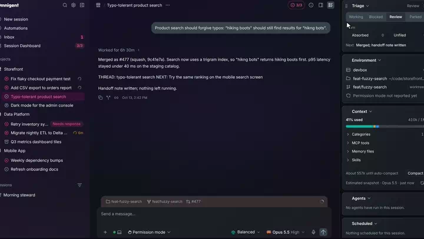

# Features

Everything omnigent-ae adds to Omnigent, grouped the way you meet it in a working day. Every screen is the real fork on made-up data (Juniper Outfitters, a fictional outdoor-gear retailer). Each feature names the core patch or package that builds it, so it can be read on its own or proposed upstream.

## Roles presets

A preset decides which model and effort each role in a chat runs on, so the lead plans on a strong model and hands the routine work to cheaper ones.

<table>
<tr>
<td width="50%" valign="top"> <b><a href="./roles-presets.md">Roles presets</a></b> Each role's model and effort per preset, a pill to pick one per chat, families of sessions, and up to three independent reviewers merged into one verdict.</td>
<td width="50%"></td>
</tr>
</table>

- [Roles presets](roles-presets.md): Presets in Settings > Roles, Newer models offered, never applied, The lead reads its preset every turn, Pick a preset per chat, Start a new chat on a preset, Who works on this, Independent reviewers, one verdict, Rules for model changes and helpers, Model changes you can undo, Families of sessions, A family at a glance, Preset insights, Session links read as titles, A helper's questions reach the lead

## Triage and policies

Beneath the screens sits a way of working, built from Omnigent policies: a cap on working sessions, a gate for new work that shows up mid-task, and notes that make parked work resumable.

<table>
<tr>
<td width="50%" valign="top"> <b><a href="./triage-and-policies.md">Triage and policies</a></b> The slot cap, the fork gate and its four answers, saved notes, the rabbit-hole check and the scheduled agents, all as Omnigent policies.</td>
<td width="50%"></td>
</tr>
</table>

- [Triage and policies](triage-and-policies.md): A cap on working sessions, The fork gate, Absorbed and Unfiled notes, The parking lot, Handoffs that open their own chat, Closed chats leave the list, The rabbit-hole check, Hurry modes, Agents that ship with it, Policies you can edit

## Many sessions

Stock Omnigent lists sessions in a sidebar and opens one at a time. The fork adds a page for the whole morning, a sidebar that says what each session is doing, and up to four sessions side by side.

<table>
<tr>
<td width="50%" valign="top"> <b><a href="./session-dashboard.md">Session Dashboard</a></b> One page for the day: the working slots, the decisions waiting on you, open pull requests and why they wait, and the parking lot.</td>
<td width="50%" valign="top"> <b><a href="./sidebar.md">Sidebar</a></b> Every row says whether its session is working, quiet, or waiting on you or its agents, and sessions group and sort by status.</td>
</tr>
<tr>
<td width="50%" valign="top"> <b><a href="./split-view.md">Split view</a></b> Up to four live sessions side by side, with layout presets and dividers you can drag.</td>
<td width="50%"></td>
</tr>
</table>

- [Session Dashboard](session-dashboard.md): A Session Dashboard row with the slot count, A header in Flow or Brief, Your move, Answer a gate from the Dashboard, Open PRs, each with the reason it waits, The Parking Lot with Resume, Reopen a closed session
- [Sidebar](sidebar.md): Every row shows what its session is doing, A hover card that says what is happening now, Status icons and the Status menu, Group and order sessions by status, Drag to reorder, Bulk select in a narrow sidebar, Create a project from Add to project
- [Split view](split-view.md): Open in split view, Pane pickers that show session names, Four live sessions at once, Layout presets, Dividers in both directions, Swap panes by the grip, One right-hand pane at a time

## Inside a session

Inside one chat, the fork puts the session's details in a rail beside it, has the composer predict your next prompt, and gathers whatever waits on you into one strip above the composer.

<table>
<tr>
<td width="50%" valign="top"> <b><a href="./session-rail.md">Session rail</a></b> One column beside the chat for triage notes, context, connectors, agents and plan limits.</td>
<td width="50%" valign="top"> <b><a href="./composer.md">Composer</a></b> Ghost-text prompt suggestions with ranked alternatives, model versions with their effort, and a token defrag while a chat compacts.</td>
</tr>
<tr>
<td width="50%" valign="top"> <b><a href="./action-dock.md">Action dock</a></b> One strip in the composer for questions, open pull requests and their state, drafts to mark ready, merges and deploys.</td>
<td width="50%"></td>
</tr>
</table>

- [Session rail](session-rail.md): A rail beside the chat, Its own toggle, Choose what a session shows when it opens, Triage card, Context that waits for Claude, Context categories, Connectors, Agents, Child chats, Usage for this session's account
- [Composer](composer.md): Prompt suggestions, Ranked alternatives, Model versions and Previous models, A one-column model menu, The effort a session runs at, Fast mode, Blurred command and file menus, Token defrag while compacting
- [Action dock](action-dock.md): One strip in the composer bar, The opened list, A waiting question, Questions from sessions this chat started, Compact a big chat, One button per choice, Usage gate, Every usage window on hover, Every open pull request with its state, Update branch, Drafts with Mark ready, Hover preview, Merge from the dock, The confirm, shown whole, Deploy tracking

## Agents and pull requests

Long sessions spend their time on background agents and pull requests. The fork shows both where you already look.

<table>
<tr>
<td width="50%" valign="top"> <b><a href="./background-agents.md">Background agents</a></b> Subagents laid out like Claude Desktop's background tasks: running, finished and failed, with the model each one ran on.</td>
<td width="50%" valign="top"> <b><a href="./pull-requests.md">Pull requests</a></b> A one-line receipt under the message that names a pull request, a preview on hover, and merged ones folded away.</td>
</tr>
</table>

- [Background agents](background-agents.md): An Agents pane like Claude Desktop's, The model each agent ran on, Running until the lead records its return, Failed helpers, Waiting on agents, Closed helpers stop counting, Role, model, effort and spend per agent, Spend in tokens, cost or both
- [Pull requests](pull-requests.md): One-line receipt, The opened receipt, Hover preview on links, Merged pull requests fold, Update branch, Compliance review, Recommended merge method and Mark session done

## Accounts and admin

Running many sessions means watching plan limits and accounts. The fork shows usage per account and adds an Admin Center for whoever runs the server.

<table>
<tr>
<td width="50%" valign="top"> <b><a href="./usage-and-accounts.md">Usage and accounts</a></b> Plan limits per account, backup and shared Claude accounts, and a context ring that warns before the window fills.</td>
<td width="50%" valign="top"> <b><a href="./admin-center.md">Admin Center</a></b> A board of cards for whoever runs the server: deploy hold, host, accounts, limits and spend, plus editable global policies.</td>
</tr>
</table>

- [Usage and accounts](usage-and-accounts.md): A context ring that changes color, The usage popover, Limits for the session's own account, Check any login's limits, Several Claude logins per host, Remove a personal login, Shared Claude accounts, Move a chat to another login, Copy a chat to another login, A relaunch keeps Claude's transcript
- [Admin Center](admin-center.md): One board for the server, Status tiles, Drag cards to rearrange, Hold deploys, Box health, Key Vault, Git repos, Every account's limits, Compute and spend, Presets card, Family cost card, Edit a global policy's parameters, Open tabs hear about an update

## On the phone

Omnigent runs in a phone browser. The fork makes the parts you need away from a desk work by touch.

<table>
<tr>
<td width="50%" valign="top"> <b><a href="./phone.md">Phone</a></b> The Dashboard, Run with a safety sheet, terminal Paste, the action dock and menus sized for a thumb.</td>
<td width="50%"></td>
</tr>
</table>

- [Phone](phone.md): Session Dashboard on a phone, Status and Move fold in the session menu, Run a code block in the session's shell, Risky commands named before they run, A Paste button in the terminal, Paste a note copied on the iPhone, Download a file a chat names, Waiting pull requests keep their state, Merge from the action dock, Merged pull requests on one line
