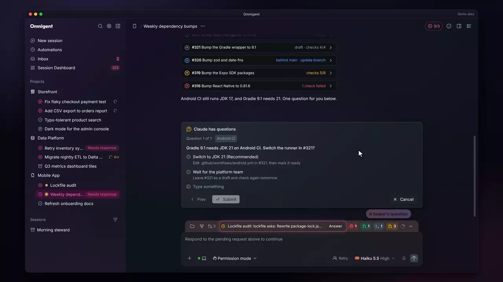
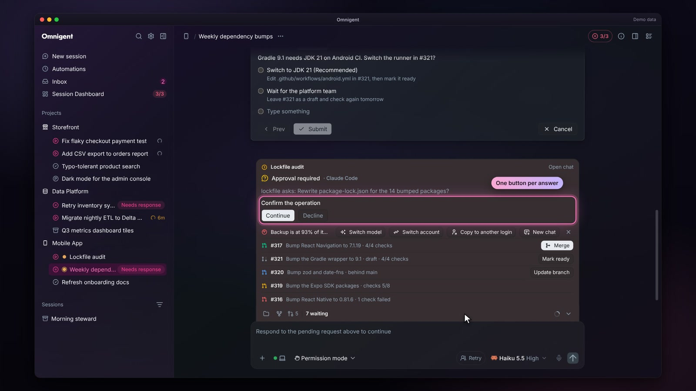

# Action dock

Inside a session &middot; [All features](README.md)

Stock Omnigent shows each question and pull request where it landed in the chat, so what waits on you scrolls away as the session goes on. The fork gathers it into the action dock: one strip inside the composer's workspace bar that leads with the most urgent item and opens to a list of everything waiting in this chat.

## One strip in the composer bar

Collapsed, the dock is one line after the folder and pull request chips: the most urgent item with its button, then a tinted badge for each other kind (a question, a usage limit, pull requests to merge, drafts, pull requests not ready). Nothing waiting draws nothing.

**Where:** The composer's workspace bar in any chat. 
**Built from:** core patches [`0137`](../../patches/0137-ae-patch-Add-an-action-dock-above-the-composer-for-q.patch), [`0141`](../../patches/0141-ae-patch-Put-the-action-dock-inside-the-composer-s-w.patch); [`packages/ae_omni_policies`](../../packages/ae_omni_policies)

## The opened list

The caret at the end of the strip opens every waiting item as a tray above the bar: questions first, then a usage limit, pull requests ready to merge, drafts and the rest, oldest first within each kind. A badge opens the list at its kind, and Escape closes it. While the tray is open, a chat scrolled to the bottom lifts above it, so the last lines stay in view.

**Where:** The caret at the end of the strip, or any badge. 
**Built from:** core patches [`0137`](../../patches/0137-ae-patch-Add-an-action-dock-above-the-composer-for-q.patch), [`0141`](../../patches/0141-ae-patch-Put-the-action-dock-inside-the-composer-s-w.patch), [`0159`](../../patches/0159-ae-patch-Lift-the-chat-above-the-open-action-dock-tr.patch)

## A waiting question

When an agent asks a question and you have scrolled away from its card, the question leads the strip with Jump to it, which scrolls the chat to the card. While the card is on screen the line steps aside, so the question never shows twice.

**Where:** The strip, whenever an agent's question is off screen. 
**Built from:** core patches [`0137`](../../patches/0137-ae-patch-Add-an-action-dock-above-the-composer-for-q.patch), [`0144`](../../patches/0144-ae-patch-Keep-merges-and-deploys-in-the-action-dock-.patch)

## Questions from sessions this chat started

A lead that starts other sessions used to leave their questions and tool permission prompts in the child chats. They now show in the lead's dock, ranked right after its own questions: the bar reads the child's title and the question ("Lockfile audit: lockfile asks: Rewrite package-lock.json for the 14 bumped packages?"), or "2 child prompts" when another kind leads. Open the list and each prompt appears as its real card, with its own buttons, the child's title and an Open chat link. The answer goes to the child, not to the lead, and the card leaves the dock once it is answered. These prompts never appear in the lead's transcript, and they do not lock the lead's composer. Two switches in Settings > General > Sessions control this: "Child prompts in this chat" (on by default) shows them, and "Lead relays answers to child questions" (on by default) lets the lead pass your answer to a child's question with its `answer_child_question` tool. That tool refuses tool permissions, plan approvals, commands and MCP prompts, which stay yours to answer in the dock. A question from an MCP server (a Power BI model asking you to confirm a change, for one) now reaches the chat the same way, as a form with the server's own choices, instead of only the terminal. When you answer a child's prompt in the dock while the lead is idle, the lead gets one line in its chat naming the child and the choice you picked, so it carries on without you typing "continue". A lead that is mid-turn gets the line when its turn ends within 30 seconds, and none after that.

**Where:** The strip and its list in the lead's chat; Settings > General > Sessions. 
**Built from:** core patches [`0210`](../../patches/0210-ae-patch-Show-a-session-s-questions-and-prompts-in-i.patch), [`0211`](../../patches/0211-ae-patch-Park-an-MCP-server-s-own-question-as-a-pend.patch), [`0218`](../../patches/0218-ae-patch-Tell-registered-observers-when-the-server-a.patch); [`packages/ae_omni_policies`](../../packages/ae_omni_policies)

## One button per choice

A prompt that asks for one choice from a short list, such as an MCP server asking you to confirm a change, shows one button per answer instead of a dropdown and Submit. The buttons drop the words every answer shares at the end, so "Continue the operation" and "Decline the operation" read Continue and Decline, and the full wording stays in the tooltip. A Reject button still shows unless one of the choices already declines (a value or label starting with no, decline, cancel, deny or reject). A form with more fields, an optional field or more than four values keeps its usual controls.

**Where:** Any approval card or dock prompt that asks for a single required choice. 
**Built from:** core patch [`0213`](../../patches/0213-ae-patch-Show-a-single-choice-form-prompt-as-one-but.patch)

## Usage gate

When the account a chat runs on reaches 90% of its 5-hour or weekly limit, the dock says so ("Backup is at 93% of its 5-hour limit, resets 11:58 AM") and offers New chat, plus Switch model where the chat has a model menu and, on a Claude chat, Switch account and Copy to another login. Switch account restarts this chat on another login and resumes it (a menu when there is more than one to pick; the next reply re-reads the conversation, which uses extra tokens), and Copy to another login forks the chat, history included, onto the login you pick. Switch account shows only when another login exists, and Copy to another login only when the chat can be forked as well. It never blocks sending. A dismissal holds for that account until the window resets.

**Where:** The strip and the opened list, in a Claude Code or Codex chat near a plan limit. 
**Built from:** core patches [`0142`](../../patches/0142-ae-patch-Show-a-usage-limit-item-in-the-action-dock-.patch), [`0209`](../../patches/0209-ae-patch-Switch-a-Claude-chat-s-login-in-place-and-k.patch); [`packages/ae_omni_policies`](../../packages/ae_omni_policies)

## Every open pull request with its state

Each open pull request the session tracks has a line with the same status word as its receipt in the chat: checks running with the passed count, a failed check, behind main, conflicts or changes requested. Lines stay in the dock wherever the chat is scrolled, even while the pull request's own receipt is on screen, so the dock always reads as what is pending now.

**Where:** The opened list (the caret at the end of the strip). 
**Built from:** core patches [`0144`](../../patches/0144-ae-patch-Keep-merges-and-deploys-in-the-action-dock-.patch), [`0152`](../../patches/0152-ae-patch-Show-every-open-pull-request-in-the-action-.patch); [`packages/ae_omni_policies`](../../packages/ae_omni_policies)

## Update branch

A pull request that is behind its base gets Update branch on its line, which merges the base into the branch without leaving the chat. The dock and the receipt share the request, so both read Updating until GitHub reports the new head and the checks start over.

**Where:** A behind line in the opened list. 
**Built from:** core patch [`0152`](../../patches/0152-ae-patch-Show-every-open-pull-request-in-the-action-.patch); [`packages/ae_omni_policies`](../../packages/ae_omni_policies)

## Drafts with Mark ready

An open draft gets a line with its checks and Mark ready, which marks it ready for review without merging it. Once GitHub calls it clean, the line turns into a Merge line.

**Where:** A draft line in the strip or the opened list. 
**Built from:** core patch [`0149`](../../patches/0149-ae-patch-Show-draft-pull-requests-in-the-action-dock.patch); [`packages/ae_omni_policies`](../../packages/ae_omni_policies)

## Hover preview

Resting the pointer on a pull request number in the dock shows a preview: its state, repository, title, author, size and checks. It opens above the bar so it never covers the text box, and it reads data the dock already holds, so it appears with no extra request.

**Where:** Any `#n` in the strip or the opened list. 
**Built from:** core patches [`0145`](../../patches/0145-ae-patch-Preview-a-pull-request-on-hover-over-its-nu.patch), [`0147`](../../patches/0147-ae-patch-Open-the-action-dock-s-pull-request-preview.patch)

## Merge from the dock

A pull request that is ready gets Merge. It asks once, inside the dock: the method the server recommends, preselected with the reason, the other method one click away, and a button that names the method and the base ("Squash into main"). The list grows while the confirm is open so it always shows whole. After the merge the line leaves and the receipt in the chat records it.

**Where:** A ready line in the strip or the opened list. 
**Built from:** core patches [`0137`](../../patches/0137-ae-patch-Add-an-action-dock-above-the-composer-for-q.patch), [`0138`](../../patches/0138-ae-patch-Lift-the-action-dock-list-s-height-cap-whil.patch), [`0141`](../../patches/0141-ae-patch-Put-the-action-dock-inside-the-composer-s-w.patch), [`0144`](../../patches/0144-ae-patch-Keep-merges-and-deploys-in-the-action-dock-.patch); [`packages/ae_omni_policies`](../../packages/ae_omni_policies)

## The confirm, shown whole

The confirm step sits in the pull request's own line and scrolls into view, with the recommended method, the reason, Cancel and the merge button all visible at once. Escape or Cancel closes it without merging.

**Where:** Merge on any ready line. 
**Built from:** core patches [`0138`](../../patches/0138-ae-patch-Lift-the-action-dock-list-s-height-cap-whil.patch), [`0141`](../../patches/0141-ae-patch-Put-the-action-dock-inside-the-composer-s-w.patch)

## Deploy tracking

For the repository the server deploys from, a merge stays in the dock until it runs: the line reads how long ago it merged and what the deploy waits on (busy sessions, or a hold set in the Admin Center), then shows a green "live in" chip with the release for a minute. Pull requests in other repositories end at the merge.

**Where:** The strip after a merge in the repository the server deploys from. 
**Built from:** core patches [`0137`](../../patches/0137-ae-patch-Add-an-action-dock-above-the-composer-for-q.patch), [`0144`](../../patches/0144-ae-patch-Keep-merges-and-deploys-in-the-action-dock-.patch); [`packages/ae_omni_policies`](../../packages/ae_omni_policies)

---

Previous: [Composer](composer.md) &middot; Next: [Background agents](background-agents.md)
