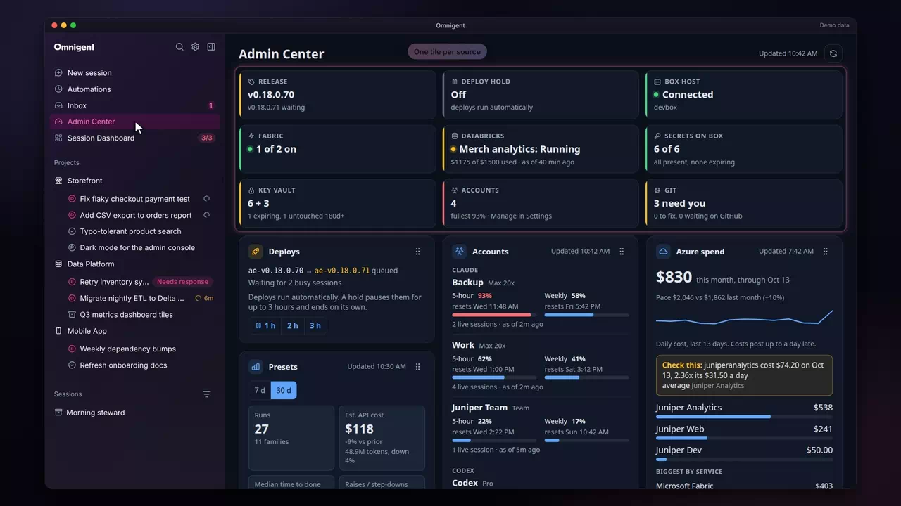
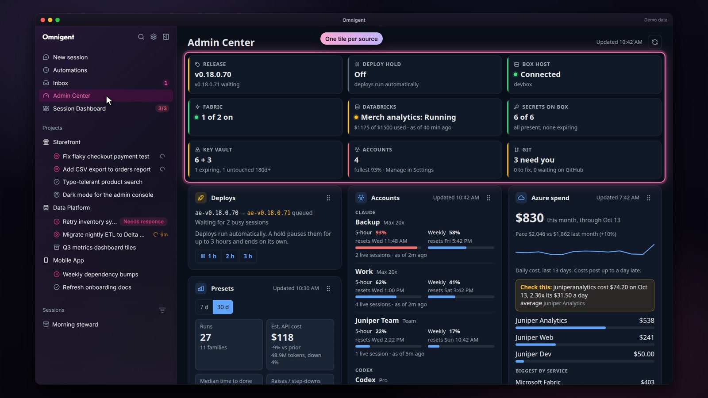
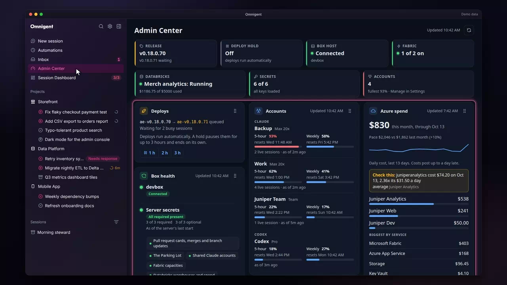
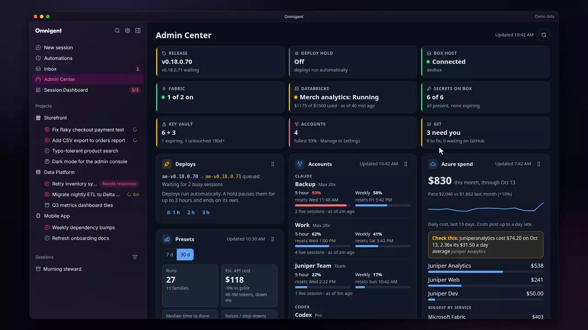
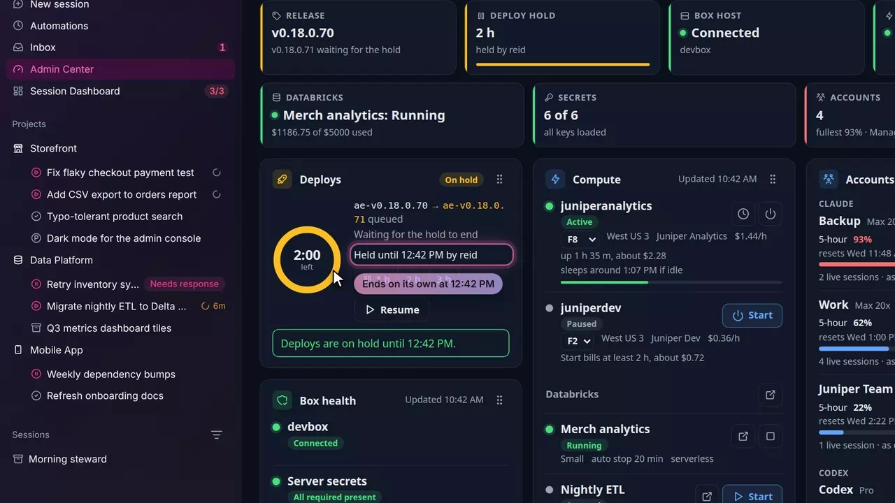
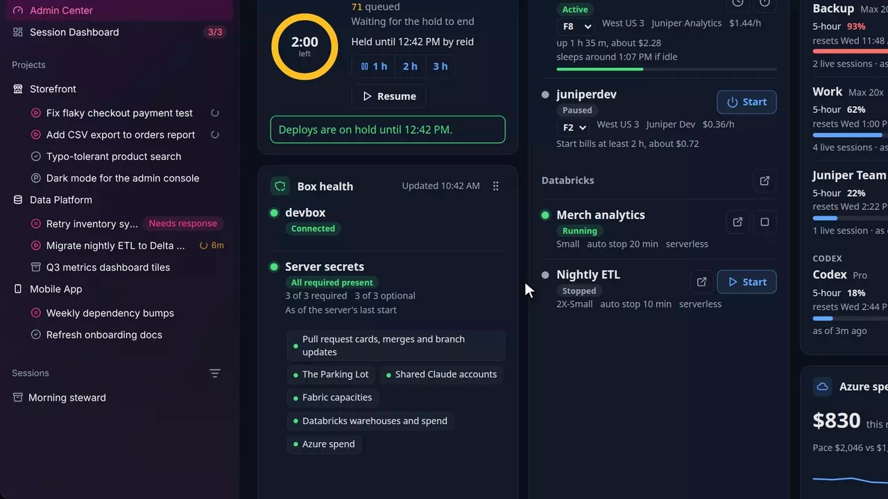
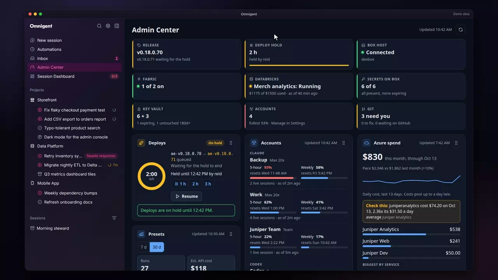
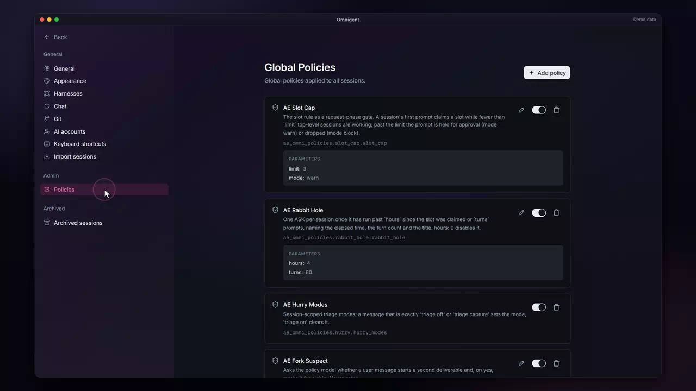
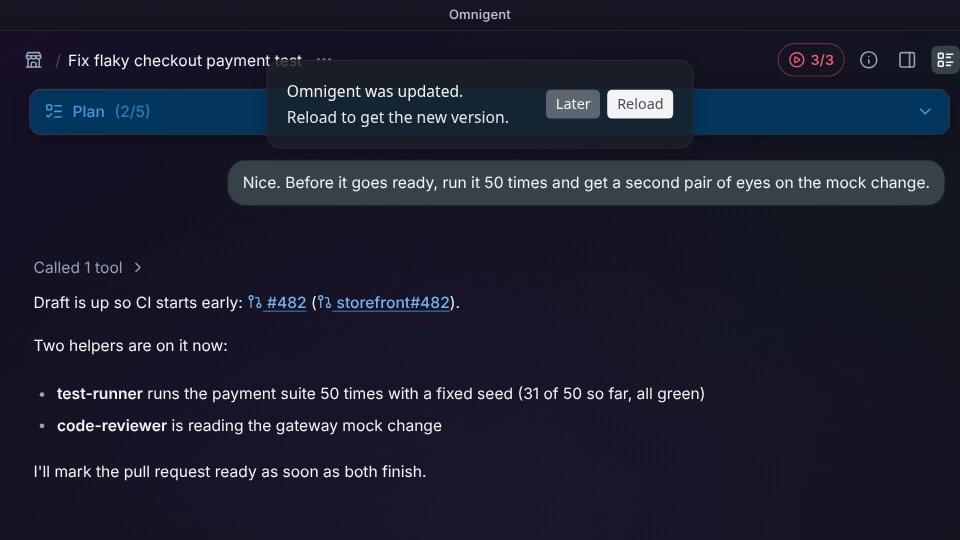

# Admin Center

Accounts and admin &middot; [All features](README.md)

Stock Omnigent manages the server on its Settings pages: harnesses, AI accounts, members and global policies. The fork adds an Admin Center, a page of its own extension built on Omnigent's extension API, so the core app is unchanged. It puts the release, deploys, the host, every account's limits and cloud spend on one board, and Settings > Global Policies gains an Edit button.

## One board for the server

The Admin Center opens on a board of cards: Deploys, Box health, Accounts, Compute, Azure spend and Databricks credit. Each card reads its own source and draws its own empty or error state, so one missing integration never blanks the page. On a phone each card folds to one line that still shows its state. The board is for admins: anyone else signed in sees one line saying so, apart from a box admin, who sees Box health (below). The server enforces it too, so a non-admin's own calls for the host, secrets, Fabric and Databricks answer admin only, and the limits they can read are shared logins and their own sessions.

**Where:** Admin Center in the sidebar, between Inbox and Session Dashboard. 
**Built from:** [`packages/ae_omni_extension`](../../packages/ae_omni_extension); [`packages/ae_omni_policies`](../../packages/ae_omni_policies)

## Status tiles

A strip of tiles above the cards gives one line per source: Release, Deploy hold, Box health, Box host, Fabric, Databricks, Secrets on box, Key Vault and Accounts, each colored by health. Amber or red tells you which card to read first.

**Where:** The top of the Admin Center. 
**Built from:** [`packages/ae_omni_extension`](../../packages/ae_omni_extension)

## Drag cards to rearrange

Each card header has a grip. Drag a card to another column or position, or focus the grip and use the arrow keys; the layout is saved per column count, and Reset layout brings the defaults back.

**Where:** The grip at the right of any card header, on two or three columns. 
**Built from:** [`packages/ae_omni_extension`](../../packages/ae_omni_extension)

## Hold deploys

A deploy restarts the server and ends every running turn. Hold 1 h, 2 h or 3 h pauses the box's automatic deploys; a ring counts down, the card says when the hold ends and who set it, and the hold ends on its own or with Resume. The card also shows the running release and any newer one queued, and how many busy sessions it waits on. The hold is admin only and needs no configuration (the server keeps it in its data volume, and `deploy/auto-update.sh` reads it); the newest release needs `AE_GITHUB_TOKEN`, and without it the card says the newest release is unknown.

**Where:** The Deploys card. 
**Built from:** [`packages/ae_omni_extension`](../../packages/ae_omni_extension); [`packages/ae_omni_policies`](../../packages/ae_omni_policies)

## Box health

The host card says whether the box's host is connected, and when it is not, how far the sign-in relink helper has got and lets an admin request a new link (the relink ends every live session, so it is admin only, and a non-admin never sees the button). Server secrets lists every key the server expects by what it turns on, never by value, and flags a missing required one. Each key is a row with its Key Vault name, when the vault says it expires (amber inside 60 days, red once past, "no expiry set" otherwise), when it last changed, and an Edit link (the Azure portal page) and a Rotate link (the system that issues the value, with the account it opens in a hint). The dates come from a daily timer on the box, because the server never reads the vault; the card says when that reading is missing or over 36 hours old (`deploy/README.md`, Secret expiry dates). The sign-in and task-store secrets count as required only when OIDC sign-in or the task store is set up. The relink status comes from `deploy/host-relink.sh`; without it the card shows only the connection.

Since 2026-10-23 the secrets block is "Secrets on this box" and starts collapsed: the counts, then a chip for each key that needs you (missing, expired, expiring inside 60 days, or refused on the server's last call), or one green line naming the next expiry. Show keys opens the rows, and the page remembers it. The host's Claude token is a row too, tagged host, once the box's daily check has reported it. Each server key also says when the server's own calls last worked with it ("worked 2:07 PM") or were refused ("failed: 401 at 1:50 PM"); that is kept in memory, so it counts from the last server start. A refused required key turns the block red, a refused optional one amber.

Since 2026-10-28 the card opens with a box monitor. On 2026-10-28 the box's `/tmp` (a 62 GB RAM tmpfs capped at 1,048,576 inodes) ran out of inodes because nothing cleaned Claude Code's per-session temp folders, and every Claude Code Bash call failed for about 15 minutes. A timer on the box (`ae-omnigent-box-health.timer`, every five minutes) now posts heat, CPU, memory, storage and bloat, and the card shows five lines (Heat, CPU, Memory, Storage, Bloat) under a "This box" header with a Details button, plus up to three Needs you lines, worst first. Amber and red are deliberate: one hot CPU reading stays green (boost bursts to 91C are normal), but every reading for 15 minutes at 90C or more turns it amber; a mount is judged on the worse of its space and its inodes. Details opens a dialog with the tables, a day of heat sparklines, and every setting with a one-line hint.

The monitor covers both box users, the owner and the second box user, and names neither one's work. Rows are per user and carry counts, sizes and ages only: stale Claude temp folders (older than two days, kept alive by any live session, which the box's temp guard protects and the card counts), leftovers at the top of `/tmp` by pattern, worktrees (counted and sized, never listed), and the second box user's container, measured through fixed read-only commands. A folder of another user that the box user cannot read shows as "not readable" with its age. Nothing posted holds a folder, project, session, branch, worktree or file name, and a test pins that. The same goes for the things around them: a mount is named only from a short list (`/`, `/tmp`, `/boot`, `/boot/efi`, `/home`, `/var`, `/secure`, `/run`, `/dev/shm`) and any other is "other mount N" with its numbers; a failed systemd unit is named only when it is an `ae-` unit (with any `@instance` dropped), one of systemd's own or Docker's, and the rest are counted ("2 other"); a folder whose size is reported is shown by the label its setting gave it, never its path.

Who sees it: OmniGent admins see every card. A box admin (a login in the server's `AE_BOX_ADMINS`, for the second box user) sees only this card and its tile, and nothing else is requested for them. Anyone else sees one line saying the Admin Center is for admins. Reading is all a box admin can do; only an OmniGent admin's login can post a reading.

Since 2026-10-29 a box admin can clean up from the card. Details has a Cleanup section with one button per cleanup the box offers now, and a Needs you line that a cleanup clears has a Clean up button that opens the same confirm step. The confirm text says whose items, how many and how big, and what is left alone ("This cannot be undone"). Four cleanups exist: a user's Claude temp folders older than two days, the old test leftovers at the top of `/tmp` (by fixed name patterns, such as `sec-appr-*`), review checkouts in `/tmp` with no uncommitted changes, and Docker's dangling images and build cache older than two days. Pressing the button only queues the request; the box's relay picks it up within five minutes, runs it as its own user (never root, never `~/worktrees`, never a running session's folder), and posts a result the card shows ("Removed 268 folders, freed 9.8 GB"). The card shows who ran it only to OmniGent admins; other box admins see "a box admin". One request exists at a time, can be cancelled until the box takes it, and the card says so if the box never picks it up. Another user's host-side folders are not offered, because only the box's own daily rule can remove them. Each mapped container also ages its own two-day-old temp folders every hour, and Details says how many; before each removal the relay checks, inside the container, that nothing in the folder changed lately and that no process works in it or names its session on a command line, and removes nothing when a check cannot finish. Every confirm says the box runs it within 5 minutes; a run whose fresh plan is larger than what you confirmed removes only that many of the oldest items (judged by the newest file inside each) and says how many more aged since (they stay for the next run), a Remove button that is locked says why in a line beside it, and a request it has not taken in 15 minutes expires. `AE_BOX_HEALTH_CLEANUP=off` in `host.env` hides every button and stops the aging. No folder, project, session, repository, branch or file name appears in the confirm text, the result, the card or the server log.

Since 2026-10-29 the card is laid out differently; what it shows has not changed. The host's live status (a dot, its name and a state pill) sits in the card's header, between the title and "Updated", and drops to a second header line under the title on a phone and on any card under 480 px (the 295 px three-column card and the 205 px two-column card). It stays visible when a phone card is folded, and it is the same status the host's tile reads, redrawn on every poll. Under the header a status line gives the worst state as a pill ("3 need you", "OK" or "No reading", colored by the box's tone), when the box was read and Details. The five readings are small tiles (five across from 600 px of card, two across below that, a plain list at 260 px and under); a tile that is amber or red is tinted. A "Needs you" panel holds each need with its Clean up button at the right of its row, and the queued or running cleanup request is the panel's last row, with a clock icon and its Cancel request button. The host's own block (its facts, notices and the reconnect button) appears under the status line only when the host has something to say, which is when it is not connected. Secrets take the full width as one block. Every nested surface uses the inner color and its border, as the other cards do ([#351](https://github.com/analyticendeavors/omnigent-ae/pull/351)), buttons on those surfaces take a slightly lighter step so they read against them, and the queued request's stripe has a color (before, it had none and showed almost nothing in dark). Each control keeps its tooltip or hint, and touch targets stay 44 px on a touch screen and on a narrow one.

**Where:** The Box health card. 
**Built from:** [`packages/ae_omni_extension`](../../packages/ae_omni_extension); [`packages/ae_omni_policies`](../../packages/ae_omni_policies)

## Key Vault

Every secret in both Key Vaults (the main vault and the website's `kv-example-web`), by name. A switch picks the vault; four numbers count the expired ones, those expiring inside 60 days, those with no expiry set and those unchanged for 180 days or more; Needs you lists the few worth a look, worst first, including any secret whose two copies were changed apart and so needs rotating in both vaults. Show all opens a search box, filters (On box, Both vaults, No expiry, 180d+) and the secrets grouped by the first word of their name, with groups folded until you open one or search. App secrets tagged to their Entra app, and the server's GitHub token, show the issuer's end date when it comes first ("from Entra", "from GitHub"). Admins only: the names say which services we use. Values never leave Key Vault; the daily check on the box reads names and dates (`deploy/README.md`, Secret expiry dates).

Since 2026-10-23 every secret can have an owner, an OmniGent member picked from the member list: open a row (or a group's "Set owner for all") to set it. Rows and Needs you lines show the owner's initials, the filters count each owner and "No owner", and the counts say how many have none. The server also files a task in the task app, with a 09:00 alarm that rings on the phone, when a secret's expiry is 30 days away, moves that alarm at 7 days and when it expires, and closes the task once the secret is rotated; Needs you says when an alarm is set and the tile says when the next one rings (`deploy/README.md`, Expiry alerts).

**Where:** The Key Vault card, under Box health; its tile says both vaults' counts. 
**Built from:** [`packages/ae_omni_extension`](../../packages/ae_omni_extension); [`packages/ae_omni_policies`](../../packages/ae_omni_policies)

## Git repos

One card for every repository across several GitHub accounts, so a backlog cleanup reads from one place instead of dozens of `gh` queries. It sorts everything by who moves next. Four numbers come first (ready to merge, alerts to fix, old branches, waiting on GitHub), then Needs you, the few things only you can decide, worst first: an account or repo that cannot be read, a late or failed Dependency Sweep, alerts still vulnerable on the default branch, a failing or conflicting pull request, one ready to merge, alerts GitHub has left open more than a day after the fix landed, and branches with no pull request whose last commit is over two weeks old. Everything else (alerts GitHub has not cleared yet, checks still running, the sweep's own Dependabot pull requests, drafts, recent branches, branches marked as kept, view-only repos) is one line each under Not yours to move. Show all opens every repo, folded, with a search box and chips for PRs, alerts, branches and view-only repos.

Alerts are split by what the default branch really installs: the server reads each alert's lockfile (npm `package-lock.json`, pinned pip `requirements.txt`) and compares the installed version to the vulnerable range. An alert whose lockfile cannot be read counts as needing a fix, so nothing hides. Read only: every row links to GitHub. Repos named view only are shown and left out of every count. Admins only.

The repo list comes from a Dependency Sweep config (`AE_GIT_SWEEP_CONFIG`, `owner/repo:path`) plus `AE_GIT_REPOS` and `AE_GIT_VIEW_ONLY`; `AE_GIT_KEEP_BRANCHES` names branches kept on purpose. Each account reads with its own read-only token, `AE_GIT_TOKEN_<OWNER>`, falling back to `AE_GITHUB_TOKEN`; an account with neither shows as not connected (`deploy/README.md`, The Git repos card's tokens).

**Where:** The Git repos card; its tile says how many things need you and how many alerts need a fix. 
**Built from:** [`packages/ae_omni_extension`](../../packages/ae_omni_extension); [`packages/ae_omni_policies`](../../packages/ae_omni_policies)

## Every account's limits

The Accounts card lists every signed-in Claude and Codex account, shared ones included, with its 5-hour and weekly use, reset times and live sessions, fullest first. Readings come from the box host's limits relay (`AE_LIMITS_*` in the host's environment); an account it has not read yet says no reading yet.

**Where:** The Accounts card; Manage in Settings on its tile opens Settings > AI accounts. 
**Built from:** [`packages/ae_omni_extension`](../../packages/ae_omni_extension); [`packages/ae_omni_policies`](../../packages/ae_omni_policies)

## Compute and spend

Compute lists Fabric capacities, with Start, Pause, keep awake and resize, and Databricks SQL warehouses with Start and Stop. Every Compute action changes the bill, so each one, and the Databricks spend refresh, is admin only; anyone signed in can read the cards, and a non-admin sees them without the action buttons. Azure spend uses Azure's own US dollar figures when Azure supplies them, so a subscription billed in another currency still counts in the totals and its targets; without them, such a subscription gets its own line outside the totals. It shows the month so far, its pace against last month, cost by subscription and service, and a flag on any day well above its average. Databricks credit shows spend against a credit when one is set, and only this month's spend otherwise. Each card is off until configured and says how to add it: Fabric needs `AE_FABRIC_WAKE_URL_<NAME>` (with `AE_FABRIC_SUSPEND_KEY_<NAME>` for Pause, and `AE_FABRIC_CAPACITIES_URL` and `AE_FABRIC_CAPACITIES_KEY` to list every capacity and resize), Databricks needs `AE_DATABRICKS_HOST`, `AE_DATABRICKS_CLIENT_ID` and `AE_DATABRICKS_CLIENT_SECRET`, and its credit card reads `AE_DATABRICKS_CREDIT_USD`, `AE_DATABRICKS_CREDIT_CADENCE` (`monthly` or `once`), `AE_DATABRICKS_CREDIT_START` and `AE_DATABRICKS_CREDIT_END` (the credit shows only when the amount and both dates are set; there is no built-in credit, and a value that does not read leaves it off). Azure needs `AE_AZURE_COST_SUBSCRIPTIONS`, `AE_AZURE_COST_TENANT_ID`, `AE_AZURE_COST_CLIENT_ID` and `AE_AZURE_COST_CLIENT_SECRET`.

Azure spend is for admins only, and its Open Cost Management button opens the portal's cost analysis page through the host.

The Azure card's Targets section, folded at first to one line of counts, holds cost targets an admin can add, edit, switch off or delete: a subscription's month-to-date spend, one resource's spend on the latest finished day, or a Fabric capacity's running hours. A target that is crossed files a task with a phone alarm, and the task closes itself when the value falls back (`AE_COST_TARGETS_FILE`, `AE_COST_ALERT_LIST`).

**Where:** The Compute, Azure spend and Databricks credit cards. 
**Built from:** core patch [`0151`](../../patches/0151-ae-patch-Let-an-extension-open-the-Azure-cost-analys.patch); [`packages/ae_omni_extension`](../../packages/ae_omni_extension); [`packages/ae_omni_policies`](../../packages/ae_omni_policies)

## Presets card

One card for how roles presets are used over 7 or 30 days: plain-word takeaways and headline numbers first (including raises, step-downs and runs that hung), then a row per preset with its runs and median time and spend, each with a bar of its spend by model, and a pop-up of a preset's recent runs. Spend shows as cost, tokens or both, as Preset insights' "Presets card shows" sets it; tokens are input and output, summed over the lead and its helpers, without cache reads. It reads the run log that Preset insights turns on (see [Roles presets](roles-presets.md)). When the catalog has a newer model than a preset row uses, a note on the card names the model and how many presets use an older one, points to Settings > Roles, and can be dismissed until the next new model; it never changes a preset. Admins only.

**Where:** The Presets card in the Admin Center. 
**Built from:** [`packages/ae_omni_extension`](../../packages/ae_omni_extension); [`packages/ae_omni_policies`](../../packages/ae_omni_policies)

## Family cost card

One card ranks each session family's spend over 7 or 30 days: a lead plus every session it started (builders, reviewers, Codex reviewers) and its native subagents, so a runaway family shows at a glance. Each row has the family's title, a host chip, the number, a bar against the biggest family, role chips (the lead's chip reads "lead incl. subagents"), the lead's context size and how many times its Claude process restarted. "Show cost as" (tokens or dollars, tokens by default) picks which number leads; the other is on hover. "Runaway family" is the spend today that raises a Needs you line naming the family (5M tokens or $25 until changed; 0 turns it off); each setting has a hint beside it. Both settings are saved per user with the roles list. An OmniGent admin sees every family on every host; anyone else the server answers sees only their own.

The server adds it up from each session's own usage, every 15 minutes, and the card answers from that sweep ("Reading" until the first one finishes). A window's spend is what a session has spent now minus what it had spent at the window's start (a total that falls, as a restarted status line's does, adds the sample before the fall to a per-session offset, so later spend still counts), taken from a snapshot kept for 35 days in `/data/ae-family-cost.json` (`AE_FAMILY_COST_FILE`; `AE_FAMILY_COST=0` turns the sweep off); days are Pacific time ("today" for the Runaway family check too), and a day's snapshot is the last sample before its midnight; a family follows `ae.orch`, parent links, subagents of subagents and handoff chains (an earlier lead is a member of the newest lead's family), and a chat whose parent is gone is a family of its own; a chat that was deleted (not archived) drops out of its family's totals; a chat older than the window counts from the oldest snapshot, and the card says when that history is shorter than the window. Checked on 2026-10-29 against the Claude transcripts: the token totals match to within 1.4%, a Claude lead's total already holds its subagents, and a Codex session's native subagents add tokens but not cost (the parent's cost already includes them). Sessions keep no cache-write figure, so "input" includes cache writes. Dollars are estimated at API rates; on a subscription they show where usage goes, not the invoice.

**Where:** The Family cost card in the Admin Center, after Presets; its tile counts the families and turns amber when one passes the runaway amount. 
**Built from:** [`packages/ae_omni_extension`](../../packages/ae_omni_extension); [`packages/ae_omni_policies`](../../packages/ae_omni_policies)

## Edit a global policy's parameters

Stock Omnigent lets an admin switch a global policy on or off. The fork adds Edit beside the switch: it opens the policy's parameters prefilled, such as the slot cap's limit or the rabbit-hole hours, and the server checks the new values by building the policy before it saves. A slot cap limit set here also sets every slot count in the UI, in place of `AE_SLOT_LIMIT`.

**Where:** Settings > Global Policies: the pencil on a policy with parameters. 
**Built from:** core patches [`0094`](../../patches/0094-ae-patch-Check-a-global-policy-s-factory_params-by-b.patch), [`0095`](../../patches/0095-ae-patch-Edit-a-global-policy-s-parameters-on-the-Gl.patch); [`packages/ae_omni_policies`](../../packages/ae_omni_policies)

## Open tabs hear about an update

Stock Omnigent keeps running the page a tab loaded, so a fix deployed to the server stays invisible until someone reloads. The fork checks the server's start page every two minutes and whenever the window comes back into view. When the server runs a newer build, a toast says Omnigent was updated, with Reload and Later. Later keeps that tab on the page it has until the next update.

**Where:** Any open tab, after the server is redeployed. 
**Built from:** core patches [`0214`](../../patches/0214-ae-patch-Tell-an-open-tab-that-the-server-was-update.patch), [`0215`](../../patches/0215-ae-patch-Spell-Omnigent-the-usual-way-in-the-Reload-.patch)

---

Previous: [Usage and accounts](usage-and-accounts.md) &middot; Next: [Phone](phone.md)
