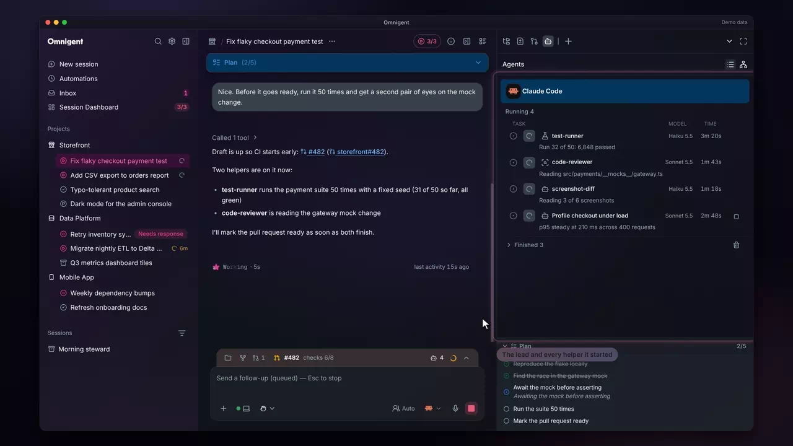
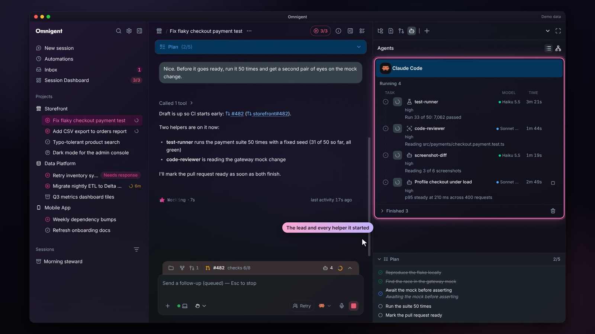
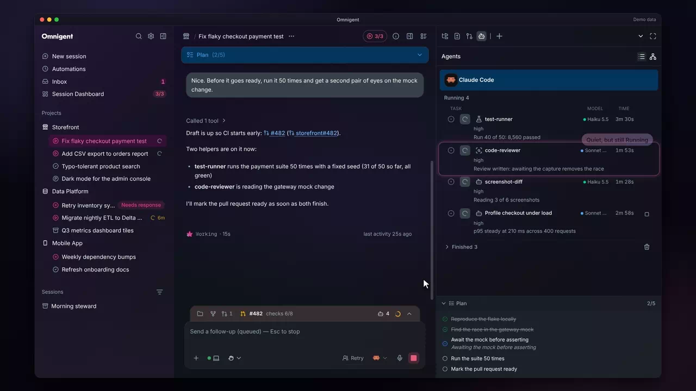
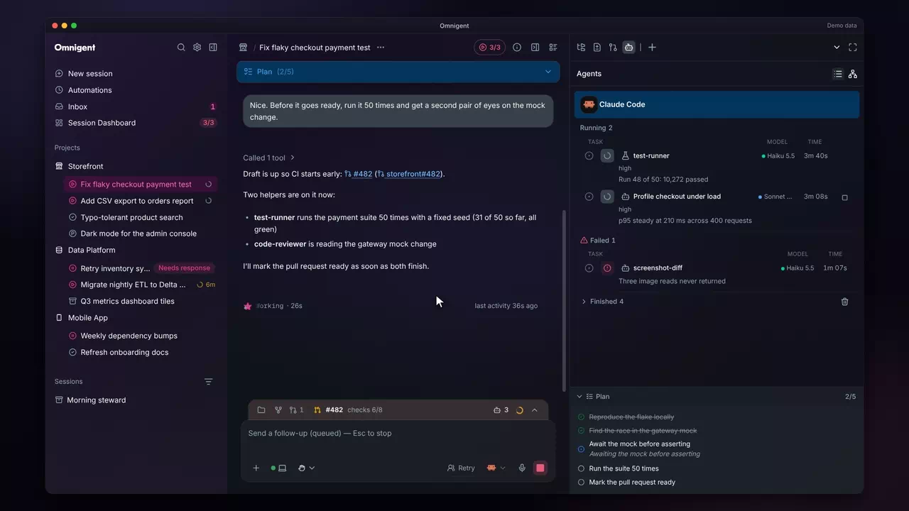
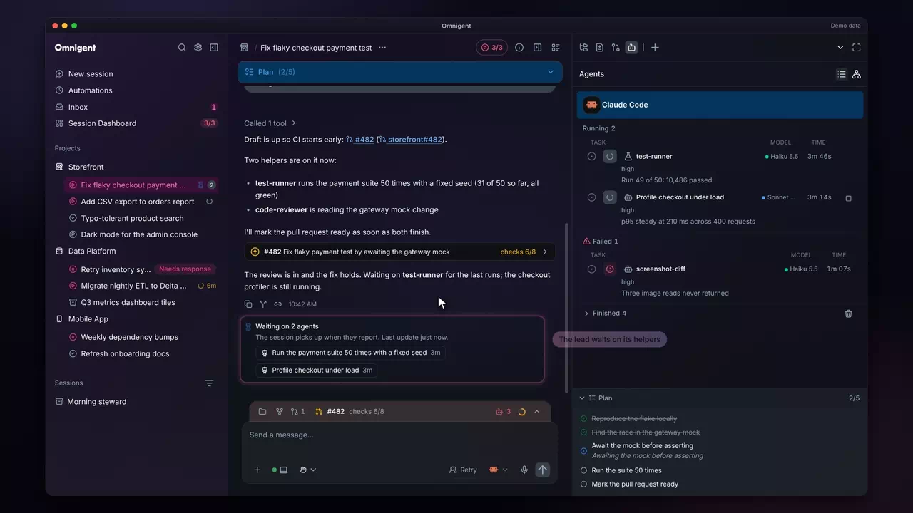
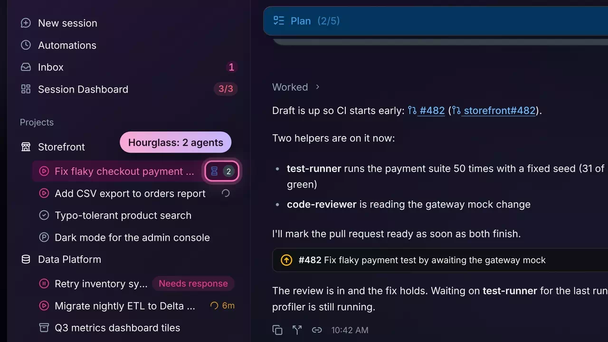
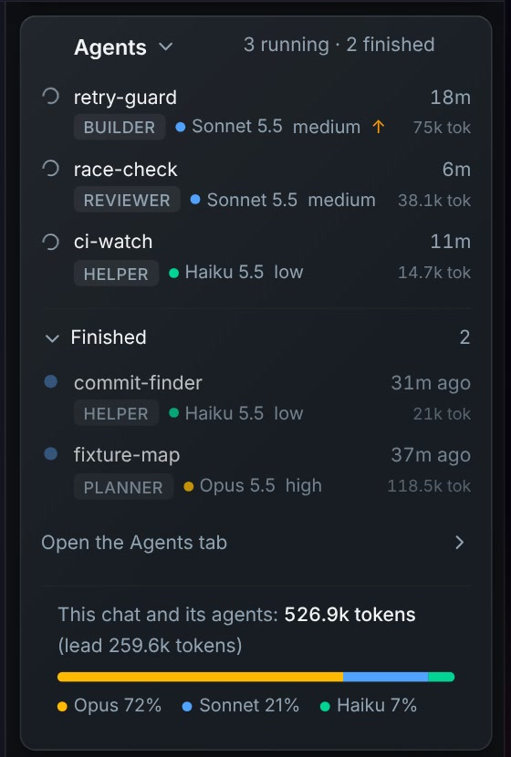
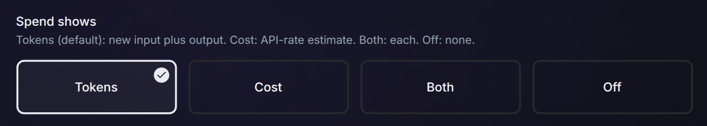

# Background agents

Agents and pull requests &middot; [All features](README.md)

Stock Omnigent lists a session's subagents in the Agents tab of the right panel. The fork lays that tab out like Claude Desktop's background tasks, keeps each helper's state honest while it runs, fails or is closed, and shows each one's role, model, effort and spend.

## An Agents pane like Claude Desktop's

The lead sits on top, then Running helpers with a live timer and the last line each one printed, then a counted Finished group you can open or clear. You can see at a glance what is still working and for how long. The graph view lays out left to right so a tall pane stays readable.

**Where:** The Agents tab in the session's right panel. 
**Built from:** core patch [`0055`](../../patches/0055-ae-patch-Lay-the-Agents-pane-out-like-Claude-Desktop.patch)

## The model each agent ran on

Every row has a Model column with the model the helper actually ran on, written as a name (Haiku 5.5, Sonnet 5.5), including Claude Code's own subagents and Codex collaborators.

**Where:** The Model column in the Agents tab. 
**Built from:** core patch [`0063`](../../patches/0063-ae-patch-Show-the-model-each-agent-ran-on-in-the-Age.patch)

## Running until the lead records its return

A Claude Code subagent goes quiet between steps, and stock Omnigent read each pause as finished, so rows flickered between Running and Finished. The fork keeps a subagent under Running until its parent records the return. A subagent that died before its first pause, or across a server restart, still settles instead of reading Running forever.

**Where:** The Agents tab, and the sidebar's waiting count. 
**Built from:** core patches [`0112`](../../patches/0112-ae-patch-Keep-a-Claude-Code-subagent-running-until-i.patch), [`0125`](../../patches/0125-ae-patch-Settle-a-Claude-subagent-that-died-before-i.patch)

## Failed helpers

A helper whose run failed moves under its own Failed heading, with a warning icon and its error line, instead of hiding among the finished ones. The state survives a server restart.

**Where:** The Failed group in the Agents tab. 
**Built from:** core patch [`0130`](../../patches/0130-ae-patch-Show-a-failed-subagent-under-its-own-Failed.patch)

## Waiting on agents

When the lead's own turn ends while helpers still run, the session reads as waiting: the sidebar row shows a pulsing hourglass with the number of agents, and a status line above the composer says "Waiting on 2 agents" with a chip per helper.

**Where:** The session's row in the sidebar, and the status line above the composer. 
**Built from:** core patch [`0074`](../../patches/0074-ae-patch-Show-when-a-session-is-working-quiet-waitin.patch)

## Closed helpers stop counting

A helper session that is closed drops out of its parent's count at once, so the hourglass only counts work that is still running. Before, a closed helper could keep its parent waiting for hours.

**Where:** The hourglass on the session's sidebar row. 
**Built from:** core patch [`0133`](../../patches/0133-ae-patch-Stop-counting-a-closed-subagent-toward-its-.patch)

## Role, model, effort and spend per agent

Each agent on the rail's Agents card and in the Agents tab shows its role, its model with a colored dot, its effort and what it spent, then a total line, "This chat and its agents", with a thin bar split by model family. A helper the lead raised carries an amber arrow. The role comes from the start of the agent's description ("Builder A: ..."), and the lead is told to name one on every helper it starts. Sessions the lead starts with `create_session` show in Grouping > Family instead (see [Roles presets](roles-presets.md)).

**Where:** The Agents card in the session rail, and the Agents tab. 
**Built from:** core patches [`0172`](../../patches/0172-ae-patch-Show-each-agent-s-role-model-effort-and-tok.patch), [`0173`](../../patches/0173-ae-patch-Show-each-agent-s-spend-as-estimated-cost-w.patch)

## Spend in tokens, cost or both

Settings > Chat's "Spend shows" picks what every spend figure shows: Tokens (new input plus output, the default, which suits a subscription account), Cost (an estimate at API prices), Both ("1.98M tok · $9.80") or Off. Under Both, a cost that leaves out a session with no cost, such as a subscription one, ends in "+". Claude sessions report real token counts, read from their transcripts, so they no longer read as zero.

**Where:** Settings > Chat > Spend shows. 
**Built from:** core patches [`0179`](../../patches/0179-ae-patch-Add-a-Spend-shows-setting-tokens-cost-or-of.patch), [`0192`](../../patches/0192-ae-patch-Add-Both-to-Settings-Chat-Spend-shows-token.patch)

---

Previous: [Action dock](action-dock.md) &middot; Next: [Pull requests](pull-requests.md)
