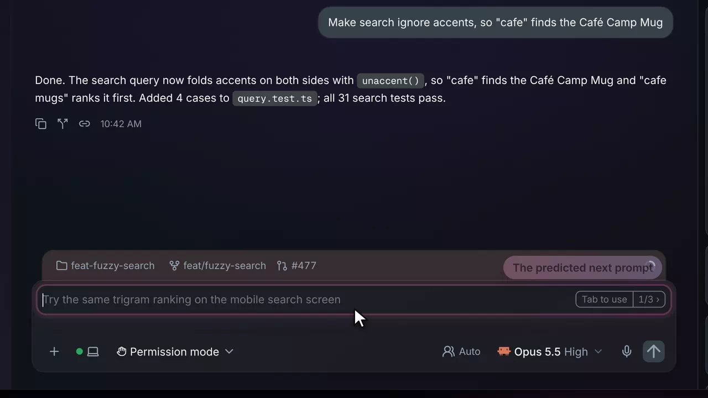
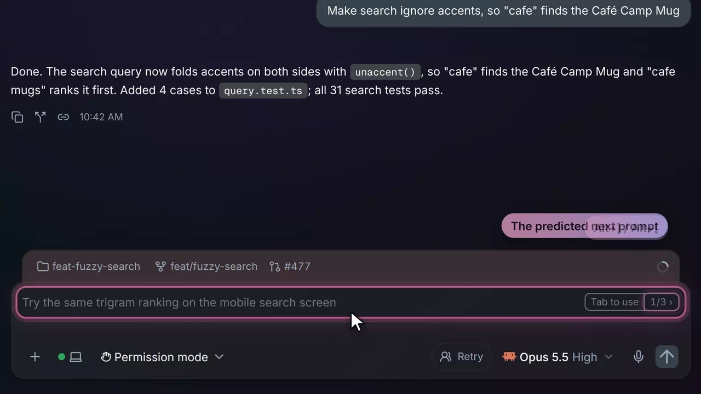
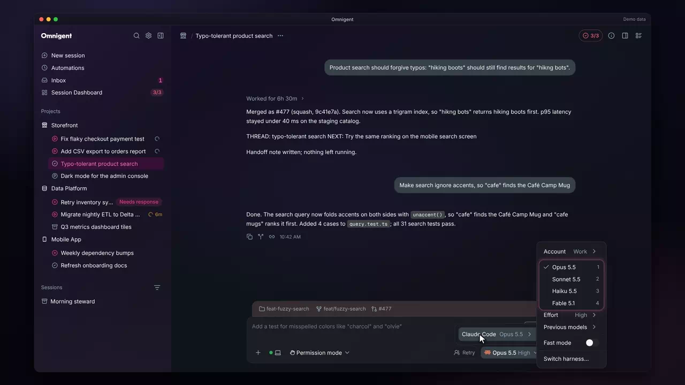
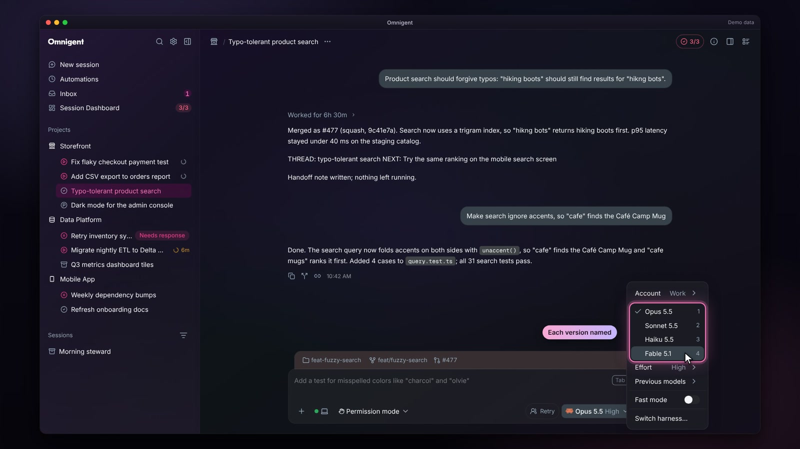
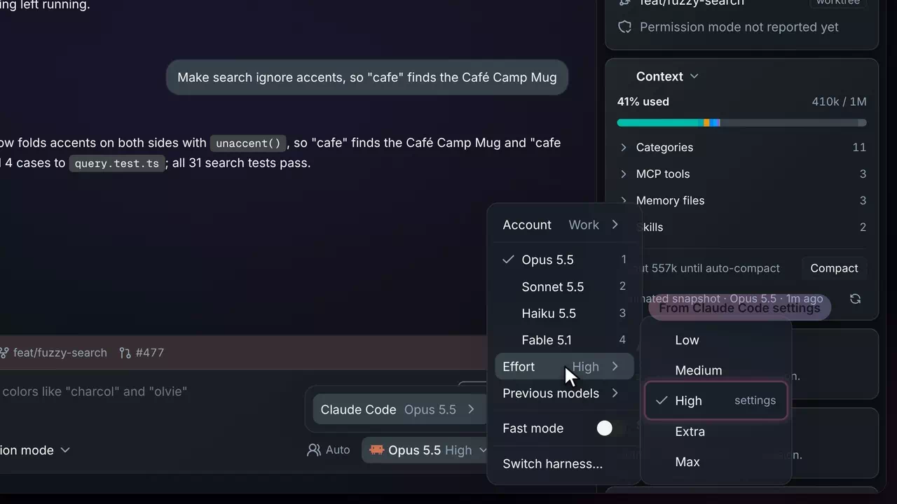
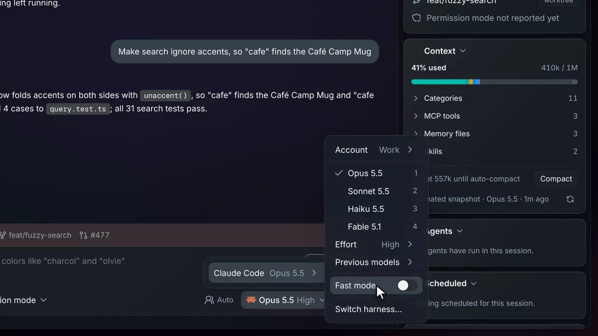
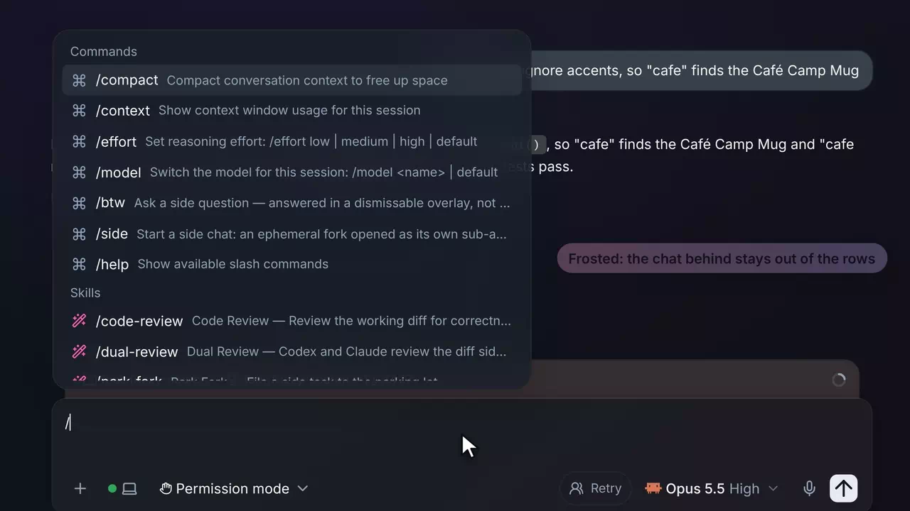
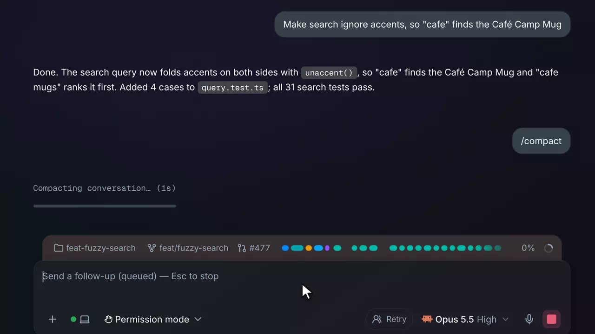

# Composer

Inside a session &middot; [All features](README.md)

Stock Omnigent's composer sends your prompt to the session and lets you pick its model and effort. The fork has it guess your next prompt, names every Claude model version, shows the effort a session really runs at, and makes the slash menu and compaction easier to read.

## Prompt suggestions

When a turn finishes, a short Haiku side call predicts what you will type next, and the composer shows it as grey ghost text over the empty box. Tab fills it in without sending, so you can edit it first; typing anything hides it. It works in Claude sessions on any account and in Codex sessions too. The suggestion stays until your next prompt, so a reload or a second tab still shows it. When the reply offers a phrase to say (Say "draft it" and I'll start), the suggestion is that phrase alone, not the whole offer sentence.

**Where:** The composer of any idle session, after a turn ends. The chip on the right reads "Tab to use" ("Tap to use" on a phone). 
**Built from:** core patches [`0123`](../../patches/0123-ae-patch-Predict-the-next-prompt-after-each-Claude-t.patch), [`0128`](../../patches/0128-ae-patch-Predict-the-next-prompt-in-every-session-on.patch), [`0183`](../../patches/0183-ae-patch-Keep-the-composer-s-prompt-suggestion-until.patch), [`0436`](../../patches/0436-ae-patch-Suggest-the-offered-phrase-not-the-reply-s-.patch)

## Ranked alternatives

The side call offers up to three clearly different guesses, best first. Alt+] and Alt+[ step through them in place, and the counter on the chip (1/3) shows which one you are on. Esc hides them until the next turn.

**Where:** The counter on the suggestion chip, or Alt+] and Alt+[. Settings > Chat lets you rebind the keys. 
**Built from:** core patch [`0132`](../../patches/0132-ae-patch-Offer-up-to-three-ranked-prompt-suggestions.patch)

## Model versions and Previous models

The host names Claude models by family alone (Opus, Sonnet), so the menu never said which version a pick runs. The fork labels each row with its version (Opus 5.5) and lists the older versions your subscription still serves under Previous models, so you can pin a session to one. When the host's catalog lags a release (Claude Code 2.1.322 still reported Fable 5.1 when Fable 5.2 was already answering), the fork's list of known models replaces the catalog's newest row of that family, so Fable 5.2 is the main row and Fable 5.1 sits under Previous models. When the catalog's row is an alias (`opus`, `fable`), that row stays as it is, labeled with its own version, and a new row for the newer model sits just above it, so picking "Opus 6" starts Opus 6 and not whatever `opus` still maps to. The alias row keeps the catalog's model and label, so if the CLI alias already resolves to the newer model, pick the new row explicitly. A Claude model id the host does not list (`claude-fable-5-2`, for example) reads as its version label (Fable 5.2) on the composer's model chip and on the menu's (current) row, instead of the raw id. A dated or otherwise suffixed id keeps its raw text, so it stays distinct from the base model.

**Where:** The model chip under the composer, then the Claude Code row. The New session dialog shows the same list. 
**Built from:** core patches [`0108`](../../patches/0108-ae-patch-Show-Claude-model-versions-and-a-Previous-m.patch), [`0339`](../../patches/0339-ae-patch-web-Claude-Fable-5.2-becomes-the-main-Fable.patch), [`0351`](../../patches/0351-ae-patch-web-a-newer-model-gets-its-own-picker-row-n.patch), [`0352`](../../patches/0352-ae-patch-Fix-the-review-findings-on-0351.patch), [`0343`](../../patches/0343-ae-patch-web-an-unlisted-Claude-model-id-reads-as-it.patch), [`0344`](../../patches/0344-ae-patch-web-Fix-the-review-findings-on-0343-a-dated.patch)

## A one-column model menu

The menu is one list, as in the Claude desktop app: the check sits before the current model, each model has a digit you can press to pick it while the menu is open, and Account, Effort, Previous models and Fast mode sit below as rows.

**Where:** The model chip under the composer. 
**Built from:** core patches [`0120`](../../patches/0120-ae-patch-Put-the-model-grid-s-check-before-the-name-.patch), [`0134`](../../patches/0134-ae-patch-Show-the-effort-a-Claude-session-runs-at-an.patch)

## The effort a session runs at

With no effort picked, stock Omnigent said nothing about the level Claude Code would use. The fork reads it: first the per-model `effortLevel` in Claude Code's settings files, tagged "settings", else Claude Code's own default for that model, tagged "default". The chip under the composer carries the level beside the model, as in "Opus 5.5 High".

**Where:** Effort in the model menu, and the model chip under the composer. 
**Built from:** core patches [`0119`](../../patches/0119-ae-patch-Show-the-effort-a-Claude-session-runs-at-wh.patch), [`0124`](../../patches/0124-ae-patch-Read-Claude-Code-s-per-model-effort-levels-.patch), [`0134`](../../patches/0134-ae-patch-Show-the-effort-a-Claude-session-runs-at-an.patch)

## Fast mode

A switch for Claude Code's fast mode, which gives faster Opus output billed to usage credits. It is per session, is enabled only on Opus models, and reads the session's real state each time the menu opens, so the switch never shows off while credits are being spent.

**Where:** Fast mode in the model menu of a Claude session. The host needs per-session fast mode in its Claude settings. 
**Built from:** core patches [`0044`](../../patches/0044-ae-patch-Add-a-Fast-mode-switch-to-the-model-menu-fo.patch), [`0045`](../../patches/0045-ae-patch-Fix-the-review-findings-on-the-Fast-mode-sw.patch)

## Blurred command and file menus

The slash command menu and the @ file mention menu blur the chat behind them, so their rows stay readable over a busy transcript in the dark theme.

**Where:** Type / or @ in the composer. 
**Built from:** core patch [`0153`](../../patches/0153-ae-patch-Blur-what-is-behind-the-slash-command-and-f.patch)

## Token defrag while compacting

While a conversation compacts, a strip of colored token blocks sorts itself in the composer tray with a progress percentage, and the marker left behind shows the token count before and after. Click the strip for a full defragmenter window. It tells you compaction is still running and roughly how far along it is. Since 2026-11-18 a `/compact` that Claude Code runs keeps its strip through turn ends until Claude reports it done, instead of the strip vanishing when the turn that started it ends; a strip still showing 15 minutes after its compaction started clears itself at the next turn end. Since 2026-11-19 Claude Code's automatic precompute, which starts a summary at about 85% of its compact window and may never use it, shows no strip; the marker and the context ring still land when an automatic compaction applies.

**Where:** The composer tray during /compact or an automatic compaction. Turn it off in Settings > Chat. 
**Built from:** core patches [`0097`](../../patches/0097-ae-patch-Play-a-token-defrag-in-the-composer-tray-wh.patch), [`0402`](../../patches/0402-ae-patch-Keep-a-harness-compaction-s-spinner-through.patch), [`0403`](../../patches/0403-ae-patch-Fix-the-review-findings-on-0402.patch), [`0404`](../../patches/0404-ae-patch-Replace-a-stale-compaction-start-the-next-c.patch), [`0416`](../../patches/0416-ae-patch-Show-the-compaction-strip-only-for-manual-c.patch), [`0417`](../../patches/0417-ae-patch-Fix-the-review-findings-on-0414-skip-the-re.patch)

## Queued notes survive a reload

A message you send while the chat is busy waits in the queue above the composer until the turn ends. The fork keeps up to 50 of those notes in the tab's session storage (each split-view pane keeps its own), so a reload, a phone discarding the tab, the automatic reload after a failed page chunk, or the reload an update notice asks for no longer loses them; past 50, newer notes stay in memory only and a reload loses them. After the reload each note comes back in its order, ahead of anything queued since. A text note under an hour old, queued under your sign-in in this tab, sends on its own as before. Any other note comes back waiting for Retry, with one toast saying why: one with attachments (attachments are not kept), an older one, one that already needed Retry, every note in a tab copied from another (they may also be waiting in the tab it came from), and every note when the browser cannot tell whether another tab holds them. A note waiting for Retry holds back the notes behind it in that chat until you retry or remove it. Each note remembers who queued it: one queued by someone else signed in on that browser is dropped, and when your sign-in cannot be confirmed within 10 seconds your notes wait, with a toast that says to reload rather than retype them. A note queued before the page knew who was signed in has no owner, so after the reload it comes back, waiting for Retry, to whoever is signed in then. A closed tab that is never reopened loses its notes, and nothing crosses devices.

**Where:** The queued notes above the composer, after a reload. 
**Built from:** core patches [`0285`](../../patches/0285-ae-patch-Keep-queued-notes-through-a-page-reload.patch), [`0286`](../../patches/0286-ae-patch-Fix-the-review-findings-on-keeping-queued-n.patch), [`0287`](../../patches/0287-ae-patch-Tell-the-user-when-queued-notes-wait-for-si.patch)

## Speak replies

A speaker button sits beside the mic in the composer action row, with a small caret right of it that opens its menu. Turn on the Speak replies switch in that menu and the browser reads each reply in that chat aloud as it streams in, starting at the first finished sentence. Code blocks are replaced by "Code block skipped", markdown marks and links are read as plain words, and the TLDR recap at the end of a reply is left out. Below the Voice mode switch (next section), the menu has six setting rows: Speak replies and Fast answers as switches (Fast answers makes the chat answer at low effort while replies are spoken, then restores the old effort), then Voice, Speed, Microphone and Speaker as sub-menus. Each row has its hint icon (the small "i") beside the label and its switch or value at the right edge, and the two actions, Read last reply and Stop speaking, sit side by side at the bottom. Microphone and Speaker list System default first and then every device the browser reports, with long device names shortened; before the mic has been used once the browser lists no devices, and the menu says "Use the mic once to list devices." Microphone sets the input for server dictation and the level meter, and a change made while the mic is listening applies the next time the mic starts. Speaker routes the natural cloud voices; device voices always play on the system default, because the browser gives no control over them. Both are saved per device, a saved device that is unplugged falls back to System default until it returns, and the rows hide where the browser cannot list devices (Speaker also needs output selection). Voice lists server voices first (four Azure Speech voices and Rocky when its local service is running), then this device's voices; if the server cannot make a sentence, the device voice reads it instead. The Azure voices need `AE_SPEECH_REGION` and the `AE_SPEECH_KEY` secret. Voice and Speed are remembered per device too. Speech stops when you send a message, switch chat or turn Speak replies off, and a send that has produced nothing after six seconds says "Working on it." once. Device voices run in the browser, and the button is hidden where the browser has no speech support. Off by default; in a narrow split pane the button hides unless it is on. The mic itself works in the desktop app through the server's dictation once the models are installed (see [Dictation](../../deploy/README.md#dictation-the-composer-mic) in the deploy README).

Rocky also appears in this Voice picker when its optional local service is running. It uses the [Rocky TTS](https://github.com/Kuberwastaken/rocky-tts) text transform and XTTS model; see the [setup guide](../../deploy/README.md#rocky-voice-optional).

Since 2026-11-19, on an iPhone or iPad the voice picker hides Apple's novelty voices that play no sound (Alex stays) and lists each device voice once, keeping its best installed quality, whatever form of id the system reports it under. A saved pick of a copy that is no longer listed resolves to the copy that is kept. When the device reports the same voice more than once, the voice log notes it once per change; Personal Voice is never logged.

**Where:** The composer action row, left of the mic: the speaker button, and the caret beside it for the menu. 
**Built from:** core patches [`0313`](../../patches/0313-ae-patch-Speak-replies-aloud-from-a-composer-toggle-.patch), [`0314`](../../patches/0314-ae-patch-Fix-the-review-findings-on-Speak-replies-03.patch), [`0315`](../../patches/0315-ae-patch-Fix-the-fix-check-findings-on-Speak-replies.patch), [`0316`](../../patches/0316-ae-patch-Speak-replies-menu-with-tooltips-and-natura.patch), [`0317`](../../patches/0317-ae-patch-Fix-the-review-findings-on-the-Speak-replie.patch), [`0325`](../../patches/0325-ae-patch-Add-a-microphone-and-speaker-picker-to-the-.patch), [`0326`](../../patches/0326-ae-patch-Tighten-the-Speak-replies-menu-layout-hint-.patch), [`0327`](../../patches/0327-ae-patch-Fix-the-picker-review-findings-devices-list.patch), [`0328`](../../patches/0328-ae-patch-Show-the-device-model-on-the-picker-rows-an.patch), [`0412`](../../patches/0412-ae-patch-Hide-Apple-s-silent-novelty-voices-from-the.patch), [`0413`](../../patches/0413-ae-patch-Fix-the-review-findings-on-0412-match-silen.patch), [`0414`](../../patches/0414-ae-patch-Show-each-iPhone-device-voice-once-keeping-.patch), [`0415`](../../patches/0415-ae-patch-Fix-the-review-findings-on-0414-a-saved-pic.patch), [`0419`](../../patches/0419-ae-patch-Merge-every-Apple-system-voice-id-form-in-t.patch), [`0420`](../../patches/0420-ae-patch-Fix-the-review-findings-on-0419-log-only-du.patch); [`packages/ae_omni_policies`](../../packages/ae_omni_policies) (`tts.py`)

## Voice mode

Voice mode is one switch for hands-free talking. Tap the speaker button to turn it on (it turns Speak replies on with it); tap it again to turn it off (while it is speaking, a tap stops the reply instead; see below). A small caret right of the speaker opens the menu above, which gains a Voice mode switch on top. Turning Speak replies off while Voice mode is on turns Voice mode off too. While it is on and idle the mic listens through the server's dictation: the server marks the end of a sentence after 1.6 seconds of silence, Voice mode waits 2 seconds more for a continuation (a new word cancels the wait), then sends the draft the way the Send button does, about 3.6 seconds after you stop. From the send until the reply has been spoken the mic is stopped, so the voice is not dictated back; listening resumes 0.3 seconds after the last sentence ends, or 0.3 seconds after you tap the speaker to stop a reply. That tap is a barge-in: it stops the current sentence and silences the rest of that reply (until your next message), and Voice mode stays on. The speaker shows the phase as a word and a ring: Listening (teal) only while the mic is really listening, Starting the mic, Mic stopped (you stopped it by hand), Mic unavailable (amber; two starts failed, and the next reply cycle tries again). The first start after the server restarts can take about 40 seconds while the speech model loads, and the speaker says Starting the mic until it listens; the other phases are Working on it (amber) and Speaking, tap to stop. The mic stays muted from your send until the turn is over and the voice has finished, however long the reply takes to begin, and sound heard in that time never reaches the draft. When a question card (AskUserQuestion) appears, the card is read aloud as `Question. <text> One, <label>. Two, <label>.` without the option descriptions, and the next sentence you say is matched to an option by number ("two", "the first one", "option 2"), by the label, or by a short run of the label's words; the match is submitted as the card's Submit would. Words that match nothing go in as your own answer after the 2 second wait (unless the card says it takes no answer of its own, then Voice mode keeps listening for an option), a multi-select card collects picks until you say "done", and silence never answers a card. A number only counts when the answer is nothing but number words, and a label said after "not", "don't" or "never" is not picked. The switch is remembered per chat in this browser, is compared with the session's `ae.voice` label when the chat opens, and writes the `ae.voice` label on the session (see `docs/LABELS.md`); while the label is `on` the `ae_voice_style` policy adds one line to each message you send: "Voice mode is on: the user hears this reply and never reads it. Answer the way you would say it out loud: the answer first, in one to three short plain sentences, then stop or ask one short question. While Voice mode is on this overrides every formatting rule you have: no bullets, bold labels, headers, tables, code blocks, links, file paths or a TLDR. Names and numbers stay exact; say a link or path in words only when it matters; give detail only when asked." In a native chat the line reaches the model as prompt context: for a message typed in the web composer the server evaluates policies at ingest and keeps the part the policy appended for the session, the hook route hands it back as the rewritten message instead of a bare ALLOW, and the UserPromptSubmit hook returns it as `additionalContext`. The Claude native bridge's relay, which the hook command tries first, passes the prompt too, so the line arrives by either route. On a phone the speaker menu shows "Default" instead of "System default" in its row values so they fit, and on a touch screen the menu caret is a 44 pixel box with no change to how it looks on a mouse. The server allows two dictation streams at once, so run Voice mode in one chat per window. Headphones keep the speakers from feeding the mic. Off by default.

Patch `0347` makes the mode visible: a panel above the message box shows listening, working, speaking or blocked (a bar on the desktop, a full sheet with a "Type instead" key on a phone), and a reply the browser refuses to play shows "Tap to hear the reply" until you tap it. Patch `0348` adds a Voice button on the new-chat page: tap it, say what you want, and the chat starts after your first sentence with Voice mode already on. Patch `0349` adds Add voice log to message to the speaker menu: it puts the last two minutes of voice events into the message box so you can send them to the agent; nothing leaves the device until you send. Patch `0350` fixes review findings: the sheet keeps the action row, so Interrupt, attach and the speaker menu stay reachable; tapping the panel after the mic stops or is unavailable listens again; ending Voice mode clears a refused reply; and a chat started by voice reliably opens with Voice mode on.

Pause and listening while speaking (patch `0354`): the wait after a finished sentence is 2 seconds (it was 0.6), and a new word cancels it; it restarts after the next finished sentence. The same 2 seconds applies to a spoken answer on a question card, so a mid-thought pause can cut a card answer off the same way. Mic while speaking is a switch in the same menu, off by default and saved per device. Off, the mic waits until the reply has been spoken (the behaviour above) and never interrupts it. On, the mic opens once audio is really playing (not while the reply is only queued or still being made) and, because speakers can feed the mic, an echo guard compares what it hears with the sentences spoken this turn, kept while they play and for 1.5 seconds after. Only a run of 3 or more heard words that matches a run in the spoken text is echo (a heard text of one or two words only when it is such a run whole); a word that merely also appears in the reply stays. While audio plays, heard words are held until they are clearly you: at least two new words in a final result, or in two interim results in a row; then the reply stops like a tap on the speaker and the new words start your next message. An utterance that began while the window was open stays filtered when its final result arrives late. The window starts fresh with each reply, and closes on a chat change or when the speaker button goes away mid-reply. The mic stays muted while the chat is thinking, before anything is spoken, in both settings. Ctrl+Alt+V (Cmd+Opt+V on a Mac), the dictation toggle, instead stops a playing reply, clears a pending send and keeps the mic listening whenever Voice mode is on and speech is playing, in either setting; in every other state it keeps toggling dictation.

Fast model (patch `0355`): in a Claude chat the speaker menu has a Fast model row (sub-menu, with its hint). While Voice mode is on the chat runs on that model, the newest Sonnet unless you pick another, and when Voice mode ends the chat goes back to the model it had. The old model is saved on the device before the switch, so a reload or crash still puts it back. A model you pick yourself during voice is left alone, Off keeps the chat's model, and the row is hidden for viewers, non-Claude chats and chats on cost routing. It is separate from Fast answers, which only lowers the effort. Read last reply unlocks audio in the tap and the voice log gets a line naming the voice and speed it used.

Fixes (patch `0356`): Read last reply keeps a stored cloud voice (Rocky) while the voice list is still loading or failed to load, retrying the list a few times, and unlocks cloud audio after it stops the current reply, inside the tap. The Fast model restore retries a refused switch once when the turn goes idle and then shows a message, switches again if Voice mode returns during a restore, keeps its saved state after a reload until the chat is loaded and the model is clearly a different hand pick, switches to a new Fast model pick while voice runs, and is owned by the tab that made the switch: another tab leaves it alone unless it is older than 6 hours or Voice mode is off for the chat. A chat with no earlier model on a session that cannot reset skips the restore.

Mic recovery (patch `0357`): if the browser speech recognizer ends before it starts, or a Voice mode start answers nothing for 4 seconds, Voice mode retries at once instead of waiting a minute. After 3 seconds on Starting the mic the panel shows Tap to start the mic, which restarts the mic inside your tap. The level bars wake a suspended audio context and follow the mic when its route changes.

Mic recovery fixes (patch `0358`): a mic start that Voice mode gave up on can no longer disturb the next start, and it is reported once. Tap to start the mic starts a fresh recognizer inside your tap and shows only for the browser mic; a server voice start is never cancelled by it. The give-up timer waits 8 seconds for the first start (4 afterwards) and stays off while the microphone permission is not granted. The level bars get their retry allowance back after 30 seconds of steady audio.

Mic recovery fix (patch `0359`): on the new-chat screen, Tap to start the mic starts a fresh recognizer, so a stuck start on an iPhone no longer ignores the tap.

Voice approvals and deaf mic (patch `0360`): when the session limit or another approve or decline card is waiting, Voice mode reads it, keeps the mic open and takes run it, yes, ok, decline, no or cancel as the answer. On the new-chat page a spoken message waits up to 10 s for the chat to be ready. A mic that says Listening but hears nothing is replaced, retried once, then offers Listen again.

Voice approvals after review (patch `0361`): only the session-limit card is answered by voice, and only by exactly run it, yes, yeah, okay, approve or go ahead (accept) or decline, no, cancel, don't run it or stop (decline); tool-permission cards always need a tap. The approval line's own sound and the 2.5 s after it are ignored. A mic is replaced as deaf only after the recognizer has been silent for 6 s with a bad meter, and a stop gets 4 s before the recognizer is replaced.

Voice speed (patch `0363`): the first spoken chunk of a reply is a short phrase (a first sentence over 10 words is cut at its first clause break after about 6 words); the Working on it. cue uses the device voice when a cloud voice is selected and the reply cuts it; the voice menu has a Voice chat voice (default the fastest non-Rocky natural voice, else the device voice) used while Voice mode is on, and Speed gains Fastest 1.5x.

Voice speed fixes (patch `0364`): a dash splits the first phrase only with a space on both sides; the per-response voice lock resets when Voice mode toggles, so the Voice chat voice does not leak into the next sentence after Voice mode turns off; an empty cloud voice list from the server drops a saved cloud Voice chat voice, a missing saved device voice falls to the default, and a voice with no provider and the Rocky id counts as Rocky; the working cue stops tracking itself when it ends on its own. Rocky Fastest is 1.5 times its own natural 1.5 speed (2.25).

Voice ring (patch `0365`): the Voice sheet circle on a phone has a ring around it. Teal bars rise from the circle edge and turn slowly while you talk, following your real mic level; an amber liquid ring ripples around it while Rocky talks; both are dim when quiet. With reduced motion on it is a still circle that draws once for each mode, theme or screen-density change and never pulses with the mic (patch `0366`). The ring stays inside the gap around the circle, so it never touches the label or the caption, and the reply colour is a darker amber in light mode so the label reads clearly. It takes no space and no taps.

Mic stall recovery (patch `0368`): if the mic hears you but the recognizer returns nothing for about 2.5 s after you stop, Voice mode swaps in a fresh recognizer without showing a pause. On Safari and iPhone the recognizer is also renewed after each phrase it delivers. After 3 such restarts in a minute the usual "Mic went quiet, tap to restart" shows.

Mic stall recovery, review fixes (patch `0369`): the quiet window is now 3.5 s and counts from the recognizer's audioend or speechend when that comes later; a stall restart keeps the old recognizer's late final (delivered once within a second), so a slow final is no longer lost. The detector is off while Voice mode's assistant is speaking and for 1.5 s after, and resets on a hidden tab or a stale meter. Steady loud noise for about 5 s raises the noise floor instead of counting as speech. The restart budget resets on each new Voice mode take and on a mic tap. A replacement recognizer that ends or errors before it starts goes the deaf route (retry, then "Mic went quiet, tap to restart") instead of reading as a manual pause.

Voice log and the new-chat Voice menu (patches `0377` to `0379`, and `0380` to `0383` below): the Voice button on the new-chat page has a caret that opens a menu with the Voice mode switch, Mic while speaking, Voice, Voice chat voice, Speed, Microphone, Speaker and Send voice log, each with its hint. Voice mode sends its recent voice events to the server (`POST /v1/ae/voice-log`, signed in, 12 per 10 minutes) when the mic fails, goes deaf or stalls, stops on its own, or Voice mode ends, and Send voice log in either menu sends them on demand. The server keeps one JSON line per upload in a per-user file under its data folder, rotated at about 2 MB with 5 files kept. An upload holds the last two minutes; automatic uploads share one per minute (a failed one can be retried), Send voice log is not limited by that, and a switch to another chat is not counted as Voice ending (patch `0378`). On the box the files are owned by the box user (`AE_VOICE_LOG_OWNER`) in a mounted host directory (`AE_VOICE_LOG_HOST_DIR`), readable without sudo.

Level meter, upload and approval fixes (patch `0380`): a Level meter switch in both Voice menus (saved per device; off by default on iPhone and Safari, on elsewhere) controls the mic button's second microphone capture, which on iOS can take the mic from speech recognition and leave it deaf. With it off, the ring and bars move with the recognizer's own sound and speech events, and a stalled take is caught from those events. The voice log upload is now a plain request from an open page with a 10 s timeout (iOS drops the keepalive kind), so one stuck upload no longer blocks the rest; it uses keepalive only when the page is hidden or closing, and its result is written to the log, with Voice end showing a Voice log sent or not sent toast. While an approval such as the session limit waits, the Voice panel shows Run it and Decline buttons in every phase, including while the line plays, so a phone sheet no longer hides the question. Each approval answer now carries where it came from (card, voice, panel, hotkey, inbox or approve page), and the server logs one line per answer with that source.

Voice review fixes (patch `0381`): with the Level meter off, a take that hears nothing from the recognizer for 10 seconds after it starts gets a fresh recognizer quietly, up to 6 times a minute, so a microphone another app or tab took is picked up again; this is not reported as a dead mic, since you may just be quiet. The recognizer-event stall check ignores a cough or click and also catches a recognizer that hung with no end event, and it only restarts the take, never calling the mic deaf. Switching the Level meter during a take opens or closes its second stream at once. An approval answer, spoken or from the panel, counts as given only once it went through; if the send failed you can answer again. Voice approval applies only to the session-limit card. A Voice end upload that was held back because a log just went shows no failure toast, and a log sent when the page is hidden has its own once-a-minute budget.

Voice stall fixes (patch `0383`): with the Level meter off, speech the recognizer has started but not ended counts as live for up to 20 seconds before the take is called stalled, so a long sentence is no longer cut off by a restart (after an end event the 3.5 second rule still applies). Stalls seen only through recognizer events restart the mic at most 4 times a minute, then stop until the next result or a new take, and never mark the mic deaf. A fresh recognizer after any quiet restart gets its full 5 seconds to report audio before the mic is judged deaf.

Send snips is a switch in the same menu, off by default and saved per device. It acts only while both it and Voice mode are on in the chat. A picture you attach (paste anywhere in the window outside the text box, the paperclip, drag and drop, or the photo picker) is acknowledged by a spoken "Got it." and is sent with your next finished sentence. If you say nothing for 10 seconds the picture goes alone with the text "Note this.", once Voice mode is listening and no question card is open. Only pictures count; a PDF or text file attaches as before. The app never reads the clipboard on its own, only in a paste event, and nothing is uploaded until a send. The Windows clipboard watcher is a later part.

Car mode and keys (patches `0424` to `0428`, 2026-11-19): on a phone the Voice sheet is built to be read at a glance. It takes the colour of its state with a coloured top edge that follows the composer card's rounded corners, shows the level bars while it listens, the keyboard and End buttons on one top row, the state in large type (Listening, Working, Speaking) and one large button for the moment: Send now while it listens (it sends what it heard without waiting out the pause), Stop while it speaks (shown dimmed while it works), Play the reply, Listen again or Start the mic, and Run it and Decline while an approval waits. On the desktop the Voice bar wraps what it heard to two lines and, when it is wide enough, shows key hints before End: while listening, Enter sends what it heard and Esc ends Voice mode (the draft stays); while speaking, the mic shortcut stops the reply and Esc ends Voice mode. Enter and Esc act only from the message box or the page, never while the chat is working or a dialog or menu is open.

Transcribe on the box (patches `0410` and `0411`, 2026-11-18): on an iPhone or iPad, Voice mode sends your speech to the box's own dictation instead of Apple's speech recognizer, which went deaf after a reply played. The Transcribe on the box switch in the Voice menu is on by default there and hidden on other devices; a mic tap outside Voice mode keeps the browser's recognizer. A take counts as deaf only when it never receives a sound sample, so a quiet room does not end it.

Faster turns (patches `0421` and `0422`, 2026-11-19): when the box transcribes, the send pause is 1 second, since its dictation already waited out 1.6 seconds of silence; the browser recognizer keeps 2 seconds. The mic and the connection to the box open together, and if either fails the take ends at once with that failure's own error.

iPhone mic fixes (patches `0392` to `0400` and `0406` to `0409`, 2026-11-18): a long sentence no longer gets dropped mid-take; a new recognizer waits for the old one to finish before it starts; the silent clip that primes playback and the cloud voice's audio are released before the mic starts; and Voice mode holds the iPhone's audio session in play-and-record and wakes it again before the next take after a reply or clip longer than about a second played, so later takes stop hearing "No speech detected". Stopping the mic during any of these short waits ends the take. The heard words no longer show under the ring; they are in the message box.

**Where:** Tap the speaker button in the composer action row, or the Voice mode switch at the top of its menu. 
**Built from:** core patches [`0320`](../../patches/0320-ae-patch-Add-Voice-mode-one-switch-for-hands-free-li.patch), [`0321`](../../patches/0321-ae-patch-Fix-the-Voice-mode-review-findings-chat-swi.patch), [`0322`](../../patches/0322-ae-patch-Fix-the-Voice-mode-fix-check-findings-stuck.patch), [`0323`](../../patches/0323-ae-patch-Fix-the-Voice-mode-second-fix-check-finding.patch), [`0334`](../../patches/0334-ae-patch-Add-Send-snips-to-the-speaker-menu-an-attac.patch), [`0335`](../../patches/0335-ae-patch-Fix-the-Send-snips-review-findings-a-restor.patch), [`0336`](../../patches/0336-ae-patch-Hand-the-spoken-style-line-to-native-chats-.patch), [`0337`](../../patches/0337-ae-patch-Carry-the-spoken-style-line-from-the-web-co.patch), [`0338`](../../patches/0338-ae-patch-Queue-the-spoken-style-line-per-web-message.patch), [`0342`](../../patches/0342-ae-patch-Pass-the-prompt-through-the-Claude-relay-so.patch), [`0347`](../../patches/0347-ae-patch-Voice-mode-shows-its-state-a-voice-sheet-on.patch), [`0348`](../../patches/0348-ae-patch-A-Voice-button-on-the-new-chat-page-starts-.patch), [`0349`](../../patches/0349-ae-patch-Add-voice-log-to-message-the-last-two-minut.patch), [`0350`](../../patches/0350-ae-patch-Fix-the-review-findings-on-0347-to-0349.patch), [`0354`](../../patches/0354-ae-patch-Voice-mode-2-s-send-pause-Mic-while-speakin.patch), [`0355`](../../patches/0355-ae-patch-Voice-mode-Fast-model-row-switches-the-chat.patch), [`0356`](../../patches/0356-ae-patch-Fix-the-review-findings-on-0355-keep-a-stor.patch), [`0357`](../../patches/0357-ae-patch-Voice-mode-mic-no-longer-sticks-on-Starting.patch), [`0358`](../../patches/0358-ae-patch-Fix-the-review-findings-on-0357-ignore-even.patch), [`0359`](../../patches/0359-ae-patch-Tap-to-start-the-mic-on-the-new-chat-screen.patch), [`0360`](../../patches/0360-ae-patch-Voice-mode-hears-the-session-limit-approval.patch), [`0361`](../../patches/0361-ae-patch-Fix-the-review-findings-on-0360-session-lim.patch), [`0363`](../../patches/0363-ae-patch-Speed-up-speech-short-first-phrase-device-c.patch), [`0364`](../../patches/0364-ae-patch-Fix-the-review-findings-on-the-speech-speed.patch), [`0365`](../../patches/0365-ae-patch-Voice-ring-teal-bars-while-you-talk-an-ambe.patch), [`0366`](../../patches/0366-ae-patch-Fix-the-review-findings-on-the-Voice-ring-0.patch), [`0368`](../../patches/0368-ae-patch-Voice-mode-restart-a-stalled-mic-in-place-a.patch), [`0369`](../../patches/0369-ae-patch-Fix-the-review-findings-on-the-Voice-mic-st.patch), [`0377`](../../patches/0377-ae-patch-Add-a-voice-log-upload-and-a-Voice-menu-on-.patch), [`0378`](../../patches/0378-ae-patch-Fix-the-review-findings-on-the-voice-log-up.patch), [`0379`](../../patches/0379-ae-patch-Fix-the-voice-log-fix-check-findings-a-swit.patch), [`0380`](../../patches/0380-ae-patch-Fix-the-voice-log-upload-add-a-Level-meter-.patch), [`0381`](../../patches/0381-ae-patch-Fix-the-voice-log-meter-and-approval-review.patch), [`0382`](../../patches/0382-ae-patch-Fix-the-action-dock-tests-for-the-approval-.patch), [`0383`](../../patches/0383-ae-patch-Fix-the-voice-stall-review-findings-long-sp.patch), [`0392`](../../patches/0392-ae-patch-Keep-the-iOS-mic-take-alive-while-the-user-.patch), [`0393`](../../patches/0393-ae-patch-Fix-the-review-findings-on-0392-the-idle-re.patch), [`0394`](../../patches/0394-ae-patch-Wait-for-the-old-WebKit-recognizer-to-end-b.patch), [`0395`](../../patches/0395-ae-patch-Fix-the-review-findings-on-0394-a-stop-duri.patch), [`0396`](../../patches/0396-ae-patch-Voice-mode-on-iPhone-do-not-hold-the-audio-.patch), [`0397`](../../patches/0397-ae-patch-Fix-the-review-findings-on-0396-a-stop-duri.patch), [`0399`](../../patches/0399-ae-patch-Voice-mode-on-iPhone-release-the-cloud-audi.patch), [`0400`](../../patches/0400-ae-patch-Fix-the-review-findings-on-0399-release-the.patch), [`0406`](../../patches/0406-ae-patch-Pin-the-iOS-audio-session-to-play-and-recor.patch), [`0407`](../../patches/0407-ae-patch-Fix-the-review-findings-on-0406-own-the-iOS.patch), [`0408`](../../patches/0408-ae-patch-Reactivate-the-iOS-audio-session-before-a-V.patch), [`0409`](../../patches/0409-ae-patch-Fix-the-review-findings-on-0408-a-stop-duri.patch), [`0410`](../../patches/0410-ae-patch-Voice-mode-on-iPhone-and-iPad-transcribes-o.patch), [`0411`](../../patches/0411-ae-patch-Fix-the-review-findings-on-0410-a-take-is-d.patch), [`0421`](../../patches/0421-ae-patch-Speed-up-Voice-mode-turns-1-s-send-pause-on.patch), [`0422`](../../patches/0422-ae-patch-Fix-the-review-findings-on-0421-log-reply-f.patch), [`0424`](../../patches/0424-ae-patch-Polish-Voice-mode-looks-car-mode-phone-shee.patch), [`0425`](../../patches/0425-ae-patch-Fix-the-review-findings-on-0424-scope-Enter.patch), [`0426`](../../patches/0426-ae-patch-Fix-the-fix-check-findings-on-0425-end-the-.patch), [`0427`](../../patches/0427-ae-patch-Round-the-Voice-sheet-s-top-corners-fill-th.patch), [`0428`](../../patches/0428-ae-patch-Fix-the-review-findings-on-0427-track-the-c.patch); [`packages/ae_omni_policies`](../../packages/ae_omni_policies) (`voice.py`, `voice_log.py`)

---

Previous: [Session rail](session-rail.md) &middot; Next: [Action dock](action-dock.md)
