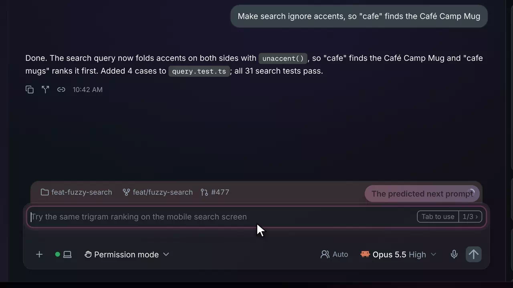
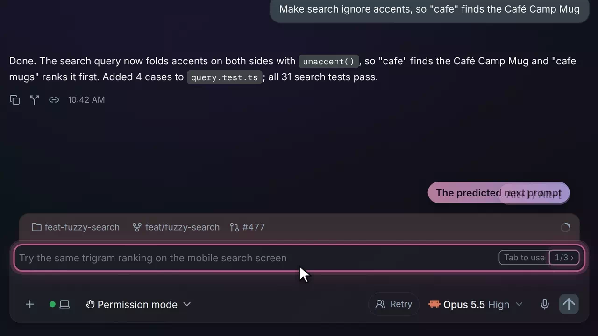
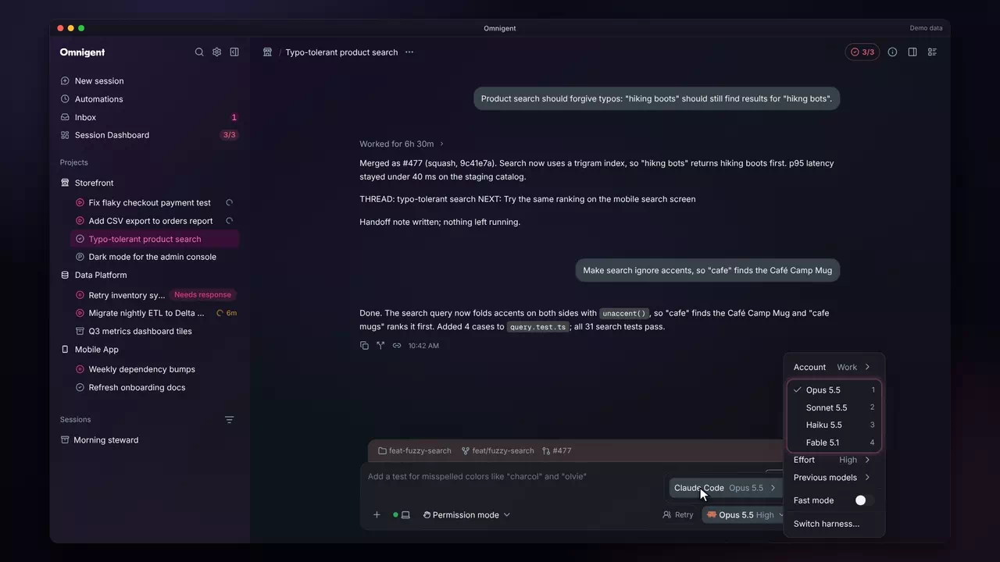
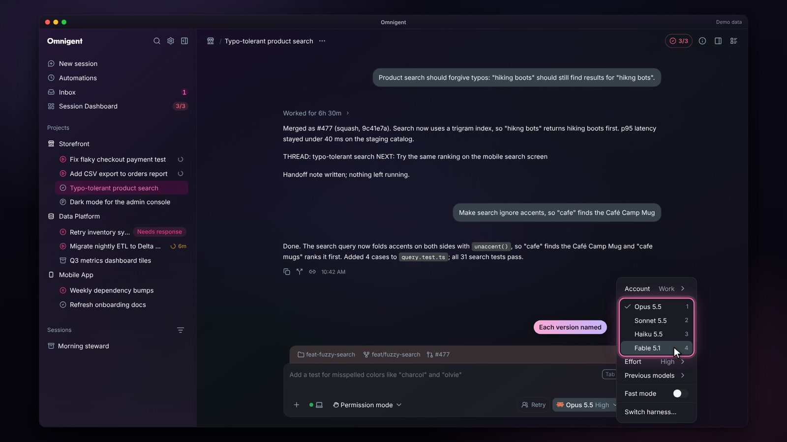
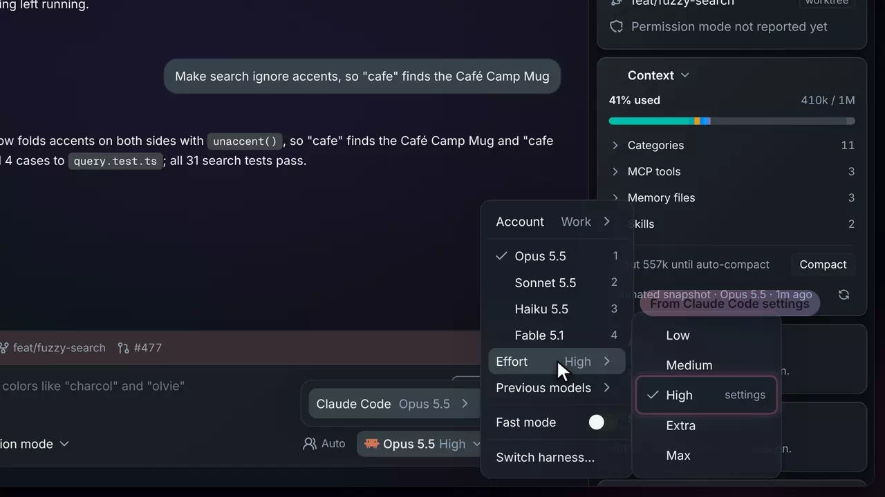
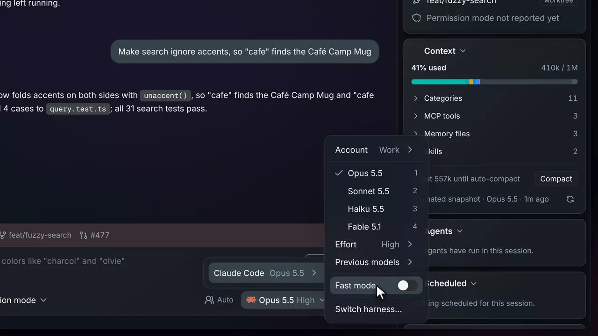
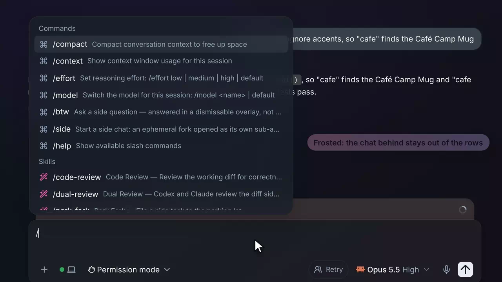
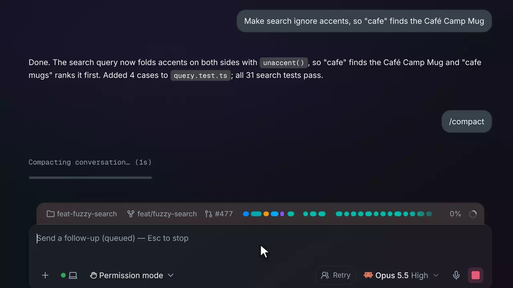

# Composer

Inside a session &middot; [All features](README.md)

Stock Omnigent's composer sends your prompt to the session and lets you pick its model and effort. The fork has it guess your next prompt, names every Claude model version, shows the effort a session really runs at, and makes the slash menu and compaction easier to read.

## Prompt suggestions

When a turn finishes, a short Haiku side call predicts what you will type next, and the composer shows it as grey ghost text over the empty box. Tab fills it in without sending, so you can edit it first; typing anything hides it. It works in Claude sessions on any account and in Codex sessions too. The suggestion stays until your next prompt, so a reload or a second tab still shows it.

**Where:** The composer of any idle session, after a turn ends. The chip on the right reads "Tab to use" ("Tap to use" on a phone). 
**Built from:** core patches [`0123`](../../patches/0123-ae-patch-Predict-the-next-prompt-after-each-Claude-t.patch), [`0128`](../../patches/0128-ae-patch-Predict-the-next-prompt-in-every-session-on.patch), [`0183`](../../patches/0183-ae-patch-Keep-the-composer-s-prompt-suggestion-until.patch)

## Ranked alternatives

The side call offers up to three clearly different guesses, best first. Alt+] and Alt+[ step through them in place, and the counter on the chip (1/3) shows which one you are on. Esc hides them until the next turn.

**Where:** The counter on the suggestion chip, or Alt+] and Alt+[. Settings > Chat lets you rebind the keys. 
**Built from:** core patch [`0132`](../../patches/0132-ae-patch-Offer-up-to-three-ranked-prompt-suggestions.patch)

## Model versions and Previous models

The host names Claude models by family alone (Opus, Sonnet), so the menu never said which version a pick runs. The fork labels each row with its version (Opus 5.5) and lists the older versions your subscription still serves under Previous models, so you can pin a session to one.

**Where:** The model chip under the composer, then the Claude Code row. The New session dialog shows the same list. 
**Built from:** core patch [`0108`](../../patches/0108-ae-patch-Show-Claude-model-versions-and-a-Previous-m.patch)

## A one-column model menu

The menu is one list, as in the Claude desktop app: the check sits before the current model, each model has a digit you can press to pick it while the menu is open, and Account, Effort, Previous models and Fast mode sit below as rows.

**Where:** The model chip under the composer. 
**Built from:** core patches [`0120`](../../patches/0120-ae-patch-Put-the-model-grid-s-check-before-the-name-.patch), [`0134`](../../patches/0134-ae-patch-Show-the-effort-a-Claude-session-runs-at-an.patch)

## The effort a session runs at

With no effort picked, stock Omnigent said nothing about the level Claude Code would use. The fork reads it: first the per-model `effortLevel` in Claude Code's settings files, tagged "settings", else Claude Code's own default for that model, tagged "default". The chip under the composer carries the level beside the model, as in "Opus 5.5 High".

**Where:** Effort in the model menu, and the model chip under the composer. 
**Built from:** core patches [`0119`](../../patches/0119-ae-patch-Show-the-effort-a-Claude-session-runs-at-wh.patch), [`0124`](../../patches/0124-ae-patch-Read-Claude-Code-s-per-model-effort-levels-.patch), [`0134`](../../patches/0134-ae-patch-Show-the-effort-a-Claude-session-runs-at-an.patch)

## Fast mode

A switch for Claude Code's fast mode, which gives faster Opus output billed to usage credits. It is per session, is enabled only on Opus models, and reads the session's real state each time the menu opens, so the switch never shows off while credits are being spent.

**Where:** Fast mode in the model menu of a Claude session. The host needs per-session fast mode in its Claude settings. 
**Built from:** core patches [`0044`](../../patches/0044-ae-patch-Add-a-Fast-mode-switch-to-the-model-menu-fo.patch), [`0045`](../../patches/0045-ae-patch-Fix-the-review-findings-on-the-Fast-mode-sw.patch)

## Blurred command and file menus

The slash command menu and the @ file mention menu blur the chat behind them, so their rows stay readable over a busy transcript in the dark theme.

**Where:** Type / or @ in the composer. 
**Built from:** core patch [`0153`](../../patches/0153-ae-patch-Blur-what-is-behind-the-slash-command-and-f.patch)

## Token defrag while compacting

While a conversation compacts, a strip of colored token blocks sorts itself in the composer tray with a progress percentage, and the marker left behind shows the token count before and after. Click the strip for a full defragmenter window. It tells you compaction is still running and roughly how far along it is.

**Where:** The composer tray during /compact or an automatic compaction. Turn it off in Settings > Chat. 
**Built from:** core patch [`0097`](../../patches/0097-ae-patch-Play-a-token-defrag-in-the-composer-tray-wh.patch)

---

Previous: [Session rail](session-rail.md) &middot; Next: [Action dock](action-dock.md)
