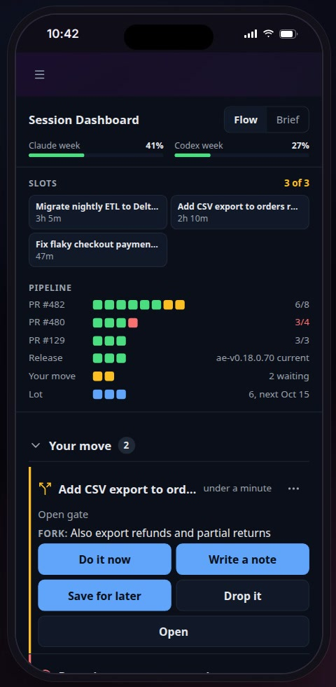
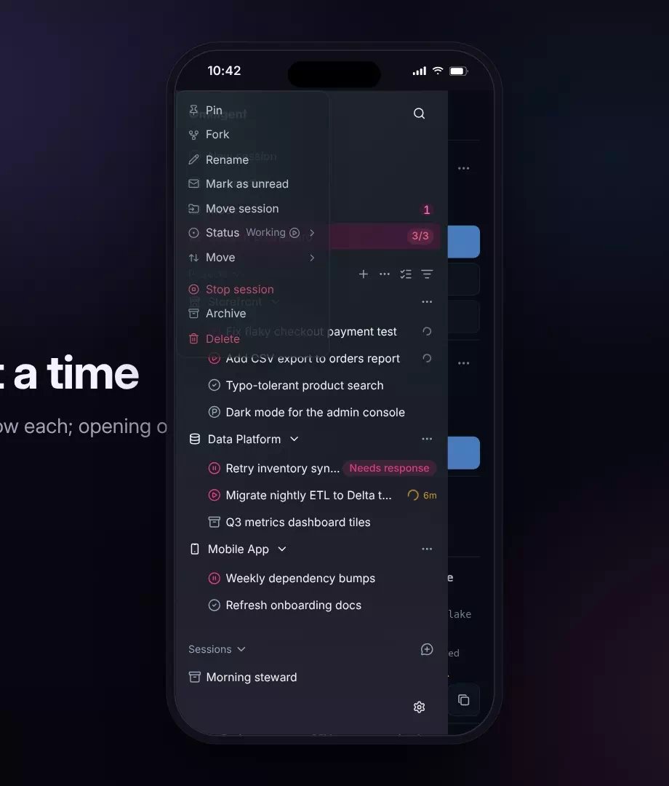
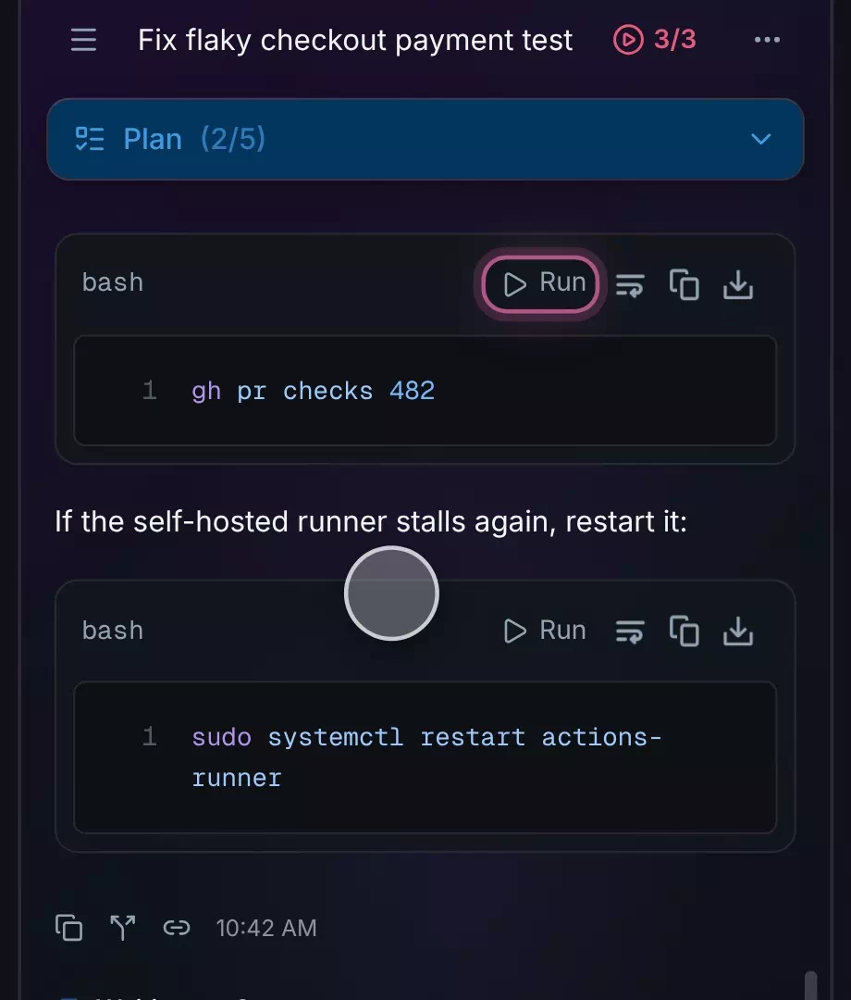
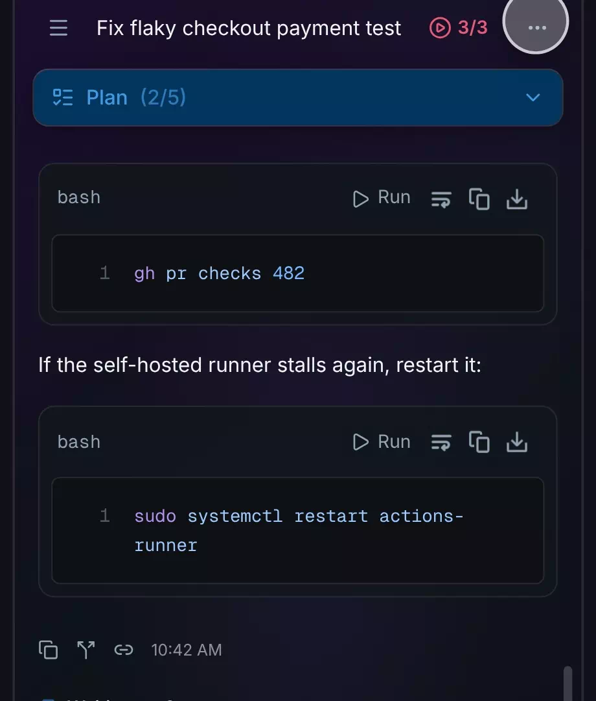
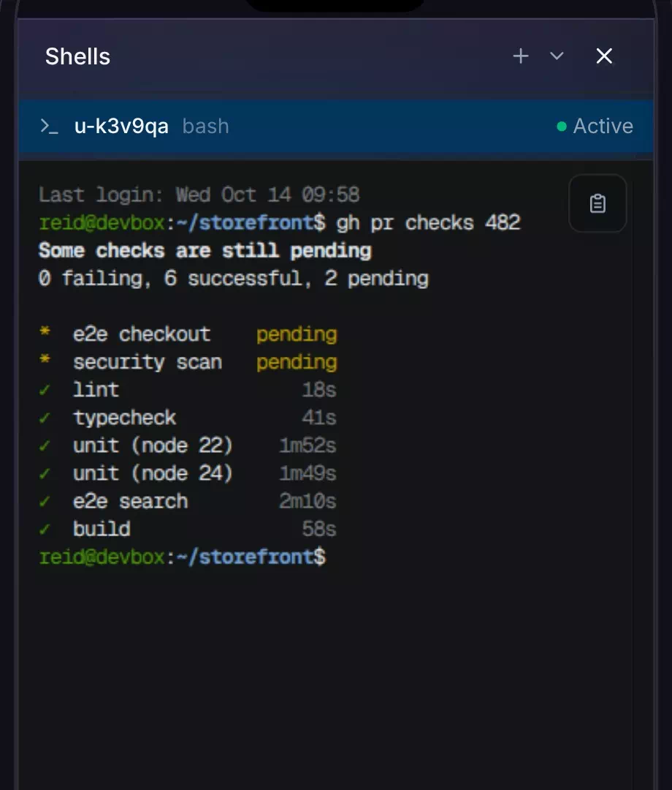
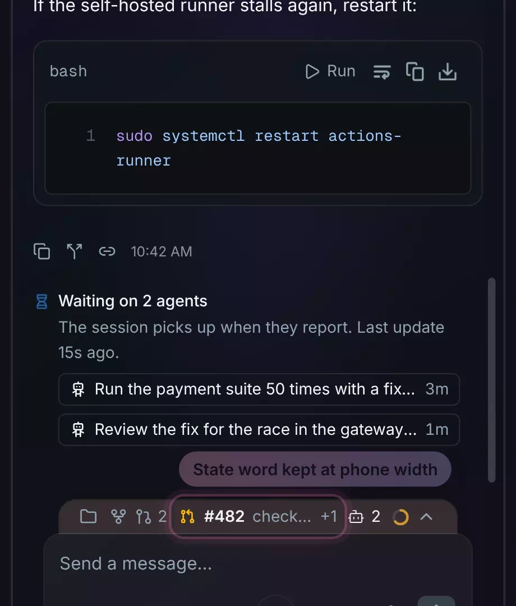
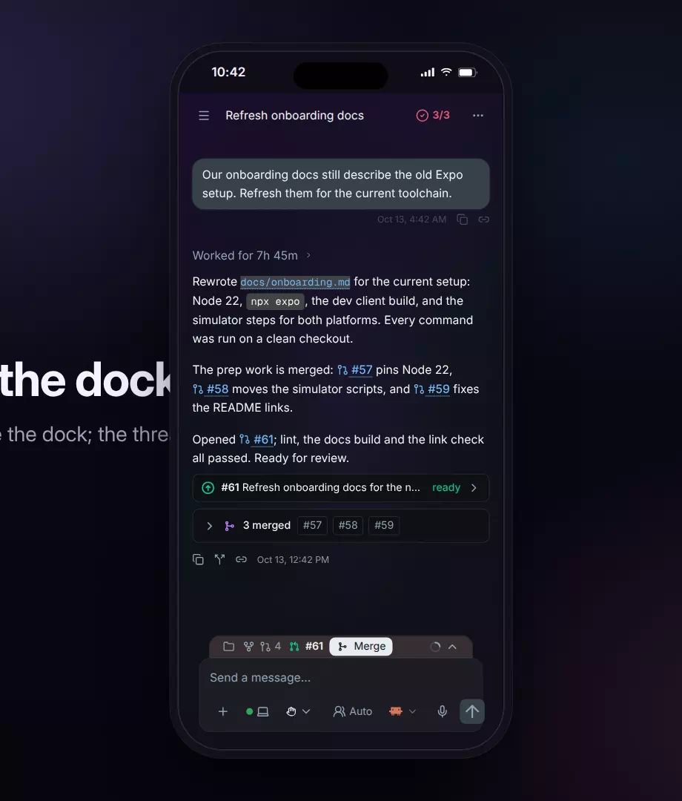
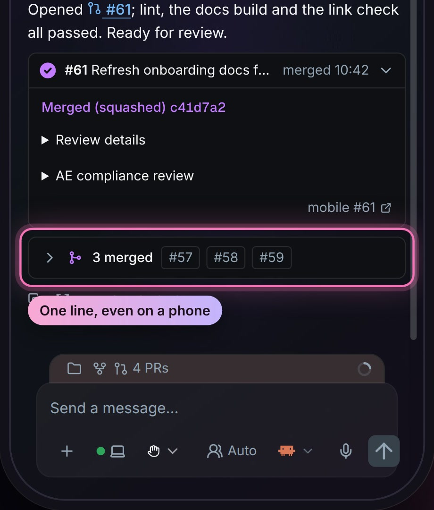

# Phone

On the phone &middot; [All features](README.md)

Stock Omnigent runs in a phone's browser, but its screens are laid out for a desk: long menus, a terminal with no way to paste, and buttons sized for a mouse. The fork makes the parts you need away from a desk work by touch, so you can check on sessions, run a command and merge a pull request from an iPhone.

## Session Dashboard on a phone

The Session Dashboard fits a phone screen: the slots and the pipeline sit at the top, and the decisions waiting on you (Your move, the parking lot, open pull requests) follow as you scroll. You see the whole day in one place without opening each session.

**Where:** Session Dashboard in the sidebar. 
**Built from:** [`packages/ae_omni_extension`](../../packages/ae_omni_extension)

## Status and Move fold in the session menu

On a phone, a session's menu shows Status and Move as one row each, with the current status beside its name. Tapping a row opens its items in place under it, and opening one closes the other, so the menu stays short enough to fit the screen.

**Where:** Open the sidebar and long press a session. 
**Built from:** core patches [`0121`](../../patches/0121-ae-patch-Fold-the-phone-session-menu-s-Status-and-Mo.patch), [`0122`](../../patches/0122-ae-patch-Open-one-phone-menu-fold-at-a-time-and-scro.patch)

## Run a code block in the session's shell

Shell code blocks in a reply get a Run button. One tap opens a sheet with the exact text, and Run pastes it into the session's own shell and presses Enter, so you can follow the agent's instructions without typing a command on a phone keyboard.

**Where:** Run on any shell code block in a chat. 
**Built from:** core patches [`0011`](../../patches/0011-ae-patch-Add-a-Run-button-to-chat-shell-code-blocks-.patch), [`0013`](../../patches/0013-ae-patch-Fix-Run-on-chat-code-blocks-paste-timing-sh.patch), [`0143`](../../patches/0143-ae-patch-Infer-bracketed-paste-for-a-shell-prompt-on.patch)

## Risky commands named before they run

Before anything is sent, the Run sheet names risky commands such as sudo, rm -rf, curl piped to a shell, and dd, and explains what happens next (a sudo password is typed in the terminal, never on the page). Cancel leaves the shell untouched.

**Where:** The Run sheet, when the block holds a risky command. 
**Built from:** core patches [`0011`](../../patches/0011-ae-patch-Add-a-Run-button-to-chat-shell-code-blocks-.patch), [`0013`](../../patches/0013-ae-patch-Fix-Run-on-chat-code-blocks-paste-timing-sh.patch)

## A Paste button in the terminal

A long press on a phone terminal offers no Paste, so the web terminal shows a Paste button on touch devices. It pastes the clipboard without pressing Enter, so you can check the line before you run it.

**Where:** The clipboard button at the top right of a shell, from the session menu's Shells. 
**Built from:** core patches [`0016`](../../patches/0016-ae-patch-Add-a-Paste-button-to-the-web-terminal-on-t.patch), [`0017`](../../patches/0017-ae-patch-Fix-the-terminal-Paste-button-s-review-find.patch)

## Waiting pull requests keep their state

The action dock in the composer's bar gathers what waits on you in a session, every open pull request included. On a phone, the collapsed dock keeps a waiting pull request's state word, such as checks 6/8, beside its number, so you can see what it waits on without opening anything. Tap the caret to list them all.

**Where:** The action dock in the composer's bar. 
**Built from:** core patches [`0137`](../../patches/0137-ae-patch-Add-an-action-dock-above-the-composer-for-q.patch), [`0141`](../../patches/0141-ae-patch-Put-the-action-dock-inside-the-composer-s-w.patch), [`0152`](../../patches/0152-ae-patch-Show-every-open-pull-request-in-the-action-.patch), [`0154`](../../patches/0154-ae-patch-Keep-the-waiting-line-s-state-word-on-a-pho.patch)

## Merge from the action dock

When a pull request is ready, the dock offers Merge. Tapping it opens the merge method as a segmented control, with Cancel and the confirm button on the next row, sized for a thumb. After the merge, the pull request's one-line receipt in the chat shows when it merged.

**Where:** Merge in the action dock. 
**Built from:** core patches [`0021`](../../patches/0021-ae-patch-Restyle-the-merge-card-for-phones-with-a-se.patch), [`0022`](../../patches/0022-ae-patch-Put-the-merge-confirm-step-on-one-row-and-r.patch), [`0137`](../../patches/0137-ae-patch-Add-an-action-dock-above-the-composer-for-q.patch), [`0141`](../../patches/0141-ae-patch-Put-the-action-dock-inside-the-composer-s-w.patch), [`0150`](../../patches/0150-ae-patch-Turn-the-thread-s-PR-card-into-a-one-line-r.patch); [`packages/ae_omni_policies`](../../packages/ae_omni_policies)

## Merged pull requests on one line

Pull requests that are already merged fold into one row under the message that names them, with their numbers beside the count. On a phone the numbers stay on one line and scroll sideways when they do not fit, so the row never grows into a block.

**Where:** Under a chat message that names merged pull requests. 
**Built from:** core patch [`0146`](../../patches/0146-ae-patch-Keep-the-merged-pull-request-row-s-numbers-.patch)

---

Previous: [Admin Center](admin-center.md) &middot; Next: [Triage and policies](triage-and-policies.md)
