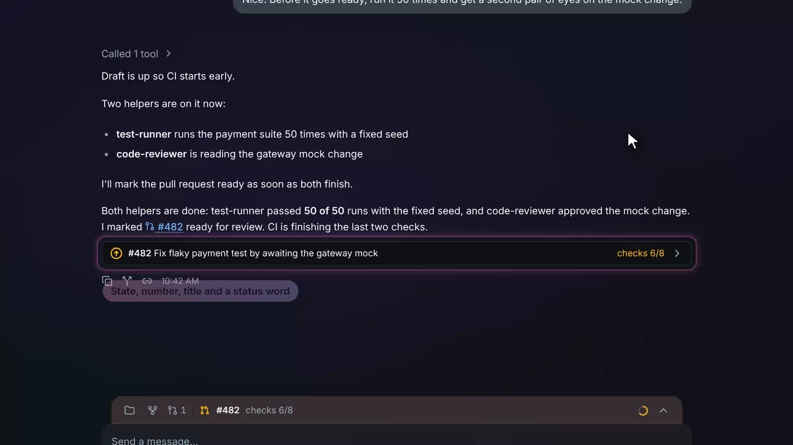
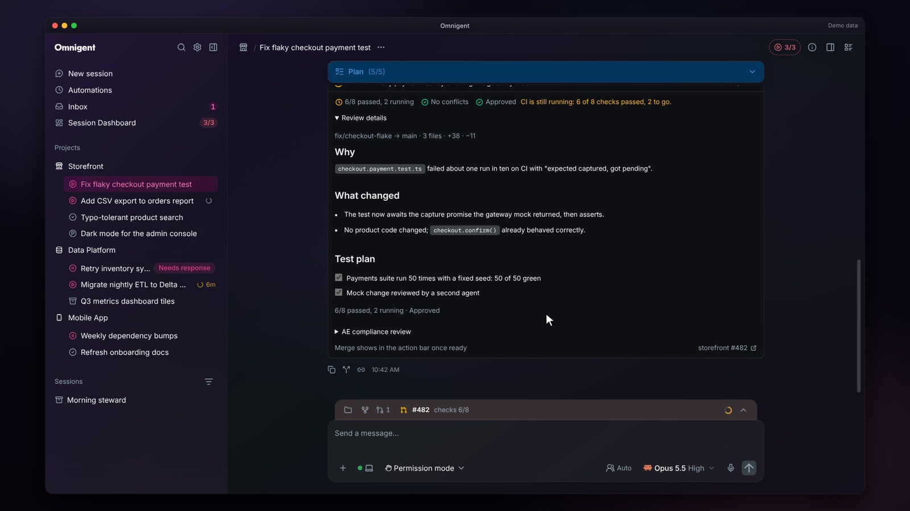
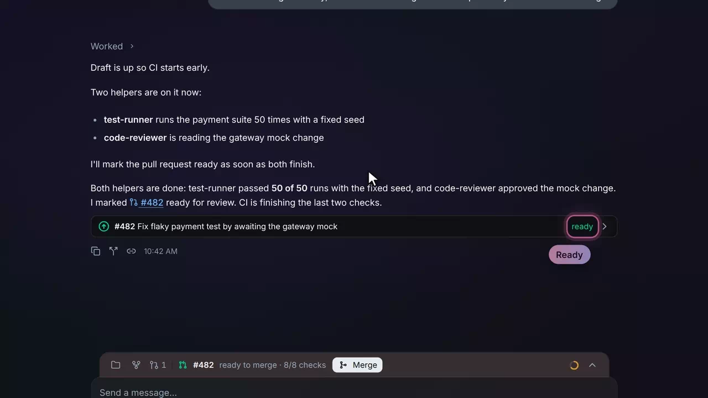
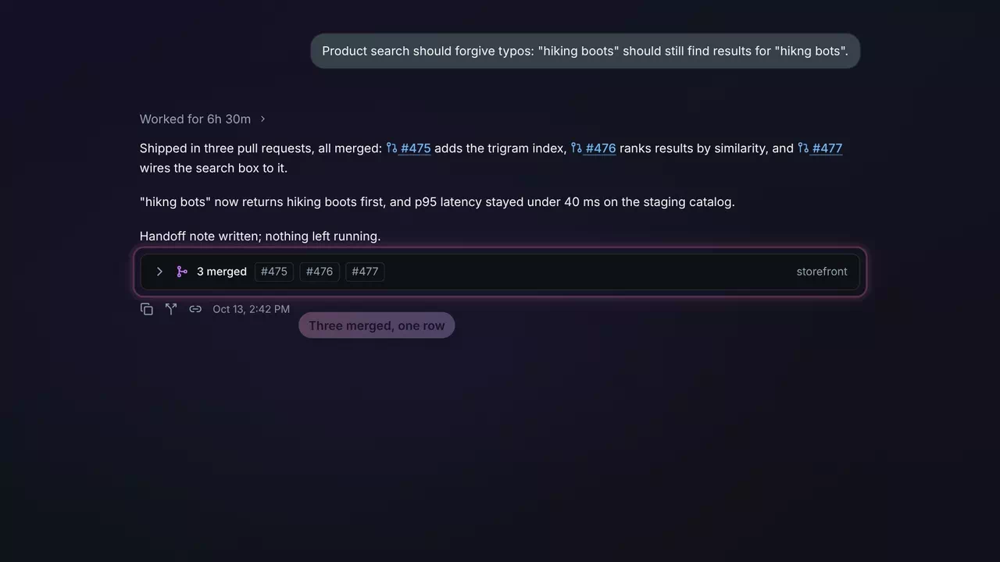
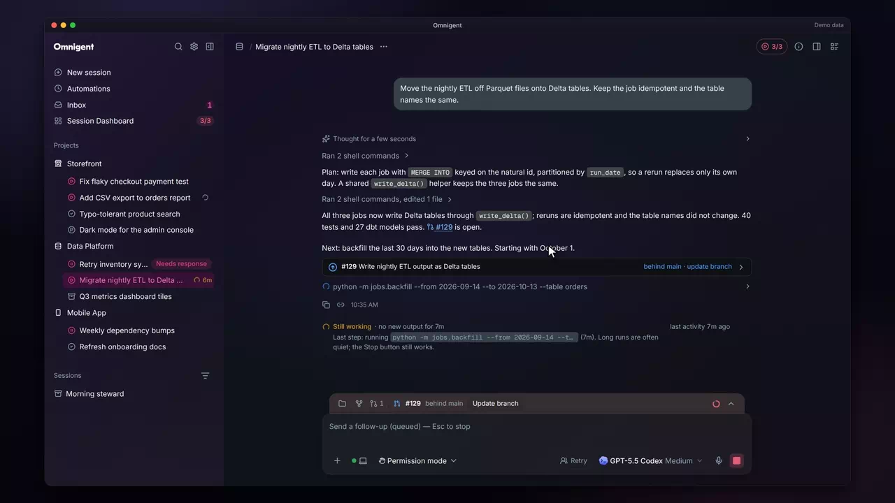
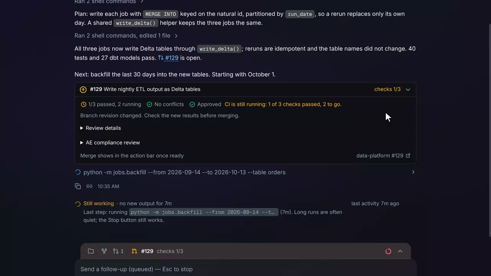

# Pull requests

Agents and pull requests &middot; [All features](README.md)

Stock Omnigent tracks each session's pull requests and reviews them in the GitHub side panel. The fork records each one in the chat as well: a one-line receipt under the message that names it, which opens onto its checks, description, branch update and compliance review. Merging happens in one place, the action dock, so the chat never shows two Merge buttons.

## One-line receipt

Under a finished message that names a pull request the session tracks, a receipt shows its state icon, number, title and a status word: checks 6/8 while CI runs, a failed check, behind main, ready, or merged with the time. The icon and the word come from one rule, so their colors always agree. A link merely quoted from another session gets no receipt.

**Where:** Under any agent message that links a pull request of this session. 
**Built from:** core patches [`0012`](../../patches/0012-ae-patch-Show-a-merge-card-per-tracked-pull-request-.patch), [`0026`](../../patches/0026-ae-patch-Put-a-pull-request-card-s-chips-outcome-and.patch), [`0037`](../../patches/0037-ae-patch-Calm-the-pull-request-cards-a-state-icon-on.patch), [`0039`](../../patches/0039-ae-patch-Fix-the-review-findings-on-the-calmer-pull-.patch), [`0150`](../../patches/0150-ae-patch-Turn-the-thread-s-PR-card-into-a-one-line-r.patch); [`packages/ae_omni_policies`](../../packages/ae_omni_policies)

## The opened receipt

Clicking a receipt opens it in place: the checks with how many passed while the rest still run, mergeability and review, Review details with the branch, the size of the change and the description rendered as markdown, and a line that says where to act ("Merge from the action bar"). A draft gets Mark ready for review, which opens it for review without merging.

**Where:** Click a receipt; open Review details inside it. 
**Built from:** core patches [`0061`](../../patches/0061-ae-patch-Add-in-app-pull-request-review-controls.patch), [`0068`](../../patches/0068-ae-patch-Render-a-pull-request-card-s-description-as.patch), [`0069`](../../patches/0069-ae-patch-Say-how-many-checks-passed-while-CI-is-stil.patch), [`0150`](../../patches/0150-ae-patch-Turn-the-thread-s-PR-card-into-a-one-line-r.patch); [`packages/ae_omni_policies`](../../packages/ae_omni_policies)

## Hover preview on links

Resting the pointer on a chat link to a pull request shows a small preview: open, draft, merged or closed, the repository and number, the title, the author, the size of the change and, while it is open, its checks. A tap on a phone still just follows the link.

**Where:** Any link to a GitHub pull request in a chat message. 
**Built from:** core patch [`0118`](../../patches/0118-ae-patch-Preview-a-pull-request-when-the-pointer-res.patch); [`packages/ae_omni_policies`](../../packages/ae_omni_policies)

## Merged pull requests fold

Merged and closed pull requests under one message fold into a single row ("3 merged #475 #476 #477"), so a finished session does not end on a stack of cards. Each number is a link with the same hover preview, and opening the row lists one titled line per pull request, each opening its detail.

**Where:** Under a message that links pull requests that have since merged or closed. 
**Built from:** core patches [`0129`](../../patches/0129-ae-patch-Fold-merged-and-closed-pull-requests-under-.patch), [`0131`](../../patches/0131-ae-patch-Link-each-number-in-the-merged-pull-request.patch)

## Update branch

A pull request that is behind its base reads "behind main · update branch", and its opened receipt has Update branch, which merges the base into the branch at the head the receipt showed. The receipt says it is waiting for GitHub, then that the revision changed, and the checks start over.

**Where:** An opened receipt for a pull request behind its base, or its line in the action dock. 
**Built from:** core patch [`0072`](../../patches/0072-ae-patch-Add-branch-updates-and-compliance-reports-t.patch); [`packages/ae_omni_policies`](../../packages/ae_omni_policies)

## Compliance review

AE compliance review fetches the review comment posted on the pull request and renders it as markdown, with its verdict and whether it covers the branch's current revision, so you can see that approval still holds before you merge.

**Where:** AE compliance review in an opened receipt or a GitHub panel card. 
**Built from:** core patch [`0072`](../../patches/0072-ae-patch-Add-branch-updates-and-compliance-reports-t.patch); [`packages/ae_omni_policies`](../../packages/ae_omni_policies)

## Recommended merge method and Mark session done

When you merge, the confirm step preselects the method the server recommends (a merge commit when the head is a long-lived branch, otherwise squash) and says why. After the merge the receipt offers Mark session done, which frees a slot, only once no other pull request of the session is still open; otherwise it says how many are.

**Where:** Merge in the action dock or on a GitHub panel card, then the merged receipt. 
**Built from:** core patches [`0020`](../../patches/0020-ae-patch-Offer-Review-after-a-merge-only-when-it-was.patch), [`0028`](../../patches/0028-ae-patch-Preselect-and-tag-the-recommended-merge-met.patch); [`packages/ae_omni_policies`](../../packages/ae_omni_policies)

---

Previous: [Background agents](background-agents.md) &middot; Next: [Usage and accounts](usage-and-accounts.md)
