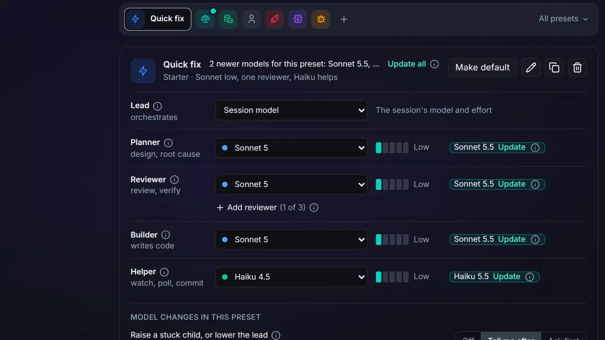
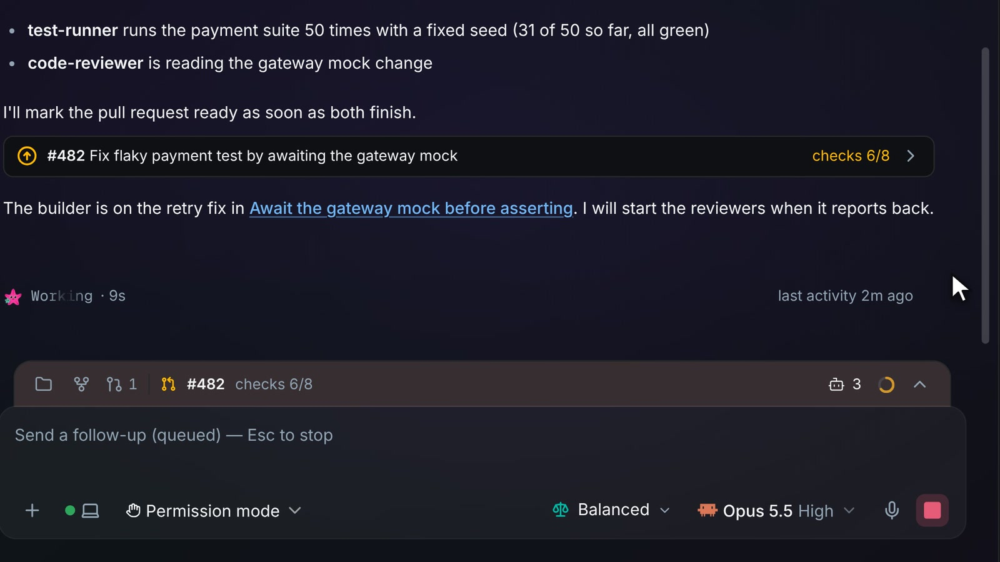
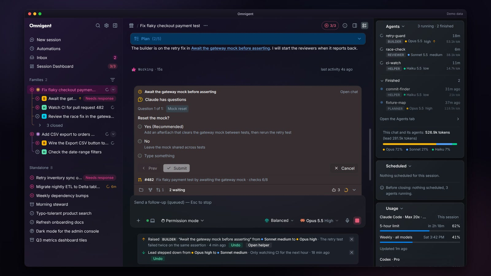

# Roles presets

Roles presets &middot; [All features](README.md)

Stock Omnigent lets a lead session start subagents and other agent sessions, and each one runs on whatever model it is given. The fork adds roles presets: a named table that gives each role (lead, planner, reviewer, builder and helper) its own model and effort, a pill in the composer to pick one per chat, families that keep a lead's sessions together, and up to three independent reviewers whose findings merge into one verdict.

## Presets in Settings > Roles

Each preset sets the model and effort for five roles: lead, planner, reviewer, builder and helper. The lead can be fixed to a model or follow the session's own (Session model). Presets sit in one row, the default marked with a teal dot and pinned ones as icons, and All presets opens the full list, which you can reorder by drag or with the arrow keys. Each has a title, an icon and a color, a card description and a "when to use" note. The starters (Save tokens, Balanced, Solo, YOLO, Think it through, Deep debug and Quick fix) are ordinary presets you can edit, duplicate or delete, and Restore starters brings them back. A preset that runs the top model at max on every role shows a cost warning. Every role, rule and Preset insights setting has an info icon that explains it on hover, tap or keyboard focus, so the page stays as short as before.

**Where:** Settings > Roles. 
**Built from:** core patches [`0163`](../../patches/0163-ae-patch-Add-Settings-Roles-where-presets-set-each-r.patch), [`0196`](../../patches/0196-ae-patch-Explain-each-preset-insights-spend-and-fami.patch); [`packages/ae_omni_policies`](../../packages/ae_omni_policies)

## Newer models offered, never applied

When the model catalog lists a newer version of a model a preset row uses, such as Sonnet 5.5 for a row on Sonnet 5, the row gets an Update chip naming the newer model, and the preset's header line counts the newer models with Update all. A click changes only that row's model and keeps its effort where the new model offers it; the chip then reads "Was Sonnet 5" with Undo, and Undo all reverts an Update all. Nothing changes until you click and save. The Admin Center's Presets card notes how many presets use an older model, and the preset review files a suggestion for each such row of a preset you have changed, up to three a review, and never refiles one you dismissed. In the reviewer model picker, older models sit in a fold for each platform, with the newest model of each family on top.

**Where:** The rows of a preset in Settings > Roles; the Presets card in the Admin Center. 
**Built from:** core patches [`0198`](../../patches/0198-ae-patch-Put-every-reviewer-on-one-model-dropdown-an.patch), [`0199`](../../patches/0199-ae-patch-Put-the-reviewer-model-picker-s-older-model.patch); [`packages/ae_omni_extension`](../../packages/ae_omni_extension); [`packages/ae_omni_policies`](../../packages/ae_omni_policies)

## The lead reads its preset every turn

Every turn, the lead's notice names the model and effort each role gets and the preset's rules, so the lead starts a builder on a cheaper model instead of its own. A Claude lead is told the tier aliases for its Agent tool; a Codex or other lead gets the roles by model and effort. Sessions the lead starts as helpers are told so, and do not start helpers of their own; a handoff chat it opens is a lead of its own. When a preset fixes the lead's model, picking it switches the session's model too, with a "Lead switched to" toast and Undo.

**Where:** Every chat, on its own; the preset in use shows on the composer's preset pill. 
**Built from:** core patches [`0162`](../../patches/0162-ae-patch-Tell-the-lead-each-turn-which-model-and-eff.patch), [`0166`](../../patches/0166-ae-patch-Deliver-the-lead-s-notice-on-plain-text-nat.patch)

## Pick a preset per chat

The preset pill sits beside the model picker in the composer. Its menu lists Lead picks, where the lead chooses a preset from each one's "when to use" note, then your pinned presets, then More presets for the rest, and Alt 1 to 9 pick by list order. Choosing the default writes nothing on the session, so a later change of default still applies. On a phone the menu is a bottom sheet that opens on the list, not the search box.

**Where:** The preset pill left of the model picker in any chat's composer. 
**Built from:** core patches [`0164`](../../patches/0164-ae-patch-Pick-a-roles-preset-per-session-from-the-di.patch), [`0165`](../../patches/0165-ae-patch-Fold-the-composer-s-Auto-Solo-and-Team-butt.patch), [`0167`](../../patches/0167-ae-patch-Open-the-phone-preset-picker-on-the-list-no.patch), [`0170`](../../patches/0170-ae-patch-Show-pinned-presets-first-in-the-composer-m.patch)

## Start a new chat on a preset

The new-chat screen has the same pill, so a chat can start on the preset you want before its first message. The pick applies when you send the first message, before it is posted, so the first turn runs on it. A `START ON:` line in a chat's first message does the same in words: it sets the preset, or the model and effort, before the message is sent, and shows "Started on" with Undo. Settings > Roles has a switch to stop applying `START ON:` lines.

**Where:** The pill on the new-chat screen, or a `START ON:` line in the first message. 
**Built from:** core patches [`0164`](../../patches/0164-ae-patch-Pick-a-roles-preset-per-session-from-the-di.patch), [`0178`](../../patches/0178-ae-patch-Show-the-roles-preset-pill-on-the-new-chat-.patch)

## Who works on this

The pill's "Who works on this?" row opens a dialog with the lead (Change lead swaps it), the Roles preset row with Customize for this chat's own role table, and the sessions added to this chat, such as Codex for an independent review, each with its own model. Each preset has a Helpers rule: Any agent or session, or Own subagents only, which keeps the work in the lead's own subagents and greys the sessions list. A Reviews line says how this preset reports reviews, such as one merged verdict.

**Where:** The preset pill, then Who works on this? 
**Built from:** core patches [`0030`](../../patches/0030-ae-patch-Add-composer-teams-and-separate-model-conte.patch), [`0032`](../../patches/0032-ae-patch-Add-Auto-collaboration-and-hide-unconfigure.patch), [`0165`](../../patches/0165-ae-patch-Fold-the-composer-s-Auto-Solo-and-Team-butt.patch)

## Independent reviewers, one verdict

A preset's Reviewer role can be a stack of up to three reviewers: a Claude model and effort, run as a native subagent, or another agent such as Codex, started as a fresh session each review so it carries nothing from the last round. Claude and Codex reviewer rows share one model dropdown and an effort bar, and a Codex model carries a Codex tag; another agent keeps its own model and effort dropdowns. The Planner, Builder and Helper rows use the same dropdown (Auto, Claude models, Codex models, each with its older models in a fold), so any of them can run as a Codex child session; other agents stay reviewer-only, and the Lead's dropdown offers Auto, the session model and Claude models. Under the Helpers rule Own subagents only, a Codex Planner, Builder or Helper is skipped, and the row and the lead's notice say so (2026-10-26, so people running the public fork can pick Codex for these roles). With two or more, the lead runs them all at the final review on the same diff, never shows one reviewer's findings to another, and merges them into one verdict; fix checks stay with Reviewer 1. Preset rules choose whether you see the merged verdict alone or each list and then the verdict, and what happens when a reviewer cannot start. A Codex reviewer joins the lead's family, and the lead reports each final review to the preset's run log. Balanced, YOLO, Think it through and Deep debug start with Codex as Reviewer 2.

**Where:** The Reviewer rows of a preset in Settings > Roles (Add reviewer), Customize, and Who works on this? 
**Built from:** core patches [`0169`](../../patches/0169-ae-patch-Let-a-roles-preset-name-up-to-three-reviewe.patch), [`0180`](../../patches/0180-ae-patch-Tell-the-lead-to-start-a-Codex-reviewer-wit.patch), [`0181`](../../patches/0181-ae-patch-Tell-the-lead-to-report-its-final-review-an.patch), [`0198`](../../patches/0198-ae-patch-Put-every-reviewer-on-one-model-dropdown-an.patch), [`0200`](../../patches/0200-ae-patch-Put-the-Planner-Builder-and-Helper-on-the-r.patch); [`packages/ae_omni_policies`](../../packages/ae_omni_policies)

## Rules for model changes and helpers

Each preset carries its own rules. "Raise a stuck child, or lower the lead" is Off, Tell me after or Ask first, and applies both ways; "Lead steps down for mechanical work" moves the lead to the Builder's model for work such as watching CI; and "Automatic raises per child" sets how many raises happen before every raise asks you. Helpers decides whether the lead may hand work to other agents and sessions, or only its own subagents.

**Where:** Model changes in this preset, in Settings > Roles. 
**Built from:** core patches [`0163`](../../patches/0163-ae-patch-Add-Settings-Roles-where-presets-set-each-r.patch), [`0165`](../../patches/0165-ae-patch-Fold-the-composer-s-Auto-Solo-and-Team-butt.patch), [`0174`](../../patches/0174-ae-patch-Show-the-lead-s-model-changes-as-chat-rows-.patch)

## Model changes you can undo

The lead changes a helper's model, or its own, with the `set_session_model` tool, under those rules. The latest change of the lead and of each of its helpers, from the last 24 hours, shows in a band under the composer, newest first: what changed ("Raised the builder from Sonnet medium to Opus high"), the reason and how long ago, with Undo, Open helper and a close box to dismiss it. A helper running above the model it started on carries an amber raise arrow in Grouping > Family and on the Agents card; its tooltip says from which model and how many of its automatic raises are used.

**Where:** The band under the composer, in both the chat and the terminal view. 
**Built from:** core patches [`0174`](../../patches/0174-ae-patch-Show-the-lead-s-model-changes-as-chat-rows-.patch), [`0177`](../../patches/0177-ae-patch-Show-model-changes-in-a-band-above-every-ch.patch), [`0186`](../../patches/0186-ae-patch-Make-the-model-change-band-s-actions-look-c.patch); [`packages/ae_omni_policies`](../../packages/ae_omni_policies)

## Families of sessions

A session that starts other sessions through the orchestrator's `create_session` leads a family: it and every session it started carry the same colored dot before the title, and a fork of any of them joins too. Hover the dot to see who started a row; click it to show only that family, and clear the bar above the list to see everything again. Grouping: Family lists the families first as trees, each lead as the parent row with its sessions on a thin line in the family's color, which replaces the dot, and a letter badge for each one's role, then the Standalone sessions in the current sort. The chevron at the right edge of the lead's row folds its family, and a folded family's chevron carries its open count as a badge, pink when a hidden session waits on you. On hover the lead's title stops at its pin, archive and menu buttons, as any other row's does. Closed sessions fold into one "closed" row under their lead, archived ones included, and archiving a lead from its row or the chat header archives its family with it, after a confirm when some are still open. A family whose lead is archived or not loaded shows a stand-in row in the lead's place; right-click it and Archive family closes the rest of that family the same way, with the same confirm and Undo. A family holds one slot between all its sessions, unless the slot cap counts helpers (see [Triage and policies](triage-and-policies.md)), and one lead may have three of them working at once. With Settings > Chat > "Pin a lead's family" set to Yes (it is No by default), pinning a lead also pins its open sessions, lead first, and unpinning the lead unpins them all, with one Undo. `create_session` takes a `role`, which starts the session on the model and effort your preset sets for it, plus optional `model`, `effort` and `preset` that override it; the session carries `ae.role` and `ae.preset` labels (see `docs/LABELS.md`).

**Where:** The filter icon on the Sessions header, then Grouping > Family; the dot before a session's title, or Show > Family dots to turn the dots off; Settings > Chat > Pin a lead's family. Right-click a stand-in lead row for Archive family. 
**Built from:** core patches [`0161`](../../patches/0161-ae-patch-Mark-session-families-in-the-sidebar-and-co.patch), [`0168`](../../patches/0168-ae-patch-Show-Grouping-Family-as-tree-rows-families-.patch), [`0171`](../../patches/0171-ae-patch-Call-the-Grouping-Family-section-for-sessio.patch), [`0175`](../../patches/0175-ae-patch-Fold-a-family-s-closed-sessions-into-one-ro.patch), [`0184`](../../patches/0184-ae-patch-Show-only-the-name-on-a-family-s-lead-row-a.patch), [`0185`](../../patches/0185-ae-patch-Archive-a-family-s-sessions-with-its-lead-f.patch), [`0187`](../../patches/0187-ae-patch-Replace-a-family-child-s-role-chip-and-rais.patch), [`0188`](../../patches/0188-ae-patch-Pin-a-family-s-open-sessions-with-its-lead-.patch), [`0191`](../../patches/0191-ae-patch-Give-a-family-lead-row-fixed-right-hand-slo.patch), [`0193`](../../patches/0193-ae-patch-Fill-a-family-lead-s-row-and-hover-cards-na.patch), [`0197`](../../patches/0197-ae-patch-Truncate-a-family-lead-s-title-at-its-hover.patch), [`0247`](../../patches/0247-ae-patch-Give-a-stand-in-family-lead-a-right-click-A.patch), [`0248`](../../patches/0248-ae-patch-Fix-the-review-findings-on-the-stand-in-Arc.patch); [`packages/ae_omni_policies`](../../packages/ae_omni_policies)

## A family at a glance

Hover a lead row and the card opens with a Family block: the preset, the sessions it leads as "3 open · 3 closed", the family's total spend as Spend shows sets it (a Tokens and a Cost row under Both), then up to four open sessions by name, waiting first, each with its role letter, its state and an arrow when it was raised. A session that started sessions of its own shows the same block as "Its sessions". Hover a helper to see its role, model, effort and spend, the session that started it and, when it was raised, what it was raised from, when, and why. Rows under "N closed" open the same card.

**Where:** The hover card on any row in Grouping > Family. 
**Built from:** core patches [`0172`](../../patches/0172-ae-patch-Show-each-agent-s-role-model-effort-and-tok.patch), [`0184`](../../patches/0184-ae-patch-Show-only-the-name-on-a-family-s-lead-row-a.patch), [`0189`](../../patches/0189-ae-patch-Show-a-lead-s-family-as-labelled-rows-at-th.patch), [`0193`](../../patches/0193-ae-patch-Fill-a-family-lead-s-row-and-hover-cards-na.patch)

## Preset insights

Settings > Roles ends with Preset insights. Its switch, "Collect run logs and review presets", logs each run (time, cost, raises and the final review) and has a reviewer suggest preset changes on a schedule. How often sets the review to run Weekly, Every 2 weeks (the default) or Monthly, on a Monday morning (the first Monday of the month for Monthly). The block shows the last and next review with Run now, and your suggestions with Apply, Undo and Dismiss; an admin chooses whether the review reads everyone's runs or only their own. The Admin Center's Presets card shows the same runs as numbers.

**Where:** Preset insights, the last block of Settings > Roles. 
**Built from:** core patches [`0181`](../../patches/0181-ae-patch-Tell-the-lead-to-report-its-final-review-an.patch), [`0182`](../../patches/0182-ae-patch-Add-preset-insights-block-to-Settings-Roles.patch), [`0195`](../../patches/0195-ae-patch-Add-a-review-frequency-to-Settings-Roles-We.patch); [`packages/ae_omni_policies`](../../packages/ae_omni_policies)

## Session links read as titles

When a lead's message names another session by its bare URL, the link reads as that session's title instead of a long address, so "The builder is on the retry fix in Await the gateway mock before asserting" says which session it means. The title is looked up once per session and kept for a few minutes. While it loads, or if the lookup fails, the link reads "session" and the first eight characters of its id. A link you write with your own text keeps that text, and a click opens the session inside the app.

**Where:** Any chat message that holds a link to another session. 
**Built from:** core patches [`0203`](../../patches/0203-ae-patch-Show-a-session-s-title-for-a-bare-session-l.patch), [`0205`](../../patches/0205-ae-patch-Fix-the-review-findings-on-session-link-tit.patch)

## A helper's questions reach the lead

When a session the lead started asks a question or needs a permission, the prompt also appears in the lead's action dock, under the helper's title with an Open chat link. The strip shows the helper's name and the question, and Answer opens the real card in the tray. Your answer goes back to the helper that asked, so you never open its chat to unblock it. A setting in Settings > General > Sessions turns the mirror off.

**Where:** The action dock in the composer bar of the lead's chat. 
**Built from:** core patch [`0210`](../../patches/0210-ae-patch-Show-a-session-s-questions-and-prompts-in-i.patch)

---

Next: [Triage and policies](triage-and-policies.md)
