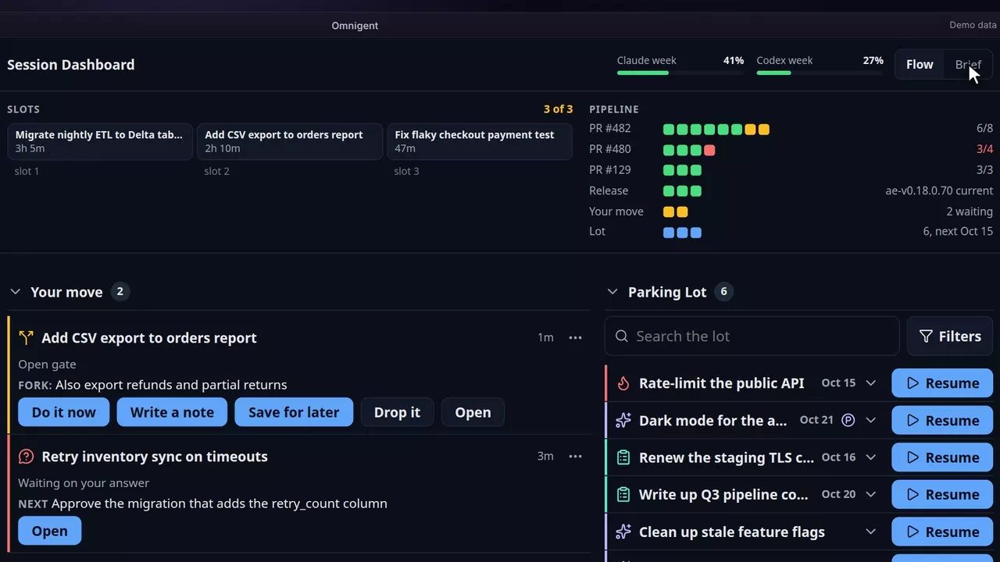
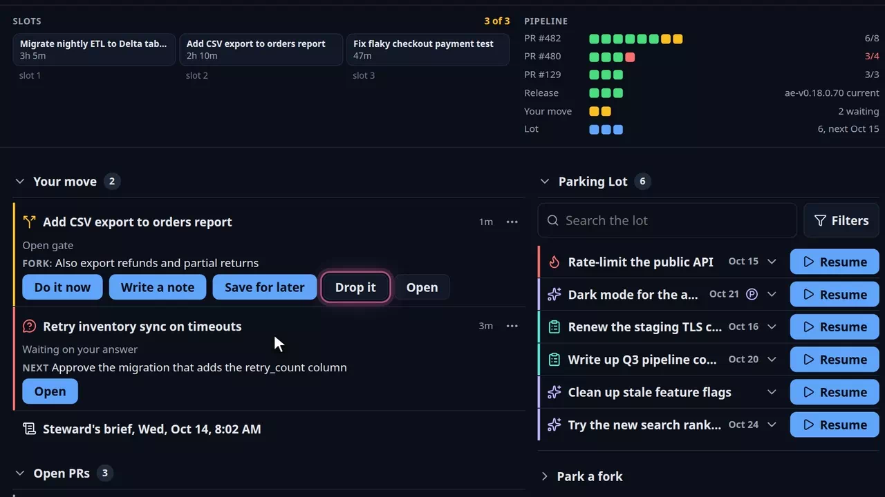
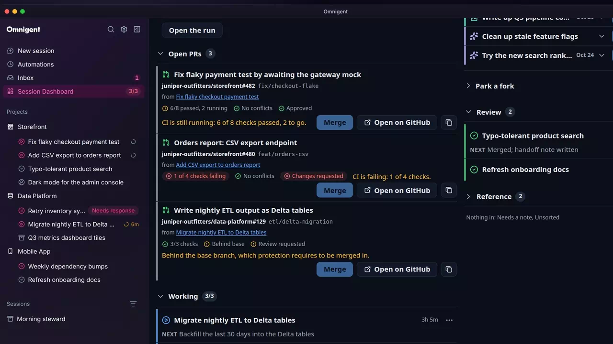

# Session Dashboard

Many sessions &middot; [All features](README.md)

Stock Omnigent lists sessions in the sidebar and collects their questions in the Inbox. The fork adds a Session Dashboard: one page with everything waiting on you, the pull requests your sessions opened, and the work you parked, built around a limit of three working sessions at a time.

## A Session Dashboard row with the slot count

The sidebar gets a Session Dashboard row that shows how many working slots are in use, such as 3/3, and turns red at the limit. The same count rides on the installed app's icon. The row opens the Dashboard, and lights up only while you are on it.

**Where:** The Session Dashboard row in the sidebar, below Inbox and Admin Center. 
**Built from:** core patches [`0002`](../../patches/0002-ae-patch-Add-a-server.request-host-method-and-ae.-la.patch), [`0007`](../../patches/0007-ae-patch-Name-the-slots-row-Dashboard-and-show-the-s.patch), [`0008`](../../patches/0008-ae-patch-Show-the-slot-count-on-the-installed-app-s-.patch), [`0014`](../../patches/0014-ae-patch-Take-the-slot-limit-from-the-server-s-capac.patch), [`0059`](../../patches/0059-ae-patch-Light-the-Dashboard-row-only-on-the-Dashboa.patch), [`0073`](../../patches/0073-ae-patch-Rename-the-sidebar-s-Dashboard-row-to-Sessi.patch); [`packages/ae_omni_extension`](../../packages/ae_omni_extension); [`packages/ae_omni_policies`](../../packages/ae_omni_policies)

## A header in Flow or Brief

The header sums up the morning. Flow shows each slot with how long it has run, one pip per check on every open pull request, the release, Your move and the lot, plus weekly usage bars for Claude and Codex. Brief turns the same read-out into one sentence, worst news first, with the usage windows and release on a line below.

**Where:** The top of the Session Dashboard; Flow and Brief are the toggle at its right. Your choice is remembered. 
**Built from:** [`packages/ae_omni_extension`](../../packages/ae_omni_extension); [`packages/ae_omni_policies`](../../packages/ae_omni_policies)

## Your move

Everything that waits on you comes first: an open fork gate, a question or approval, a blocked session, a session ready for review. A gate card shows the work the agent found and its four answers as buttons, so you can decide without opening the chat. The morning steward's brief sits under the list.

**Where:** Your move, the first section of the Session Dashboard. 
**Built from:** core patches [`0002`](../../patches/0002-ae-patch-Add-a-server.request-host-method-and-ae.-la.patch), [`0025`](../../patches/0025-ae-patch-Let-navigation.openExternal-open-GitHub-pul.patch); [`packages/ae_omni_extension`](../../packages/ae_omni_extension); [`packages/ae_omni_policies`](../../packages/ae_omni_policies)

## Answer a gate from the Dashboard

Each gate button posts the answer to the session as its next message. Save for later files the new work to the Parking Lot, the card leaves Your move, and the session goes back to its own task.

**Where:** Do it now, Write a note, Save for later and Drop it on a gate card in Your move. 
**Built from:** [`packages/ae_omni_extension`](../../packages/ae_omni_extension); [`packages/ae_omni_policies`](../../packages/ae_omni_policies)

## Open PRs, each with the reason it waits

Every open pull request your sessions opened gets a card with its checks, conflicts and review, and one line that says why it cannot merge yet: checks still running, a failing check, changes requested, or a branch behind its base. Merge stays off until that line clears, and Open on GitHub opens the pull request in a new tab.

**Where:** Open PRs on the Session Dashboard. 
**Built from:** core patch [`0025`](../../patches/0025-ae-patch-Let-navigation.openExternal-open-GitHub-pul.patch); [`packages/ae_omni_extension`](../../packages/ae_omni_extension); [`packages/ae_omni_policies`](../../packages/ae_omni_policies)

## The Parking Lot with Resume

Parked work is listed by urgency, return date and tag, with search and filters. Open a task to see its repository, tags and next step, and Resume starts a session from its note.

**Where:** Parking Lot, the right-hand column of the Session Dashboard. It needs a task service (`AE_TASK_STORE_URL`). 
**Built from:** [`packages/ae_omni_extension`](../../packages/ae_omni_extension); [`packages/ae_omni_policies`](../../packages/ae_omni_policies)

---

Next: [Sidebar](sidebar.md)
