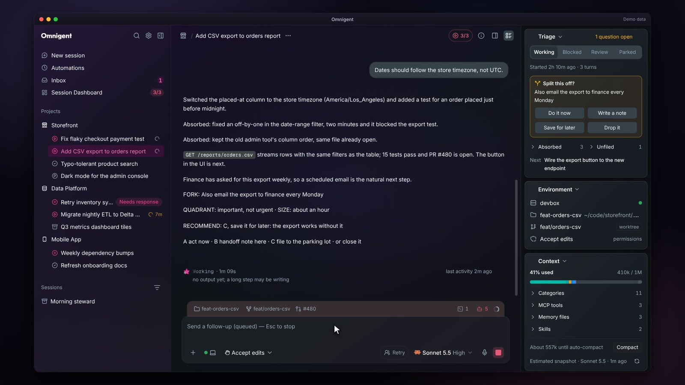
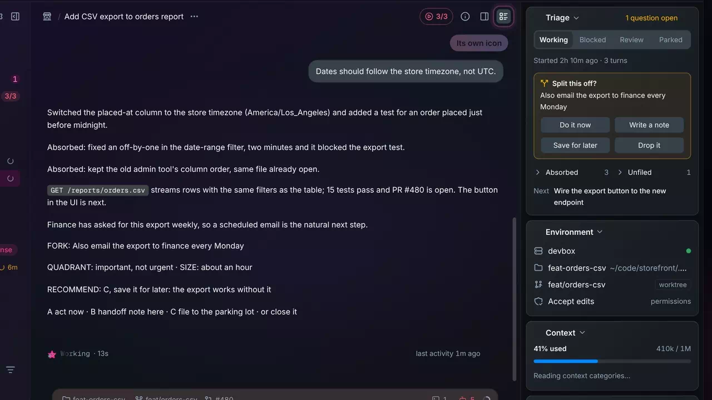
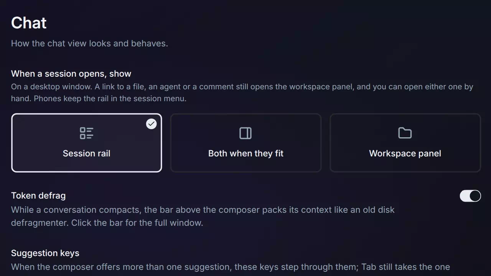
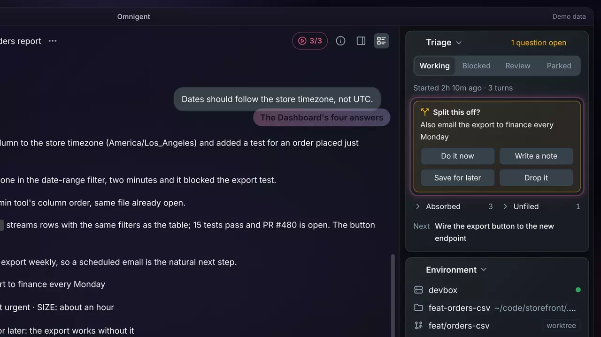
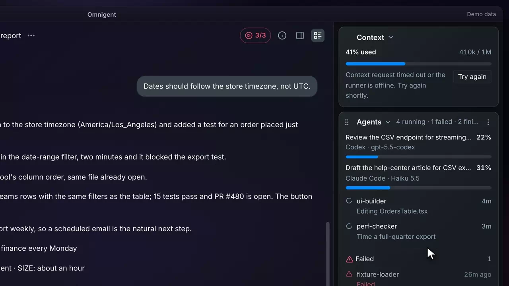
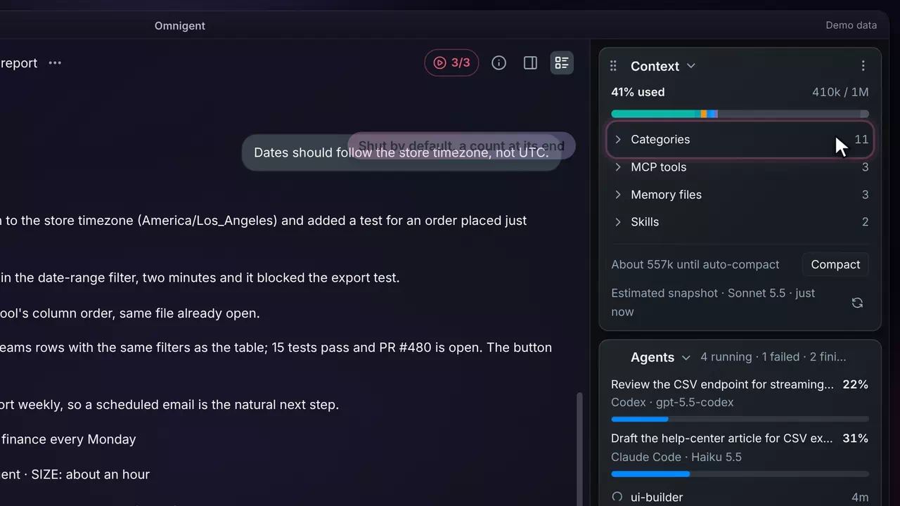
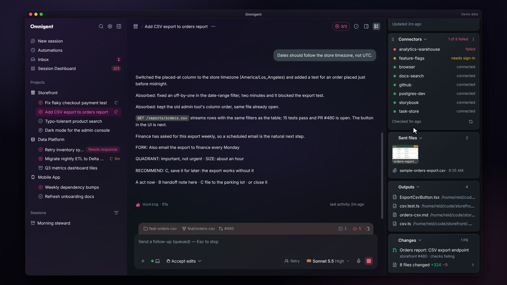
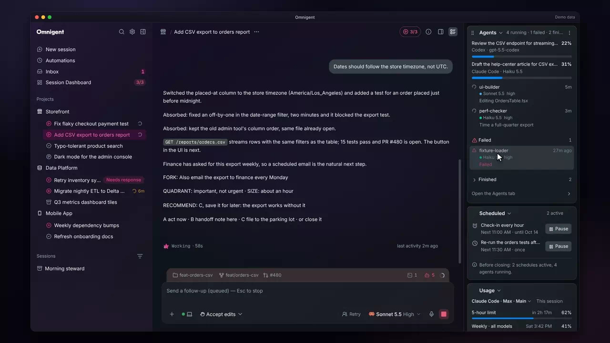
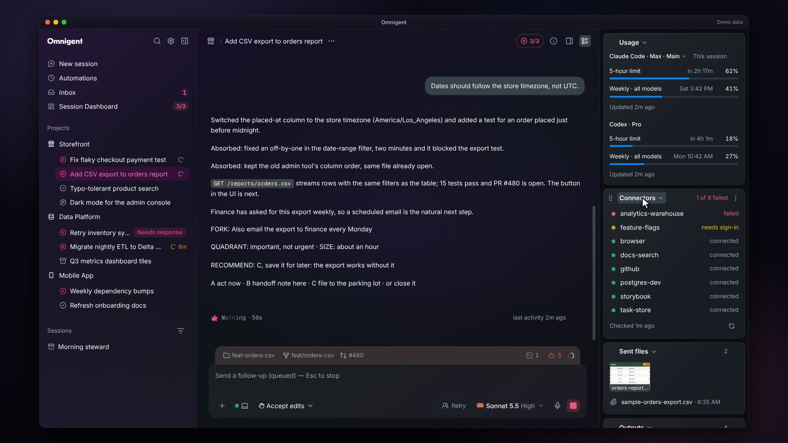

# Session rail

Inside a session &middot; [All features](README.md)

Stock Omnigent spreads a session's details across separate panels, each holding one kind of detail. The fork adds the session rail: one column of folding sections beside the chat for the session's triage, environment, context, agents, schedules, plan limits, connectors and files. Sections reorder by drag, and the order, folds and open state are kept per device.

## A rail beside the chat

The rail docks as a 304 px column whenever the chat keeps at least 480 px, and floats over the chat's right edge on a narrower window instead of squeezing it. On a phone it opens as a full-screen sheet. Every section folds, and its grip drags it into the order you like.

**Where:** The chat header's session rail icon; on a phone, Session rail in the session menu. 
**Built from:** core patches [`0071`](../../patches/0071-ae-patch-Add-a-session-rail-beside-the-chat-and-slim.patch), [`0075`](../../patches/0075-ae-patch-Dock-the-session-rail-whenever-the-chat-kee.patch)

## Its own toggle

The rail has its own icon in the chat header, so it never looks like the workspace panel toggle beside it. It slides in and out with the same motion as the workspace panel, and by default it opens on its own each time you switch sessions.

**Where:** The session rail icon at the right of the chat header. 
**Built from:** core patches [`0085`](../../patches/0085-ae-patch-Give-the-session-rail-toggle-its-own-icon-a.patch), [`0087`](../../patches/0087-ae-patch-Fix-the-review-findings-on-the-rail-s-open-.patch), [`0096`](../../patches/0096-ae-patch-Slide-the-session-rail-in-and-out-with-the-.patch), [`0101`](../../patches/0101-ae-patch-Slide-the-session-rail-out-only-while-the-w.patch)

## Choose what a session shows when it opens

Settings > Chat asks what a session shows when it opens on a desktop window: the session rail (the default, and a workspace panel you left open starts closed), both when the window fits them, or the workspace panel as you left it. A link to a file, an agent or a comment still opens the workspace panel, and phones keep the rail in the session menu.

**Where:** Settings > Chat > When a session opens, show. 
**Built from:** core patch [`0155`](../../patches/0155-ae-patch-Let-Settings-Chat-choose-what-a-session-sho.patch)

## Triage card

Triage comes first: the session's status as a switch (Working, Blocked, Review, Parked), when it started and how many turns it has had, an open fork question with the Session Dashboard's four answers (Do it now, Write a note, Save for later, Drop it), and the Absorbed and Unfiled counts side by side. Opening a count lists its saved notes with a bullet each, even when the message they came from is too old to be loaded.

**Where:** The Triage section at the top of the session rail. 
**Built from:** core patches [`0071`](../../patches/0071-ae-patch-Add-a-session-rail-beside-the-chat-and-slim.patch), [`0098`](../../patches/0098-ae-patch-Put-the-rail-s-Absorbed-and-Unfiled-counts-.patch), [`0100`](../../patches/0100-ae-patch-List-the-notes-saved-on-the-session-in-the-.patch), [`0107`](../../patches/0107-ae-patch-Show-a-bullet-beside-each-note-in-the-rail-.patch)

## Context that waits for Claude

While Claude Code is still starting, Context shows a loading line and retries quietly instead of an error. If the runner is out of reach, it says so at once and offers Try again. An answer that retrying can never fix shows its reason straight away, with no Try again.

**Where:** The Context section of the session rail. 
**Built from:** core patches [`0091`](../../patches/0091-ae-patch-Show-the-rail-s-context-and-connectors-as-l.patch), [`0092`](../../patches/0092-ae-patch-Show-a-permanent-context-answer-at-once-ins.patch), [`0093`](../../patches/0093-ae-patch-Fix-the-review-findings-on-the-rail-s-conte.patch)

## Context categories

Context reads Claude Code's own breakdown of the window: how much each category uses, and how much room is left before auto-compact, with a Compact button beside it. The category rows fold under Categories, shut by default with a count at its end. Opened, each row carries the same color as its part of the bar, and deferred tools sit inside the fold, marked as costing nothing until Claude loads them.

**Where:** Categories in the Context section of the session rail. 
**Built from:** core patches [`0064`](../../patches/0064-ae-patch-Label-context-window-colors-directly-beneat.patch), [`0065`](../../patches/0065-ae-patch-Match-context-legend-colors-to-detailed-cat.patch), [`0071`](../../patches/0071-ae-patch-Add-a-session-rail-beside-the-chat-and-slim.patch), [`0113`](../../patches/0113-ae-patch-Fold-the-rail-s-context-category-rows-under.patch), [`0114`](../../patches/0114-ae-patch-Move-deferred-tools-inside-the-rail-s-Categ.patch), [`0115`](../../patches/0115-ae-patch-Tidy-the-rail-s-Categories-fold-no-gap-whil.patch)

## Connectors

Connectors lists every MCP server the session loaded with its status (connected, needs sign-in, failed), and its folded summary counts the failures, so a broken server shows before a tool call trips on it. It says Checking connectors while Claude starts.

**Where:** The Connectors section of the session rail (folded by default). 
**Built from:** core patches [`0071`](../../patches/0071-ae-patch-Add-a-session-rail-beside-the-chat-and-slim.patch), [`0091`](../../patches/0091-ae-patch-Show-the-rail-s-context-and-connectors-as-l.patch)

## Agents

Agents shows each collaborator's own context reading, then Claude Code's own subagents. A running subagent shows how long it has run and its newest step, a failed one sits in an always-open Failed group, and finished ones fold under Finished. The rail reads the same live list as the Agents tab, so the two always agree.

**Where:** The Agents section of the session rail; Open the Agents tab at its end. 
**Built from:** core patches [`0071`](../../patches/0071-ae-patch-Add-a-session-rail-beside-the-chat-and-slim.patch), [`0111`](../../patches/0111-ae-patch-List-running-and-finished-Claude-Code-subag.patch), [`0130`](../../patches/0130-ae-patch-Show-a-failed-subagent-under-its-own-Failed.patch)

## Usage for this session's account

Usage shows the plan limits of both harnesses, with the plan this session runs on first and tagged This session. For a Claude session it reads the limits of the Claude account the session runs on, named beside the plan, so sessions on different accounts never share a reading. The account name is a menu of the host's Claude logins: pick one to read its limits while the chat stays on its own. A new chat on another account shows that account's usage before its first reply.

**Where:** The Usage section of the session rail; the account name beside the plan opens the menu. 
**Built from:** core patches [`0071`](../../patches/0071-ae-patch-Add-a-session-rail-beside-the-chat-and-slim.patch), [`0078`](../../patches/0078-ae-patch-Record-each-Claude-session-s-account-beside.patch), [`0202`](../../patches/0202-ae-patch-Name-a-Claude-session-s-account-at-launch-a.patch), [`0208`](../../patches/0208-ae-patch-Show-a-chat-s-live-Claude-login-in-the-Usag.patch)

---

Previous: [Split view](split-view.md) &middot; Next: [Composer](composer.md)
