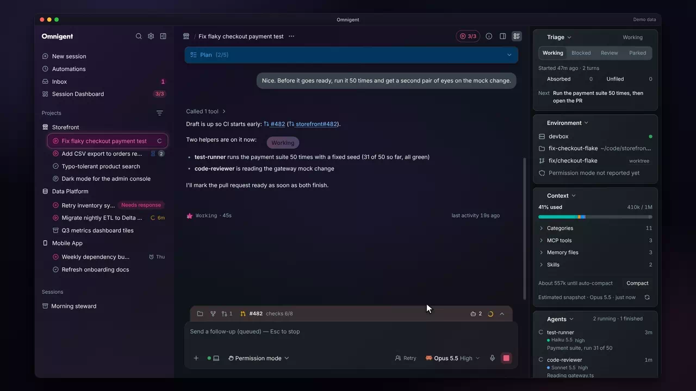
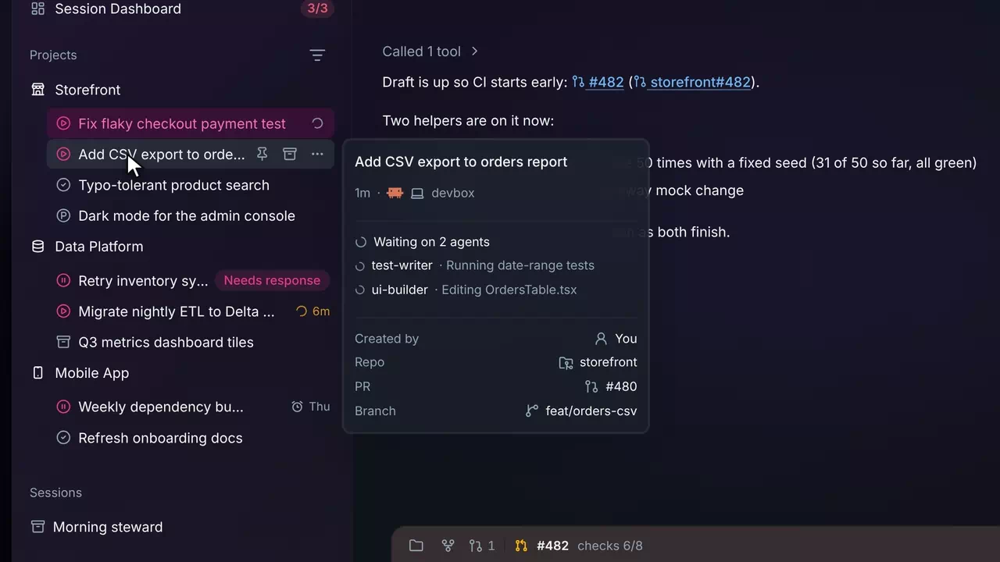
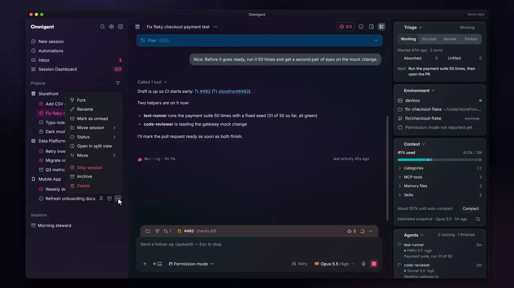
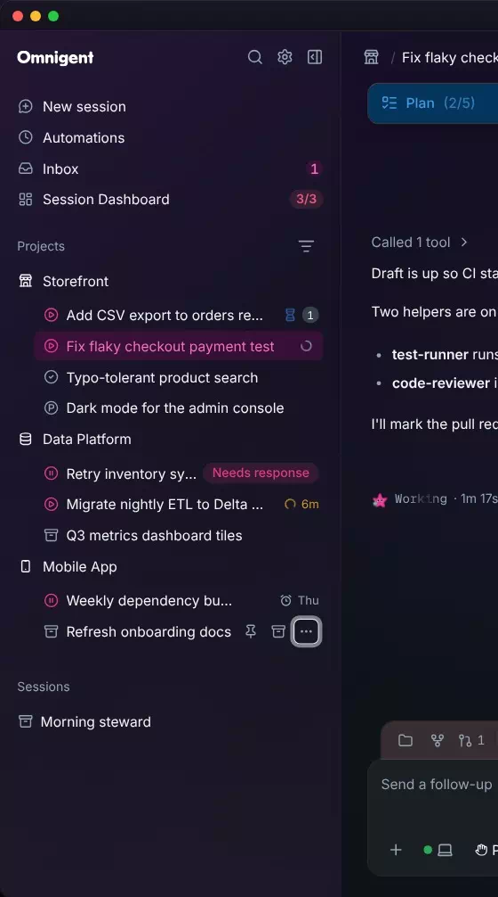
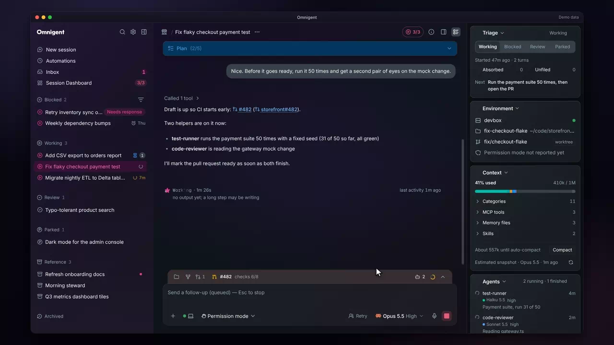
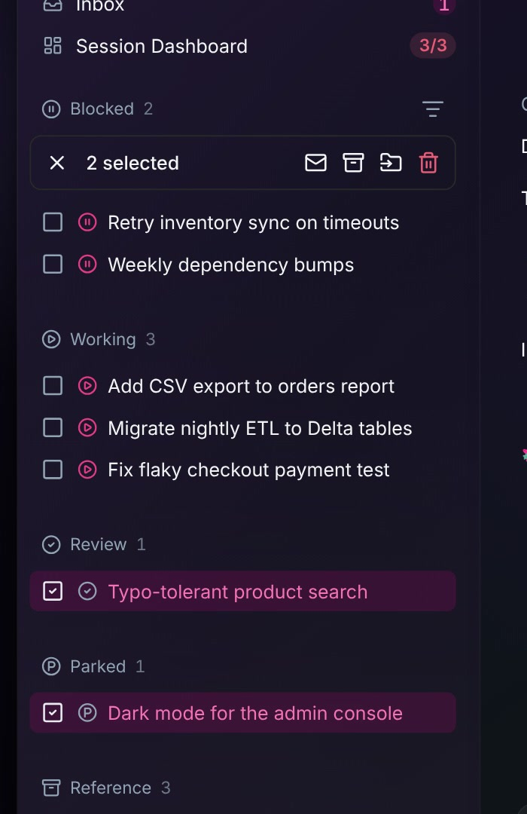

# Sidebar

Many sessions &middot; [All features](README.md)

Stock Omnigent's sidebar marks a session as running, or as waiting on you. In the fork, every row says what its session is doing, whether you have opened it or not. You can also set each session's triage status from the row and group, sort or drag the list by that status.

## Every row shows what its session is doing

A spinner means working. An hourglass with a count means the session's own turn is over and it waits on that many helper agents, and the count drops live as they report back. An amber spinner means no new output for five minutes or more, and an alarm shows when a scheduled check-in will wake a paused session. Every row shows this, not only the one you have open.

**Where:** Every session row in the sidebar. 
**Built from:** core patches [`0074`](../../patches/0074-ae-patch-Show-when-a-session-is-working-quiet-waitin.patch), [`0088`](../../patches/0088-ae-patch-Show-every-sidebar-row-s-waiting-state-and-.patch), [`0089`](../../patches/0089-ae-patch-Fix-the-review-findings-on-the-sidebar-rows.patch)

## A hover card that says what is happening now

Hover a row and its card shows a status block under the title: how long the turn has run and its newest step, the question waiting on you, or, for a session waiting on agents, each running agent with its latest step. It refreshes while open, so you can check a session without leaving the one you are in.

**Where:** Hover any session row in the sidebar. It needs upstream's `sidebar_grouping_ui` release flag, which the fork's image turns on; without it the stock hover card shows. 
**Built from:** core patch [`0116`](../../patches/0116-ae-patch-Show-what-a-session-is-doing-now-in-its-sid.patch)

## Status icons and the Status menu

Each session carries a triage status (Working, Blocked, Review, Parked or Reference) as its `ae.status` label, shown as an icon at the start of its row. The row menu's Status item sets it. When every slot is taken, Working is refused with a note that names the sessions holding them.

**Where:** The ... menu on a session row, or a right-click on the row, then Status. 
**Built from:** core patches [`0001`](../../patches/0001-ae-patch-Show-the-ae.status-label-on-session-rows-an.patch), [`0004`](../../patches/0004-ae-patch-Add-a-Status-submenu-to-the-sidebar-session.patch); [`packages/ae_omni_policies`](../../packages/ae_omni_policies)

## Group and order sessions by status

Grouping: Triage splits the list into Blocked, Working, Review, No status, Parked and Reference, each with its icon and count, then a collapsed Archived group. Ordering: Status keeps your grouping and sorts each list by status icon, then by activity.

**Where:** The filter icon on the Projects or Sessions header, then Grouping or Ordering. The menu needs upstream's `sidebar_grouping_ui` release flag, which the fork's image turns on; without it the filter menu offers only Display. 
**Built from:** core patches [`0102`](../../patches/0102-ae-patch-Group-sidebar-sessions-by-triage-status-and.patch), [`0109`](../../patches/0109-ae-patch-Sort-sessions-by-status-icon-under-Ordering.patch); [`packages/ae_omni_policies`](../../packages/ae_omni_policies)

## Drag to reorder

Drag a row where it belongs, or use Move on its menu, and the sidebar switches to Manual order. A toast says where to switch back. The order is saved for your account, so other devices see it too, and Settings > Chat can reset it.

**Where:** Drag a session row, or use its ... menu, then Move. 
**Built from:** core patches [`0102`](../../patches/0102-ae-patch-Group-sidebar-sessions-by-triage-status-and.patch), [`0105`](../../patches/0105-ae-patch-Reorder-sessions-by-drag-in-any-Ordering-sw.patch), [`0126`](../../patches/0126-ae-patch-Wait-out-dnd-kit-s-click-blocker-after-each.patch); [`packages/ae_omni_policies`](../../packages/ae_omni_policies)

## Bulk select in a narrow sidebar

Select puts a checkbox on every row and a bar with the count and its actions, such as archive, move to a project and delete. In a narrow sidebar the bar keeps its icons inside the edge and shows a bare count.

**Where:** Select sessions on the Projects or Sessions header. 
**Built from:** core patch [`0103`](../../patches/0103-ae-patch-Keep-the-bulk-select-bar-inside-a-narrow-si.patch)

---

Previous: [Session Dashboard](session-dashboard.md) &middot; Next: [Split view](split-view.md)
