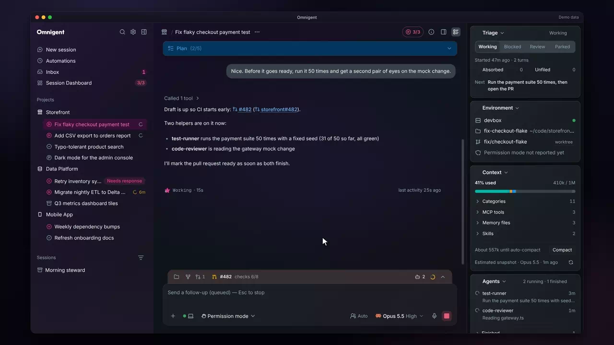
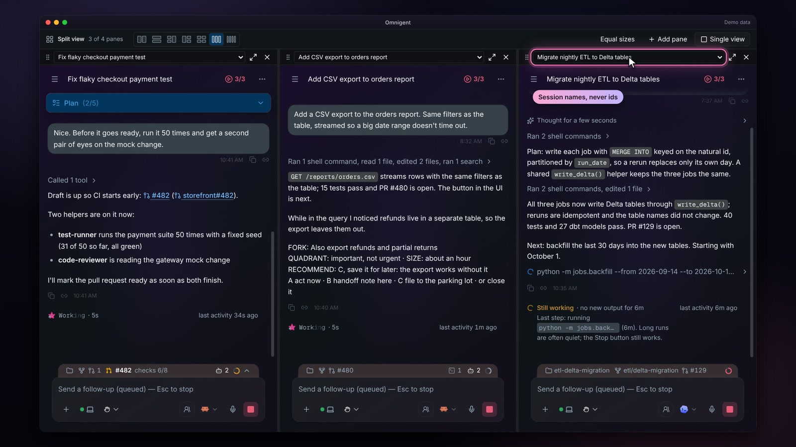
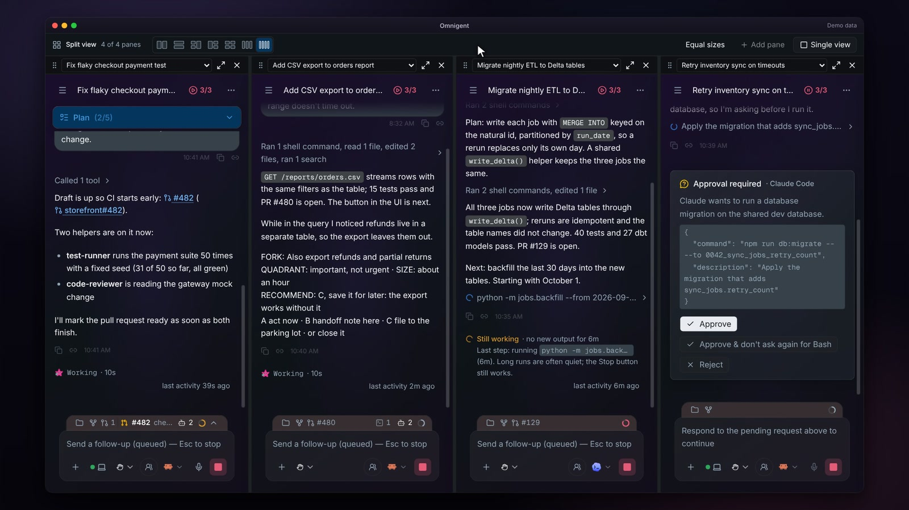
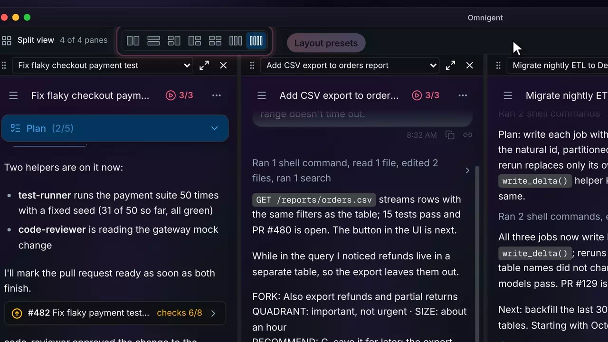
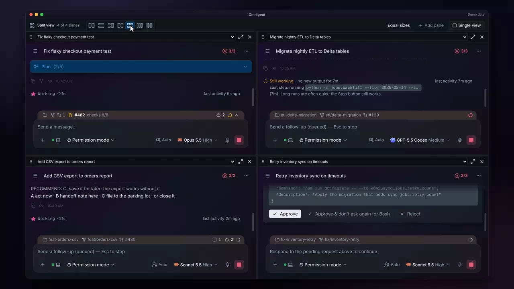
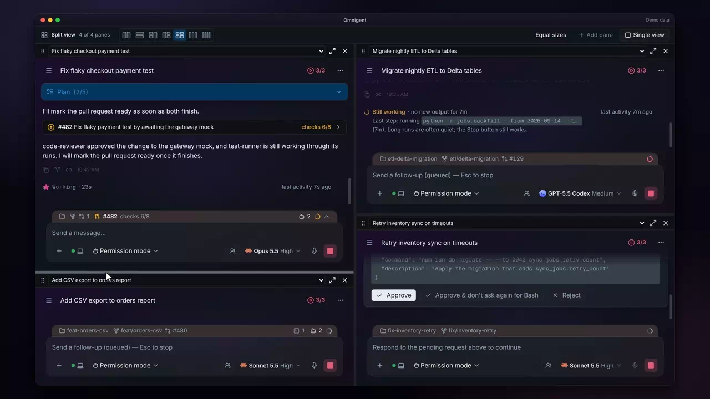
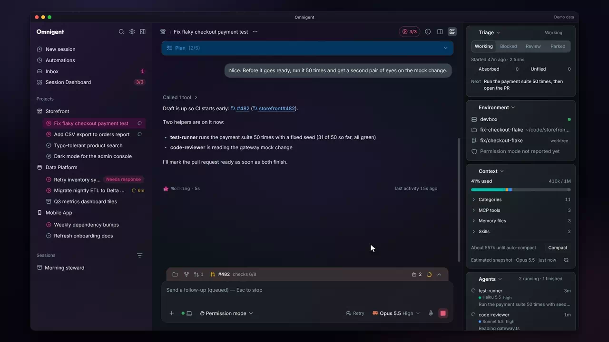

# Split view

Many sessions &middot; [All features](README.md)

Stock Omnigent shows one session at a time. The fork adds a split view that keeps up to four sessions live in one window, each in its own pane with its own chat, composer and approvals. It also keeps the right side of a single session tidy: the workspace panel and the session rail take turns instead of covering each other.

## Open in split view

Every session's menu has Open in split view. It puts that session in a pane beside the one you are reading, so you can compare two sessions or keep an eye on one while you work in the other. The layout lives in the URL and in local storage, so a reload brings the same panes back.

**Where:** The three-dot menu on any session in the sidebar, then Open in split view. 
**Built from:** core patch [`0005`](../../patches/0005-ae-patch-Add-a-split-view-that-shows-up-to-four-sess.patch)

## Pane pickers that show session names

Each pane has a picker at the top that lists your sessions by name. A pane on a session the sidebar has not loaded (older, shared or archived) fetches its own name, reads "Loading..." while it does, and marks an archived one "(archived)", so a pane never shows a raw session id.

**Where:** The picker at the top of each pane; Add pane opens a new one. 
**Built from:** core patches [`0084`](../../patches/0084-ae-patch-Show-session-names-never-ids-in-the-split-v.patch), [`0086`](../../patches/0086-ae-patch-Fix-the-review-findings-on-the-split-view-s.patch)

## Four live sessions at once

Every pane stays live: one session streams its reply while another waits on your approval, and you can answer it in place. Closing a pane never stops its session, and Open alone shows a pane's session by itself. In a pane about as narrow as a four-up column, the composer drops the voice button and host badge and tightens its gaps, so Send and Interrupt stay inside the composer instead of running past its edge. In the narrowest panes the roles preset control is hidden too.

**Where:** Add pane in the split view's top bar; Open alone and Close on each pane's strip. 
**Built from:** core patches [`0005`](../../patches/0005-ae-patch-Add-a-split-view-that-shows-up-to-four-sess.patch), [`0212`](../../patches/0212-ae-patch-Keep-the-composer-s-buttons-inside-it-in-na.patch)

## Layout presets

A picker in the top bar holds seven layouts: two side by side, two stacked, two plus one and its mirror, a two by two grid, and three or four side by side. Changing the layout never reloads a pane, so its stream and draft stay as they were. Adding a pane past the layout's slots grows to the next layout that fits.

**Where:** The layout icons at the left of the split view's top bar. 
**Built from:** core patch [`0010`](../../patches/0010-ae-patch-Add-layout-presets-two-axis-dividers-and-pa.patch)

## Dividers in both directions

Dividers resize the columns and the panes stacked in a column, by pointer or by arrow keys. Equal sizes puts them back.

**Where:** The lines between panes; Equal sizes in the top bar. 
**Built from:** core patch [`0010`](../../patches/0010-ae-patch-Add-layout-presets-two-axis-dividers-and-pa.patch)

## Swap panes by the grip

Drag a pane by the grip at the left of its strip and drop it on another pane, and the two trade places without reloading. The arrow keys do the same from the keyboard.

**Where:** The grip at the left of each pane's strip. 
**Built from:** core patch [`0010`](../../patches/0010-ae-patch-Add-layout-presets-two-axis-dividers-and-pa.patch)

## One right-hand pane at a time

In a window too narrow for both, the workspace panel and the session rail no longer overlap. Open the panel and the rail slides out; open the rail and the panel closes. A rail that made way for a panel comes back once nothing needs the room.

**Where:** The right panel toggle and the session rail toggle in the chat header. 
**Built from:** core patches [`0083`](../../patches/0083-ae-patch-Show-one-right-hand-pane-at-a-time-when-the.patch), [`0087`](../../patches/0087-ae-patch-Fix-the-review-findings-on-the-rail-s-open-.patch), [`0096`](../../patches/0096-ae-patch-Slide-the-session-rail-in-and-out-with-the-.patch), [`0101`](../../patches/0101-ae-patch-Slide-the-session-rail-out-only-while-the-w.patch)

---

Previous: [Sidebar](sidebar.md) &middot; Next: [Session rail](session-rail.md)
