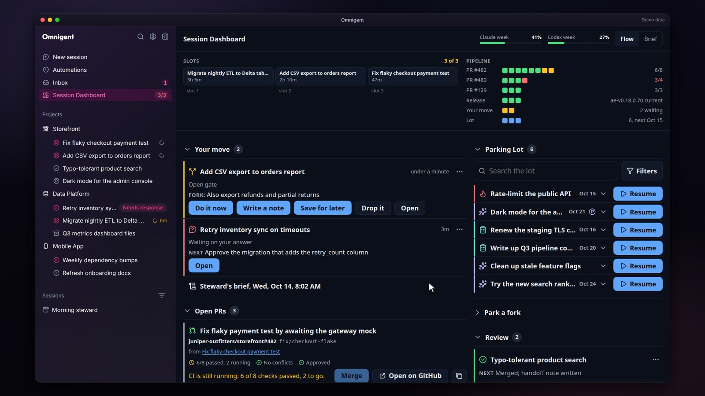
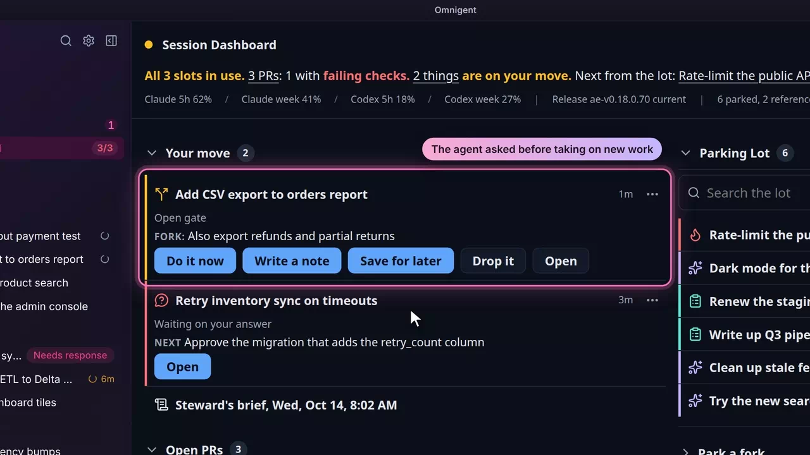
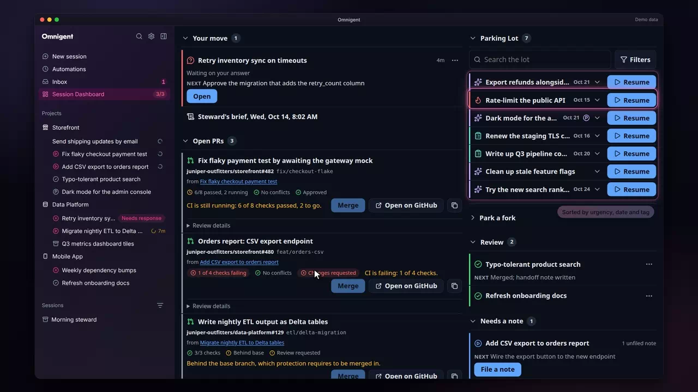
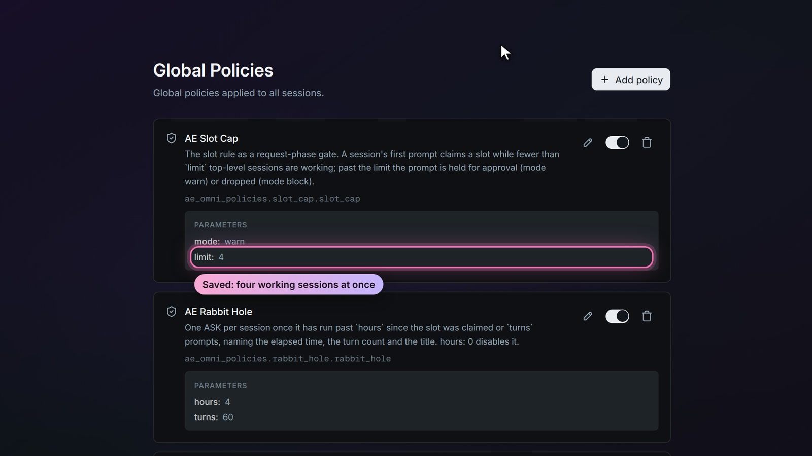

# Triage and policies

Triage and policies &middot; [All features](README.md)

Stock Omnigent has policies: small functions that see each prompt and tool call and can allow it, ask first, or deny it. The fork uses that seam for a way of working, so the rules live in the product instead of in every prompt. Each one below is a global policy, switched and edited on Settings > Global Policies.

## A cap on working sessions

Every session carries a status (working, blocked, review, parked or reference) as its `ae.status` label. The first prompt in a session claims a working slot. Once the limit is reached (three by default, set with `AE_SLOT_LIMIT` in the server's environment, or with the slot cap's `limit` on Settings > Global Policies, which replaces it), the next prompt is held with a warning or blocked, and the reply names the sessions holding the slots; typing `ride unparked` runs one more anyway. A blocked or failed session holds no slot. A family of sessions holds one slot through its lead; the slot cap's `helpers_count` parameter (off by default) makes each working helper hold a slot of its own as well. Without it, a helper holds no slot, even when its lead is parked, archived or gone. Every slot count in the UI follows the same number.

**Where:** The slots strip on the Session Dashboard, and Status on any session's menu. 
**Built from:** core patches [`0001`](../../patches/0001-ae-patch-Show-the-ae.status-label-on-session-rows-an.patch), [`0004`](../../patches/0004-ae-patch-Add-a-Status-submenu-to-the-sidebar-session.patch), [`0035`](../../patches/0035-ae-patch-Count-only-unblocked-unfailed-working-sessi.patch), [`0190`](../../patches/0190-ae-patch-Count-working-helper-sessions-toward-the-sl.patch); [`packages/ae_omni_policies`](../../packages/ae_omni_policies)

## The fork gate

When a second piece of work shows up mid-task, an agent whose instructions include triage rules stops and asks in a message that starts with `FORK:`, with four answers: do it now, write a handoff note, save it to the parking lot, or drop it. The fork reads each saved assistant turn, records the open gate on the session, and the Dashboard and the rail answer it with one click. An optional second model can flag a user message that starts a second deliverable.

**Where:** Your move on the Session Dashboard and the Triage card in the session rail. The rules that teach an agent to write the gate are not in this repository (Analytic Endeavors keeps its own), so add yours to the agent's instructions; the tokens the fork reads are listed in [observer.py](../../packages/ae_omni_policies/src/ae_omni_policies/observer.py). 
**Built from:** core patch [`0003`](../../patches/0003-ae-patch-Add-an-item-observers-registry-the-server-c.patch); [`packages/ae_omni_policies`](../../packages/ae_omni_policies); [`packages/ae_omni_extension`](../../packages/ae_omni_extension)

## Absorbed and Unfiled notes

Small things the agent folds into the current task are marked with an `Absorbed:` line, and work it could not file is marked `UNFILED`. The fork counts both on the session and keeps every note, so you can see how much scope crept in and what still needs a home.

**Where:** The Triage card in the session rail. 
**Built from:** core patches [`0098`](../../patches/0098-ae-patch-Put-the-rail-s-Absorbed-and-Unfiled-counts-.patch), [`0100`](../../patches/0100-ae-patch-List-the-notes-saved-on-the-session-in-the-.patch), [`0107`](../../patches/0107-ae-patch-Show-a-bullet-beside-each-note-in-the-rail-.patch); [`packages/ae_omni_policies`](../../packages/ae_omni_policies)

## The parking lot

Parked work becomes a task with a note a fresh session can resume from: the thread, where it stands, the next physical step, and how urgent it is. The Dashboard lists the lot by urgency, date and tag, and Resume starts a session with the note.

**Where:** The Parking Lot on the Session Dashboard. It needs a task service (`AE_TASK_STORE_URL`); without one the section says how to add it. 
**Built from:** [`packages/ae_omni_policies`](../../packages/ae_omni_policies); [`packages/ae_omni_extension`](../../packages/ae_omni_extension)

## Handoffs that open their own chat

A lead can hand work off by starting a new chat itself: `create_session` with `standalone: true`, the handoff note as the brief and the preset the note names. The new chat holds its own slot, joins no family, and you get its link. When every slot is taken, the lead gives you the note to paste instead.

**Where:** Ask the lead for a handoff; the new chat appears in the sidebar. 
**Built from:** [`packages/ae_omni_policies`](../../packages/ae_omni_policies)

## Closed chats leave the list

A chat that has sat idle in reference for ten minutes, with nothing running and no approval or gate open, is archived the same way the Archive button does it. A chat someone unarchives is left alone until its status changes, and chats shared with anyone else are never archived this way. `AE_AUTO_ARCHIVE=0` turns it off and `AE_AUTO_ARCHIVE_MINUTES` sets the wait.

**Where:** On its own, on the server; the archived chats are under Archived in the sidebar. 
**Built from:** [`packages/ae_omni_policies`](../../packages/ae_omni_policies)

## The rabbit-hole check

Once a session passes four hours or sixty prompts, its next prompt asks before it runs. Accepting covers the rest of that session, so it costs one click, at the moment a long session is most likely to have drifted. Its approval card gives the reason and folds the held request's code under Show details, as the slot cap's warning card does.

**Where:** An approval card in the chat; the hours and prompts are parameters on Settings > Global Policies. 
**Built from:** core patch [`0156`](../../patches/0156-ae-patch-Fold-a-request-phase-approval-card-s-code-u.patch); [`packages/ae_omni_policies`](../../packages/ae_omni_policies)

## Hurry modes

Typing `triage off`, `triage capture` or `triage on` sets the session's `ae.triage` label, and the second-model flag stays quiet while it is set. What each mode does is up to the agent's instructions: in Analytic Endeavors' rules, `off` absorbs each new piece of work with a one-line note and `capture` files every one to the parking lot without asking. The mode is a label on the session, so it never leaks into the next one.

**Where:** Any chat. 
**Built from:** [`packages/ae_omni_policies`](../../packages/ae_omni_policies)

## Agents that ship with it

Four agent specs come with the fork, each a single `agent.yaml` with a short list of tools, and none of them merges anything. Two run on a schedule: a steward writes a brief each weekday morning (what to merge, what resurfaces from the lot today), and a shutdown agent writes a resume note for each working session at the end of the day. The orchestrator starts and briefs sessions when you talk to it, from the phone for example, and checks in on them hourly. `reviewer-codex` reviews on request and is off by default.

**Where:** The steward's brief on the Session Dashboard; the orchestrator from New session. The README's agents table lists each one's schedule and tools. 
**Built from:** core patches [`0029`](../../patches/0029-ae-patch-Add-keep_runs-to-scheduled-tasks-and-a-post.patch), [`0033`](../../patches/0033-ae-patch-File-each-scheduled-task-run-into-the-task-.patch); [`agents`](../../agents)

## Policies you can edit

A new server seeds the fork's policies into Settings > Global Policies. From there an admin switches them on or off, deletes them or edits their parameters (warn or block for the slot cap, the rabbit-hole hours), and each change is checked by building the policy before it saves.

**Where:** Settings > Global Policies. 
**Built from:** core patches [`0094`](../../patches/0094-ae-patch-Check-a-global-policy-s-factory_params-by-b.patch), [`0095`](../../patches/0095-ae-patch-Edit-a-global-policy-s-parameters-on-the-Gl.patch); [`packages/ae_omni_policies`](../../packages/ae_omni_policies)

---

Previous: [Roles presets](roles-presets.md) &middot; Next: [Session Dashboard](session-dashboard.md)
