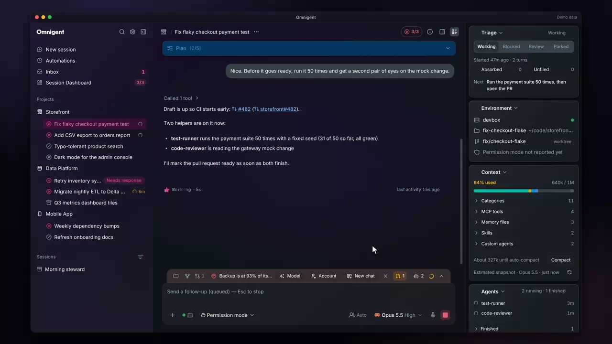
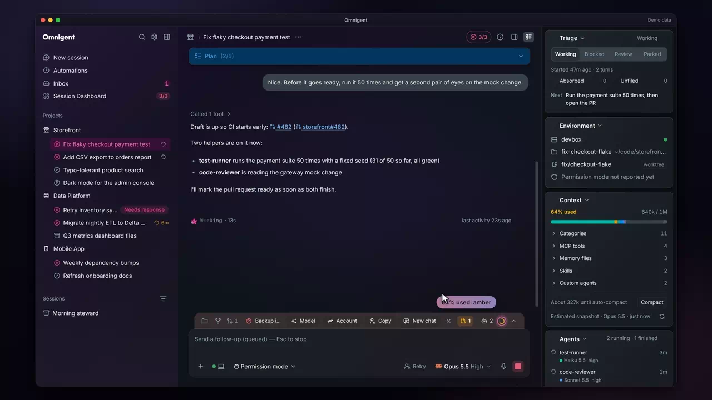
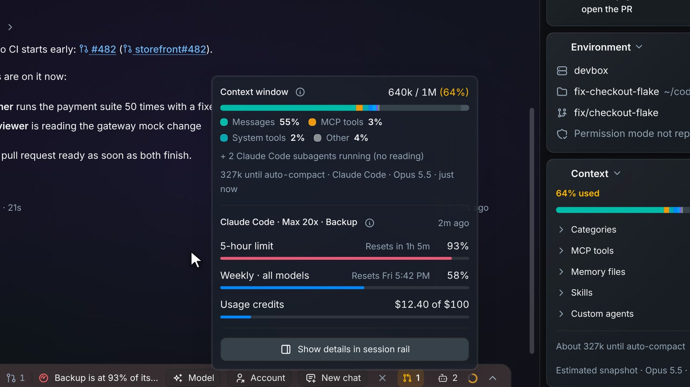
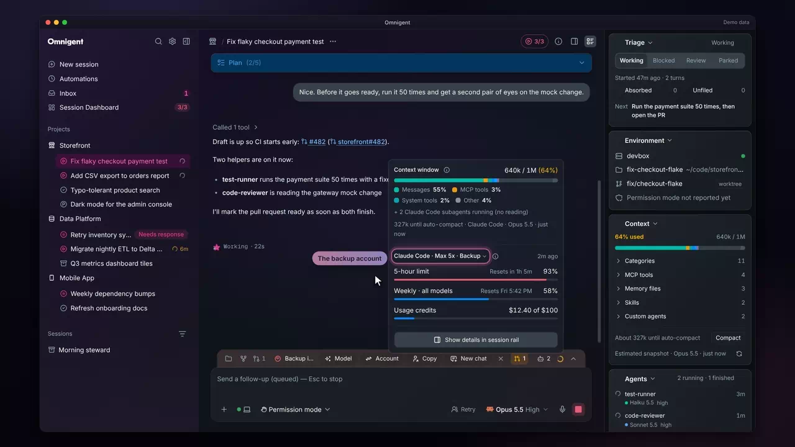
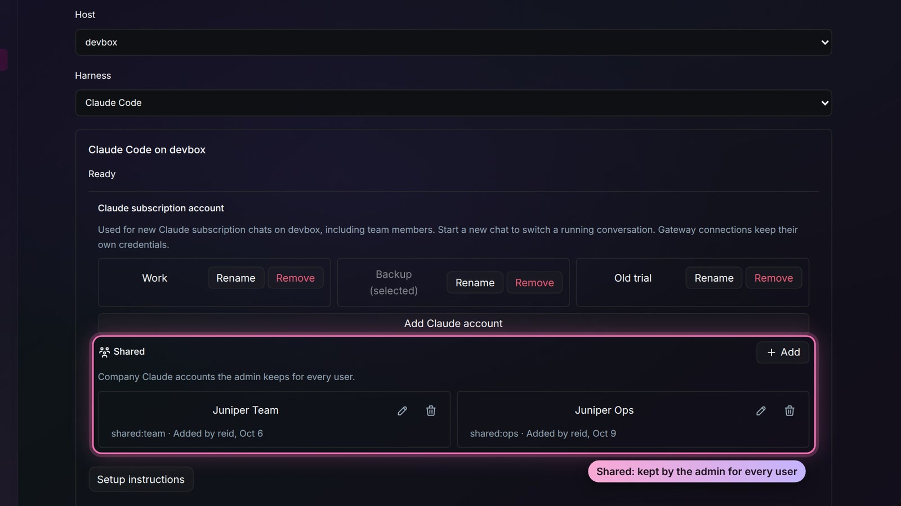
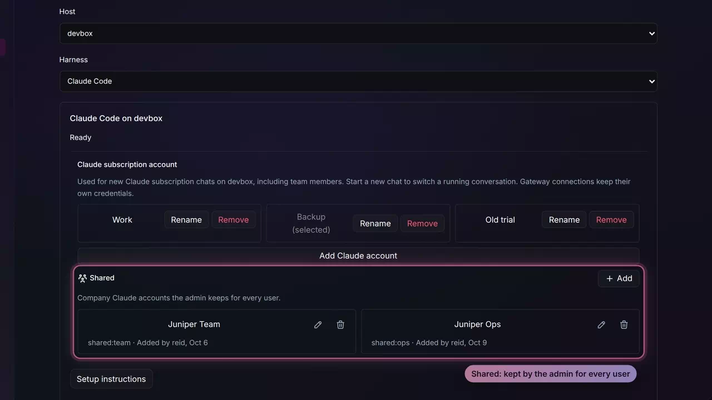
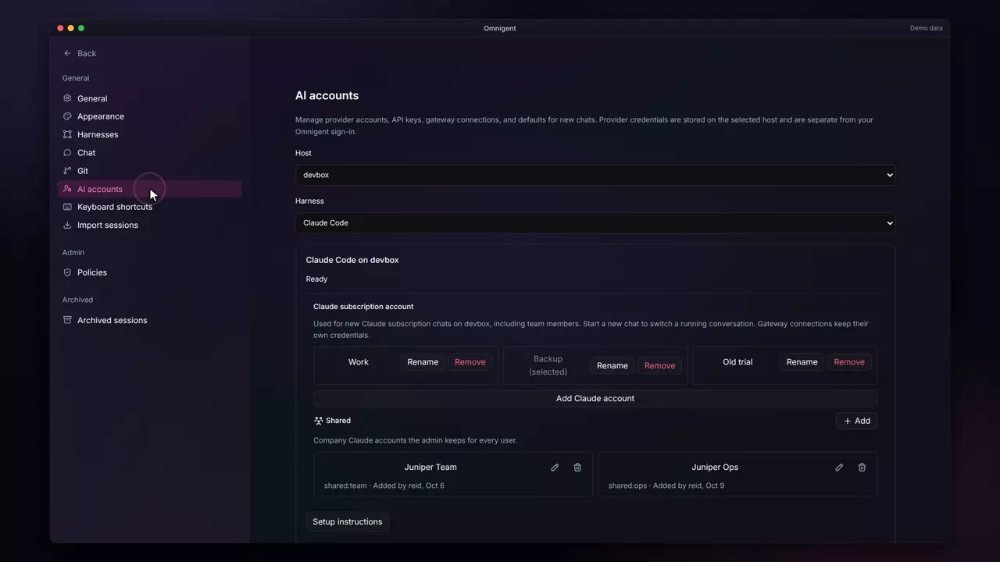
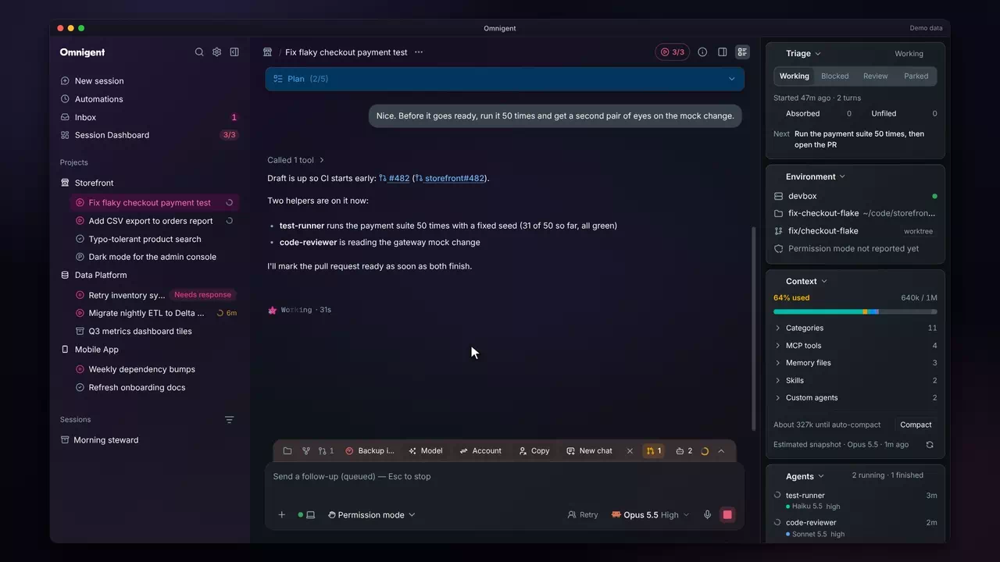
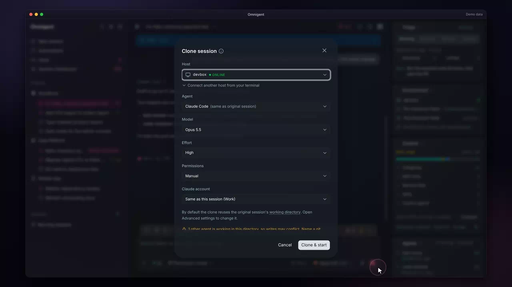

# Usage and accounts

Accounts and admin &middot; [All features](README.md)

Stock Omnigent draws a context ring under the composer and lets a host sign in to Claude Code with one account. The fork turns the ring into a usage readout for the session and its plan, keeps several Claude logins per host, adds company accounts an admin shares with every user, and lets you choose the account when you fork a session.

## A context ring that changes color

The ring under the composer turns amber when the session's context window is sixty percent full and red at eighty, the same cue Claude Code desktop gives. You see which sessions are close to compacting without opening any of them.

**Where:** The context ring at the right of the composer's workspace bar. 
**Built from:** core patch [`0018`](../../patches/0018-ae-patch-Color-the-context-ring-near-a-full-window-a.patch)

## The usage popover

Click the ring to open the usage popover. A bar shows what fills the context window by category (messages, tools, memory files and the rest), with a color legend under it, and below that the plan's 5-hour and weekly windows with their reset times and the usage credits spent. A Codex session shows the Codex plan instead.

**Where:** Click the context ring under the composer. Show details in session rail opens the full breakdown. 
**Built from:** core patches [`0006`](../../patches/0006-ae-patch-Open-a-plan-limits-popover-from-the-compose.patch), [`0009`](../../patches/0009-ae-patch-Show-the-session-s-context-and-every-usage-.patch), [`0040`](../../patches/0040-ae-patch-Shorten-the-Usage-popover-in-Claude-Desktop.patch), [`0064`](../../patches/0064-ae-patch-Label-context-window-colors-directly-beneat.patch), [`0065`](../../patches/0065-ae-patch-Match-context-legend-colors-to-detailed-cat.patch), [`0071`](../../patches/0071-ae-patch-Add-a-session-rail-beside-the-chat-and-slim.patch); [`packages/ae_omni_policies`](../../packages/ae_omni_policies)

## Limits for the session's own account

Each Claude session records which account it runs on, and the popover reads the limits for that account, so a session on a backup login shows the backup's windows and not the default login's. The runner labels the session with its login at every launch, so a restart on another login shows the right numbers at once. The account's label appears beside the plan name.

**Where:** The usage popover, on the line that names Claude Code, the plan and the account. 
**Built from:** core patches [`0078`](../../patches/0078-ae-patch-Record-each-Claude-session-s-account-beside.patch), [`0208`](../../patches/0208-ae-patch-Show-a-chat-s-live-Claude-login-in-the-Usag.patch); [`packages/ae_omni_policies`](../../packages/ae_omni_policies)

## Check any login's limits

The account name in the usage popover and in the session rail's Usage card is a menu of every Claude login on the host, each with its plan, and the one this chat runs on is marked This chat. Pick another and the card shows that login's windows and credits; the chat itself stays on its own login. The choice lasts while you look at that chat. Codex cards stay plain. In the Usage card the title reads just Claude Code, and the plan sits in the login pill beside it ("Backup · Max"), with a people icon for a shared login. A small green dot marks the login this session runs on, and the pill turns amber while the card shows a login other than the chat's own.

**Where:** The account name on the plan line of the usage popover or the rail's Usage card. 
**Built from:** core patches [`0208`](../../patches/0208-ae-patch-Show-a-chat-s-live-Claude-login-in-the-Usag.patch), [`0233`](../../patches/0233-ae-patch-Move-the-plan-into-the-Usage-card-s-login-p.patch); [`packages/ae_omni_policies`](../../packages/ae_omni_policies)

## Several Claude logins per host

A host keeps more than one Claude subscription login, each with a label you can rename, and you pick which one new chats use. Add Claude account signs a new login in through the browser, so no token is ever pasted; pasting an existing OAuth token stays available under Advanced.

**Where:** Settings > AI accounts, under Claude subscription account. 
**Built from:** core patches [`0046`](../../patches/0046-ae-patch-Add-Claude-backup-accounts-and-repair-chat-.patch), [`0048`](../../patches/0048-ae-patch-Make-Claude-account-setup-readable-and-avai.patch), [`0049`](../../patches/0049-ae-patch-Add-browser-Claude-sign-in-and-provider-set.patch), [`0060`](../../patches/0060-ae-patch-Add-editable-account-labels-and-responsive-.patch)

## Remove a personal login

Remove deletes a login and its token from the host after one confirm, which names the host and says running chats keep their token until they restart. The default CLI login cannot be removed, and removing the selected login hands new chats back to the default.

**Where:** Settings > AI accounts: Remove beside a login. 
**Built from:** core patch [`0135`](../../patches/0135-ae-patch-Remove-a-personal-Claude-login-from-Setting.patch)

## Shared Claude accounts

An admin adds company Claude accounts once on the server, and every user's host can select them without copying a token; the host fetches the token at launch. The Shared group lists each account with who added it and when, and an admin can add, rename or remove one. They also appear in every account picker with a Shared tag. The server needs `AE_SHARED_ACCOUNTS_KEY`; without it the group says shared accounts cannot be added or used.

**Where:** Settings > AI accounts, in the Shared group below the host's own logins. 
**Built from:** core patches [`0117`](../../patches/0117-ae-patch-List-the-admin-s-shared-Claude-accounts-in-.patch), [`0127`](../../patches/0127-ae-patch-Manage-shared-Claude-accounts-from-Settings.patch); [`packages/ae_omni_policies`](../../packages/ae_omni_policies)

## Move a chat to another login

The composer's Account menu now has two groups. Under This chat, the login the chat runs on is ticked, and picking another restarts the chat's Claude terminal on it and resumes the same conversation; its next reply re-reads the conversation, which uses extra tokens on that subscription. A chat in the middle of a reply is refused, with the reason under the rows. Under New chats, the pick sets the login for chats you start later, and changing it asks whether to move every open chat too (Only new chats, or Move all chats). Move all chats moves idle chats, four at a time, and skips a chat that is mid-reply; the result line names each skipped chat and why. A restart never moves a chat to the new-chat default.

**Where:** The composer's model menu > Account, in a Claude Code chat. 
**Built from:** core patch [`0209`](../../patches/0209-ae-patch-Switch-a-Claude-chat-s-login-in-place-and-k.patch); [`packages/ae_omni_policies`](../../packages/ae_omni_policies)

## Copy a chat to another login

Omnigent switches a running session to another harness or model by forking it. The fork dialog adds a Claude account row, so the copy can run on another login or a shared account while the original keeps its own. It defaults to Same as this session and names that account. The usage gate in the action dock offers it as Copy to another login, next to Switch account, which moves the chat in place.

**Where:** The composer's model menu > Claude Code > Switch harness, then Claude account. 
**Built from:** core patches [`0099`](../../patches/0099-ae-patch-Pick-the-Claude-account-when-forking-a-Clau.patch), [`0209`](../../patches/0209-ae-patch-Switch-a-Claude-chat-s-login-in-place-and-k.patch)

## A relaunch keeps Claude's transcript

A Claude Code chat restarts its terminal cold after a deploy, a host restart, a wake from idle, or a login or model switch. Stock Omnigent then rebuilt Claude's transcript file from the server's history, and since the rebuilt file never matches what Claude sent before, the next reply wrote the whole conversation to the prompt cache again at the cache-write price. The fork keeps the file Claude already has when it still matches the server: the host records how far the server's history reached when it last wrote to the transcript, and a relaunch keeps the file when the server has added nothing since, apart from items the transcript never holds, such as its own resource and error events. The host keeps that record for seven days after it last changed, even once the chat's runner has stopped, so a relaunch after a host restart can still use it. When a keep is refused, the host log says why and the transcript is rebuilt as before.

**Where:** Nothing to turn on: it applies on every cold relaunch of a Claude Code chat. The reason for a refused keep is in the host's log. 
**Built from:** core patches [`0243`](../../patches/0243-ae-patch-Keep-a-Claude-session-s-transcript-on-a-col.patch), [`0244`](../../patches/0244-ae-patch-Fix-the-review-findings-on-the-transcript-k.patch), [`0245`](../../patches/0245-ae-patch-Let-the-transcript-keep-ignore-the-server-s.patch), [`0249`](../../patches/0249-ae-patch-Recognise-the-forwarder-s-own-posts-when-th.patch), [`0251`](../../patches/0251-ae-patch-Keep-a-transcript-with-a-native-image-read-.patch), [`0257`](../../patches/0257-ae-patch-Keep-a-claude-native-bridge-dir-for-7-days-.patch)

---

Previous: [Pull requests](pull-requests.md) &middot; Next: [Admin Center](admin-center.md)
